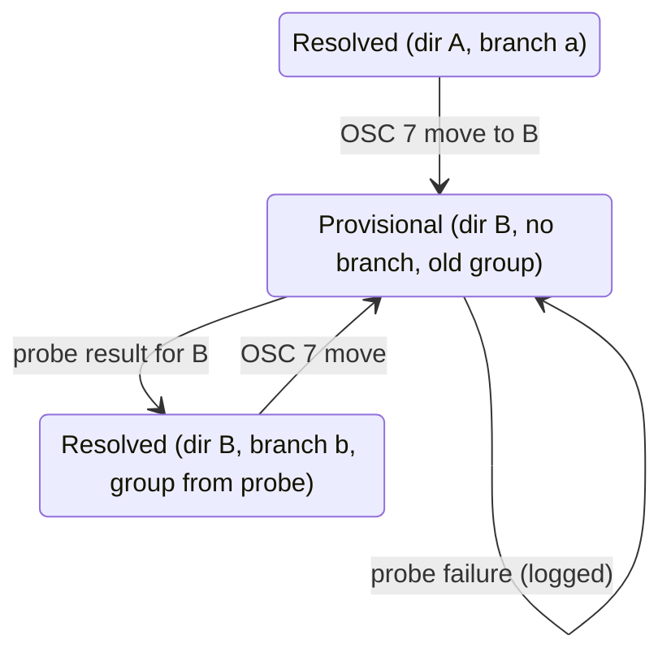

# Data Model: Remote Worktree Follow

**Feature**: `018-remote-worktree-follow` | **Date**: 2026-10-15

No struct gains a slot. The feature changes when two existing fields change.

## Session (`claude-code-ide-session`)

| Field | Before | After |
|---|---|---|
| `directory` | Set once at creation for a remote Session | Also set by a remote move. Always a bare absolute path on `host`, with no trailing `/` except for `/` itself |
| `group-metadata` | Set by the remote probe | Also rewritten by a remote move (see below) |
| `id`, `order`, `custom-name`, `zmx-name`, `buffer`, `host` | Unchanged by a move | Unchanged by a move (FR-010) |

### Remote move validation (FR-001 to FR-003)

A report `R` for a Session with host `H` is accepted only when all hold:

1. `R` is a string with no control characters.
2. `R` is a TRAMP name. `L` = `(file-remote-p R 'localname)` with one trailing
   `/` removed, except when `L` is `/`.
3. `claude-code-ide-zmx--valid-directory-p` accepts `L`.
4. `L` differs from the current Session `directory`.

The TRAMP host part of `R` is not compared with `H` (research R2).
No local file predicate runs.

### Group metadata rewrite on a remote move

| Old `:kind` | New value |
|---|---|
| `git` | Copy with `:directory` = `L`, `:branch` nil, `:worktree-path` nil. `:host`, `:common-dir`, `:project-path` stay |
| `non-git`, or nil | nil |

The rewritten git plist passes `--valid-group-metadata` for `(H, L)`. The row
keeps group key `(git H COMMON-DIR)`, and its label is the basename of `L`.

## Remembered row (`claude-code-ide-manager-item`, persisted)

- `:directory` and `:group-metadata` are written by `--save-state` right
  after a remote move (FR-009), and again when the probe result applies.
- A reattach uses the stored `:directory`.

## Remote metadata operation (per host)

| Field | Change |
|---|---|
| `known` | A remote move removes `L` before it enqueues, so a return to a directory inside one operation is probed again |
| `pending`, `process` | Unchanged. The move snapshot waits behind an in-flight probe |

## State transitions of a remote row

