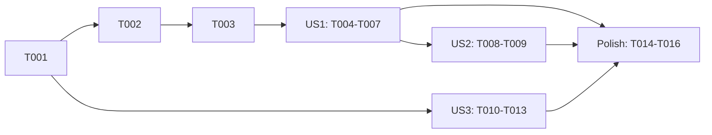

---

description: "Task list for Remote Worktree Follow"
---

# Tasks: Remote Worktree Follow

**Input**: Design documents from `specs/018-remote-worktree-follow/`

**Prerequisites**: plan.md, spec.md, research.md, data-model.md, contracts/elisp-surface.md, quickstart.md

**Tests**: Required. Constitution principle II says new logic ships with ERT
tests in `claude-code-ide-tests.el`. Each test proves an invariant from
`contracts/elisp-surface.md` ("Behavioral invariants" 1 to 7).

## Format: `[ID] [P?] [Story] Description`

- **[P]**: Can run in parallel (different files, no dependencies)
- **[Story]**: Which user story this task belongs to (US1, US2, US3)

## Phase 1: Setup

- [X] T001 Run `./scripts/compile-and-test.sh` from the repository root and record the baseline count of unexpected results (MG3 is a known flake). Baseline: 1004 tests, 0 unexpected, 15 skipped

---

## Phase 2: Foundational (Blocking Prerequisites)

**Purpose**: A remote Session accepts and stores a move. Every user story needs this.

- [X] T002 Add ERT tests in `claude-code-ide-tests.el` next to `claude-code-ide-test-ghostel-directory-hook-moves-session` (~line 2379). Use a Session with `:host "host-a" :directory "/work/proj"` and call `claude-code-ide--record-ghostel-directory` with `default-directory` bound in its buffer. Prove: (a) `/rpc:host-a:/work/other/` stores `/work/other` (invariant 1). (b) `/rpc:host-a:/work/proj/` and `/rpc:host-a:/work/proj` change nothing and call no refresh (invariant 2). (c) a relative path, a path with a control character, and a local absolute path change nothing for the remote Session (invariant 3). (d) `/scp:other-name:/work/x/` stores `/work/x` (research R2). (e) `/` stays `/`. Stub `claude-code-ide-manager-refresh-all` and `claude-code-ide-manager--note-remote-move` and count calls
- [X] T003 In `claude-code-ide.el`, change `claude-code-ide-session-relocate` (~line 705): find the Session first. When it has a host, require `(file-remote-p directory)`, take `(file-remote-p directory 'localname)`, remove one trailing `/` unless the value is `/`, require `claude-code-ide-zmx--valid-directory-p` and no control characters, and require that it differs from the current Session directory. Store it with no `expand-file-name` and no `file-directory-p` (FR-001 to FR-003). Keep the local branch byte-for-byte in behavior (FR-013). Update the docstring. Make T002 pass

**Checkpoint**: A remote OSC 7 report changes the Session directory.

---

## Phase 3: User Story 1 - The sidebar shows the new branch after a remote move (Priority: P1) 🎯 MVP

**Goal**: The row shows the new path at once, keeps its group, and shows the new branch when the probe replies.

**Independent Test**: In `claude-code-ide-tests--with-remote-metadata`, add a live remote Session with git metadata, move it, reply to the probe, and check the row.

- [X] T004 [US1] Add ERT tests in `claude-code-ide-tests.el` near the remote metadata tests (~line 23266), inside `claude-code-ide-tests--with-remote-metadata`. Use `add-live "a" "host-a" "/work/proj" "agent" (git-record "host-a" "/work/proj" "/work/proj/.git" "main")`, then move the Session to `/rpc:host-a:/work/topic/` through `claude-code-ide--record-ghostel-directory`. Prove: (a) one request for `("/work/topic")` on `host-a` is queued. (b) before the reply, the item group key is `(git "host-a" "/work/proj/.git")` and the item metadata has no `:branch` (invariant 5). (c) after `reply` with a git record for `/work/topic` on branch `topic`, the item `:branch` is `topic` (FR-007). (d) a reply for `/work/proj` that arrives after the move is not applied (invariant 4, FR-005). (e) for a move A → B → A where the A reply arrives while the row is at B, a second request for A is queued and its reply applies (research R4). (f) a non-git Session that moves gets nil metadata until the reply
- [X] T005 [US1] In `claude-code-ide.el` `claude-code-ide-session-relocate`, remote branch only: after storing the directory, rewrite `group-metadata` with `claude-code-ide--set-session-group-metadata`. For `:kind git`, use a copy with `:directory` set to the new path and `:branch` and `:worktree-path` set to nil. For any other value, set nil (data-model.md "Group metadata rewrite")
- [X] T006 [P] [US1] In `claude-code-ide-manager.el`, add `claude-code-ide-manager--note-remote-move (session)` next to `claude-code-ide-manager--enqueue-remote-metadata` (~line 5790). It removes the Session directory from the `known` table of the host's entry in `claude-code-ide-manager--remote-metadata-operations` when one exists, calls `(claude-code-ide-manager-refresh-items '(:type global) t)`, then calls `claude-code-ide-manager--enqueue-remote-metadata`. It never cancels a probe (contracts/elisp-surface.md)
- [X] T007 [US1] In `claude-code-ide.el`, add a `declare-function` for `claude-code-ide-manager--note-remote-move`, and call it from the remote branch of `claude-code-ide-session-relocate` after `claude-code-ide-manager-refresh-all`. Make T004 pass

**Checkpoint**: User Story 1 works on its own. This is the MVP.

---

## Phase 4: User Story 2 - A moved remote Session keeps its new directory after a restart (Priority: P2)

**Goal**: The remembered row holds the new directory right after the move.

**Independent Test**: Move a remote Session in the fixture and read the serialized state.

- [X] T008 [US2] Add an ERT test in `claude-code-ide-tests.el` next to the "result is saved" remote metadata test (~line 23448). Move a live remote Session, do not reply to the probe, and prove that the state passed to the persist layer has the item with `:directory "/work/topic"` (invariant 6, FR-009)
- [X] T009 [US2] In `claude-code-ide-manager.el` `claude-code-ide-manager--note-remote-move`, call `claude-code-ide-manager--save-state` after `refresh-items` and before the enqueue. Make T008 pass

**Checkpoint**: User Stories 1 and 2 both work.

---

## Phase 5: User Story 3 - Session views stay usable after a remote move (Priority: P3)

**Goal**: A move never rebuilds the project view or the Magit view. `R` shows the new worktree (FR-011).

**Independent Test**: In the existing remote layout fixtures, change the Session directory, switch back, and then reset.

- [X] T010 [US3] In `claude-code-ide-tests.el`, rewrite `claude-code-ide-test-manager-layout-preset-remote-stale-directory` (~line 23991). After the Session directory changes, a switch back must keep the same view object in the window and start no preparation. `claude-code-ide-manager-reset-layout` must then prepare a request whose `:directory` is the RPC form of the new directory (invariant 7). Replace the comment "A directory change also replaces a ready view without an explicit reset"
- [X] T011 [US3] In `claude-code-ide-tests.el`, change `claude-code-ide-test-remote-project-layout-keeps-exact-view-object` (~line 25467): after the directory change, `claude-code-ide-remote-project--surviving-view` must return the view (`should`, not `should-not`)
- [X] T012 [P] [US3] In `claude-code-ide-manager.el`, remove the `(equal (plist-get request :directory) (claude-code-ide-remote-project-rpc-directory ...))` clause from `claude-code-ide-manager--remote-layout-request-current-p` (~line 5025) and update its docstring
- [X] T013 [P] [US3] In `claude-code-ide-remote-project.el`, remove the live Session directory clause from `claude-code-ide-remote-project--resume-layout-request` (~line 1438) and from `claude-code-ide-remote-project--surviving-view` (~line 1642). Keep the descriptor check that compares the view key with the request's own `:directory` (~line 1645). Update both docstrings. Make T010 and T011 pass

**Checkpoint**: All user stories work.

---

## Phase 6: Polish & Cross-Cutting Concerns

- [X] T014 [P] In `docs/remote.org`, section "Views After Directory Changes" (~line 271), add: a remote Session follows the Agent directory report, the sidebar row gets the new branch from one probe, and the project view and Magit view keep the old worktree until `R`
- [X] T015 Run `./scripts/compile-and-test.sh`. Expected: no new unexpected result compared with T001. Result: 1008 tests, 0 unexpected, 15 skipped
- [X] T016 Load the changed files in the running Emacs with `~/bin/emacsclient` and run `specs/018-remote-worktree-follow/quickstart.md` sections 2 and 4 on `v12dev`. Record the Session directory and branch before and after `wtmove`. Result: section 2 passed live (`/home/yufu/v12x` on `feat/omniscience-bench` became `/home/yufu/wt/v12x/feat-030-target-checkout` on `feat/030-target-checkout` within 5 s, sidebar row updated). Section 4 is covered by ERT only, because `R` in the live frame would replace your open layout

---

## Dependencies & Execution Order



- **Foundational (T002, T003)**: blocks US1 and US2.
- **US2** extends the helper from T006, so it starts after US1.
- **US3** does not need the move code. Its tests change the directory by hand, so it can run in parallel with Phase 2 and US1.
- Inside each story, write the test first and see it fail, then implement.

## Parallel Opportunities

- T006 (`claude-code-ide-manager.el`) can run in parallel with T005 (`claude-code-ide.el`).
- T012 (`claude-code-ide-manager.el`) and T013 (`claude-code-ide-remote-project.el`) can run in parallel.
- T014 (`docs/remote.org`) can run in parallel with any code task.
- All test tasks edit `claude-code-ide-tests.el`, so they run one after another.

### Parallel Example: User Story 3

```text
Task: "T012 Remove the live directory clause in claude-code-ide-manager.el"
Task: "T013 Remove the live directory clauses in claude-code-ide-remote-project.el"
```

## Implementation Strategy

### MVP First (User Story 1 Only)

1. Do T001 to T003.
2. Do T004 to T007.
3. **Stop and validate**: run the gate, then quickstart section 2 on `v12dev`.

### Incremental Delivery

1. MVP: the row shows the new branch.
2. Add US2: the move survives a restart.
3. Add US3: views stay the same until `R`.
4. Polish: docs, gate, and live smoke.
