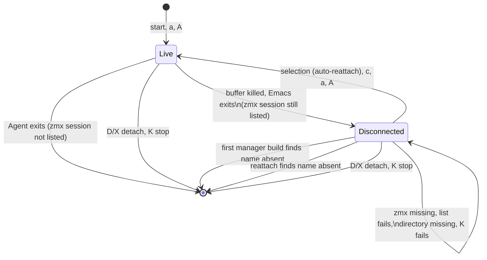

# Data Model: Local Session Reattach

No new struct, slot, or persisted key. This feature changes which existing items the manager keeps.

## Manager item (`claude-code-ide-manager-item`)

The fields that this feature uses already exist:

| Field | Local zmx row | Remote row | Plain local row |
|---|---|---|---|
| `session-key` | Session ID, kept across reattach | same | same |
| `host` | nil | Configured host | nil |
| `zmx-name` | local zmx name | remote zmx name | nil |
| `directory` | local Session directory | remote Session directory | local directory |
| `cli-type` | Agent type | Agent type | Agent type |
| `order`, `created-at`, `custom-name`, `pinned`, `order-key` | kept | kept | not remembered |
| `live-p` | t while a client is attached, else nil | same | t only |

**Remembered item**: an item that has a `zmx-name`. Before this feature, a remembered item had to have a `host`. The rule applies when the manager builds items, retains an ended Session, renders `[disconnected]`, and deserializes state.

**Identity rule**: one row for each `(host, zmx-name)` pair, where host nil means local. A local name never matches a remote row (R4).

## Lifecycle of a local zmx row

## Validation

- A local remembered item needs a non-empty `zmx-name` that passes `claude-code-ide-zmx--valid-name-p`. Reattach validates it before it calls zmx.
- `directory` must be an accessible absolute directory when the user reattaches. Otherwise the row stays, with a `user-error`.
- Deserialization keeps the remote validation unchanged. A local item gets no new validation at load. Reattach validates it.

## Transient state

- `claude-code-ide-manager--local-rows-checked`: nil at load. Set to t after the one startup cleanup in an Emacs instance (R6). This value is not persisted.
