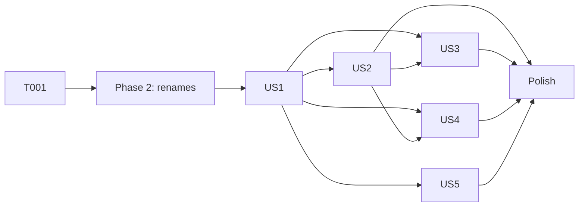

# Tasks: Local Session Reattach

**Input**: Design documents from `specs/019-local-session-reattach/`

**Prerequisites**: plan.md, spec.md, research.md, data-model.md, contracts/elisp-surface.md, quickstart.md

**Tests**: Required. Constitution principle II requires ERT tests for new logic in `claude-code-ide-tests.el`. Mock zmx at `claude-code-ide-zmx--call` and `claude-code-ide-zmx-list-sessions`. Mock Ghostel the same way that `claude-code-ide-tests--with-remote-targets` (~21917) does. Each test asserts a lifecycle transition from data-model.md, not wiring.

**Organization**: One phase for each user story. All source files are at the repository root.

## Format: `[ID] [P?] [Story] Description`

- **[P]**: Can run in parallel (different files, no dependencies)
- **[Story]**: The user story from spec.md (US1–US5)

---

## Phase 1: Setup

- [X] T001 Run `./scripts/compile-and-test.sh` on the current tree, which includes the uncommitted remote auto-reattach work, and record the failing tests (MG3 is known flaky) as the baseline

---

## Phase 2: Foundational (Blocking Prerequisites)

**Purpose**: The rename cutover from contracts/elisp-surface.md. Every later task uses the new names.

- [X] T002 Rename `claude-code-ide--reattach-remote-target` → `claude-code-ide--reattach-target`, `claude-code-ide--reattach-remote-session` → `claude-code-ide--reattach-session`, `claude-code-ide--verify-remembered-remote-target` → `claude-code-ide--verify-remembered-target`, and `claude-code-ide-manager--remember-remote-session` → `claude-code-ide-manager--remember-session`. Update every definition, caller, `declare-function`, and docstring reference in claude-code-ide.el, claude-code-ide-manager.el, and claude-code-ide-tests.el. Add no aliases
- [X] T003 Rename the defcustom `claude-code-ide-manager-auto-reattach-remote` → `claude-code-ide-manager-auto-reattach` in claude-code-ide-manager.el (~342). Update its two test bindings in claude-code-ide-tests.el and the docstring reference in claude-code-ide.el (`--reattach-session`). Reword the docstring so it covers local and remote rows, and keep the SSH-deadline note for remote rows. Add no alias

**Checkpoint**: The gate result matches T001. Behavior is unchanged.

---

## Phase 3: User Story 1 - Local rows survive an Emacs restart (Priority: P1) 🎯 MVP

**Goal**: A local zmx-backed Session keeps a `[disconnected]` row after a buffer kill and after a restart, with the same identity, name, order, pin, and group (research R1, R2, R9).

**Independent Test**: In ERT, register a local zmx Session. Set a custom name and a pin, kill its buffer, then reset and reload the manager state. The row is in the global items with `live-p` nil, the same Session ID, the custom name, the pin, and `[disconnected]` in its visible name. A plain local Session without zmx is gone.

### Tests for User Story 1

- [X] T004 [P] [US1] Add ERT tests in claude-code-ide-tests.el:
  - (a) a buffer kill keeps a local zmx row as disconnected (US1-3).
  - (b) after `claude-code-ide-manager--save-state`, `--reset-state`, and `--load-state`, `--build-items` returns the local row with the same session-key, custom-name, pinned, and order, and `live-p` nil (US1-1, US1-2).
  - (c) a local Session without a zmx name leaves no row (US1-4, FR-016).
  - (d) `claude-code-ide--next-session-order` returns a value above a remembered row's order in the same project after the counters reset (R9).
  
  Bind `claude-code-ide-manager--local-rows-checked` to t so that the startup check (US4) does not run.

### Implementation for User Story 1

- [X] T005 [US1] In claude-code-ide-manager.el, make `claude-code-ide-manager--remember-session` (~2092) act when `(claude-code-ide-session-zmx-name session)` is non-nil instead of when the host is non-nil
- [X] T006 [US1] In claude-code-ide-manager.el `--build-items` (~2084), merge remembered items whose `claude-code-ide-manager-item-zmx-name` is non-nil instead of items whose host is non-nil
- [X] T007 [US1] In claude-code-ide-manager.el `claude-code-ide-manager-session-ended` (~3732), set `retain` from the item's zmx name (`--item-by-session-key`) instead of `--session-host`, and keep the FORGET override. Update its docstring
- [X] T008 [US1] In claude-code-ide.el `--cleanup-on-exit` (~1242), call `claude-code-ide-manager--remember-session` when the Session has a zmx name, and keep the `verified-stop`/`failed-remote-launch` exclusion. Update the docstring
- [X] T009 [US1] In claude-code-ide-manager.el, show disconnected status for any remembered row:
  - `--item-visible-name` (~2675): `[disconnected]` for a non-live item with a zmx name.
  - help-echo (~3150): "Press c to reattach." for the same items.
  - `--navigate-project-group` (~4084): report a disconnected local row as `Session is disconnected. Press c to reattach.` and keep the `on HOST` form for remote rows.
- [X] T010 [US1] In claude-code-ide.el `claude-code-ide--next-session-order` (~861), also take the maximum `order` of the manager items for the same `claude-code-ide--project-key`, from `claude-code-ide-manager--all-items` (R9)
- [X] T011 [US1] In claude-code-ide-tests.el, update the existing tests that assert that a local zmx row is removed after a buffer kill or session end, so that they assert the retained disconnected row (SC-006). Delete the assertions that only pin the old removal

**Checkpoint**: US1 tests pass. After a restart, rows appear disconnected, but `c` still refuses them until US2.

---

## Phase 4: User Story 2 - Reattach a disconnected local row (Priority: P1)

**Goal**: `c` and selection reattach a local row under the same Session ID without restarting the Agent (R3, R7).

**Independent Test**: In ERT, with a remembered local row and a mocked zmx list that includes its name, `claude-code-ide-manager-reattach-at-point` creates a live Session with the same Session ID, order, and created-at. The terminal command is an attach-only zmx command, not an Agent launch.

### Tests for User Story 2

- [X] T012 [P] [US2] Add ERT tests in claude-code-ide-tests.el:
  - (a) `c` on a remembered local row reattaches it under the same session-key, order, created-at, custom-name, and pin. The terminal command attaches only (US2-1, FR-007).
  - (b) `--ensure-live-target` reattaches when `claude-code-ide-manager-auto-reattach` is t, and signals `user-error` "Press c" when it is nil (US2-2, US2-3).
  - (c) a missing directory signals `user-error` and keeps the row (spec edge case).
  - (d) zmx missing (`executable-find` nil) signals `user-error` and keeps the row (FR-013).

### Implementation for User Story 2

- [X] T013 [US2] In claude-code-ide.el `claude-code-ide--create-local-session` (~1840), add an optional `reusable-session-id`. When it is set, use it as the Session ID, and take `order` and `created-at` from `claude-code-ide-manager--item-by-session-key`, as `--create-remote-session` (~2019–2030) does. In `claude-code-ide--create-session` (~2191), pass `reusable-session-id` to the local call, and update the docstring
- [X] T014 [US2] In claude-code-ide.el `claude-code-ide--attach-zmx-entry` (~2503–2507), pass `session-id` to the local `--create-session` call
- [X] T015 [US2] In claude-code-ide.el `claude-code-ide--reattach-target` (~2394), make the host optional. Keep the remote branch as it is. For a row without a host:
  1. Validate the zmx name.
  2. Call `claude-code-ide-zmx--ensure`.
  3. If `claude-code-ide-zmx-list-sessions` does not list the name, log it, call `claude-code-ide-manager-session-ended KEY t`, and signal `user-error "zmx session %s no longer exists. Removed its row"` (FR-012).
  4. Otherwise, call `--attach-zmx-entry (list :name NAME)` with the Session ID.
  
  Update the docstring, and update the docstring of `claude-code-ide--reattach-session`
- [X] T016 [US2] In claude-code-ide-manager.el, make the manager reattach local rows:
  - `claude-code-ide-manager-reattach-at-point` (~5438): replace the "Use the attach commands for local zmx sessions" refusal with `user-error "Session is not zmx-backed"` for an item without a zmx name.
  - `--ensure-live-target` (~5182): for a remembered item with a zmx name and no host, reattach when `claude-code-ide-manager-auto-reattach` is on, and otherwise signal `user-error "Session is disconnected. Press c to reattach"`. Keep the remote branch as it is.

**Checkpoint**: US1 and US2 deliver the requested behavior. Restart Emacs, then select a row or press `c`.

---

## Phase 5: User Story 3 - `a` and `A` do not duplicate rows (Priority: P2)

**Goal**: Adopting a local zmx session that has a remembered row reuses that row (R4).

**Independent Test**: In ERT, with a remembered local row for name N, `claude-code-ide--attach-zmx-entries (list (list :name N :start_dir DIR :cmd "claude"))` produces one live item with the remembered session-key. The global item count does not change.

### Tests for User Story 3

- [X] T017 [P] [US3] Add ERT tests in claude-code-ide-tests.el:
  - (a) single attach of a remembered local name reuses its session-key (US3-1).
  - (b) attach of two remembered names adds no rows (US3-2).
  - (c) a local name equal to a remote row's zmx name gets a new local row and leaves the remote row unchanged (spec edge case).
  - (d) a live local name is still excluded from `--zmx-adoptable-sessions` (US3-4).

### Implementation for User Story 3

- [X] T018 [US3] In claude-code-ide.el:
  - `claude-code-ide--live-session-for-target` (~1753): remove the `(when host ...)` wrapper, so that host nil matches only local Sessions through `equal`.
  - `--attach-zmx-entry` (~2487–2490): compute `live` and the remembered Session ID without the `host` guard. Keep the `pending` lookup remote-only.
  - Update both docstrings.

**Checkpoint**: `a`/`A` and `c` converge on one row for each zmx session (SC-005).

---

## Phase 6: User Story 4 - Rows for ended Agents go away (Priority: P2)

**Goal**: A local row is forgotten when its zmx session is gone: on client exit, at the first manager build, and on reattach (R5, R6, clarification A).

**Independent Test**: In ERT, with two remembered local rows and a mocked `zmx list` that lists only one, the first global `--build-items` returns one remembered row. A second build makes no zmx call. When the list call signals, both rows stay.

### Tests for User Story 4

- [X] T019 [P] [US4] Add ERT tests in claude-code-ide-tests.el:
  - (a) the client exits, and the name is absent from the list: the row is removed (US4-1).
  - (b) the client exits, and the name is still listed: the row is kept.
  - (c) the first global build removes absent rows and calls the list only once for each Emacs instance (US4-2).
  - (d) a list error or a missing zmx keeps every row (US4-4).
  - (e) reattach of an absent name reports it and removes the row (US4-3).
  - (f) live rows are never removed by the startup check.

### Implementation for User Story 4

- [X] T020 [US4] In claude-code-ide.el `claude-code-ide--verify-remembered-target` (~1251), add a branch for an item without a host. It calls `claude-code-ide-zmx-list-sessions` synchronously inside `condition-case`. If the name is absent, it calls `claude-code-ide-manager-session-ended KEY t`. If the call fails, it logs and keeps the row. In `--cleanup-on-exit` (~1238), call it for a local zmx Session after `remhash` and resource cleanup. Update the docstrings
- [X] T021 [US4] In claude-code-ide-manager.el, add `(defvar claude-code-ide-manager--local-rows-checked nil)` with a docstring. In `--build-items` for the global scope, check once when the flag is nil and remembered local rows exist:
  1. Set the flag.
  2. Read the list through `claude-code-ide-zmx-list-sessions` inside `condition-case`, with no call when `executable-find` fails.
  3. Remove the remembered local rows whose name is absent, through `claude-code-ide-manager-session-ended KEY t`, or by filtering the scope items and then calling `--save-state`.
  
  Do not run the check for live rows. Also reset the flag in `claude-code-ide-manager--reset-state`

**Checkpoint**: After a reboot, dead rows do not appear (SC-004).

---

## Phase 7: User Story 5 - Stop and detach end a disconnected local row (Priority: P3)

**Goal**: `D`/`X` and `K` work on disconnected local rows (R8).

**Independent Test**: In ERT, `claude-code-ide-manager-detach-at-point` on a disconnected local row removes it and makes no zmx kill call. `claude-code-ide-stop KEY` with a mocked successful `zmx kill` removes the row. A kill that signals keeps the row.

### Tests for User Story 5

- [X] T022 [P] [US5] Add ERT tests in claude-code-ide-tests.el:
  - (a) detach of a disconnected local row removes the row and makes no zmx call (US5-1).
  - (b) detach of a live local row removes the row even though the buffer kill alone would keep it.
  - (c) stop of a disconnected local row kills its zmx session, removes the row, and leaves the current buffer alive (US5-2, R8 `kill-buffer nil` guard).
  - (d) a failed kill keeps the row (US5-3).

### Implementation for User Story 5

- [X] T023 [US5] In claude-code-ide.el:
  - `claude-code-ide-stop` (~2298): build the stub Session from any remembered item with a zmx name, copying `host`, which can be nil.
  - `claude-code-ide--stop-local-session` (~2317): call `kill-buffer` only when the buffer is live. After `claude-code-ide-zmx-kill` succeeds, call `claude-code-ide-manager-session-ended (claude-code-ide-session-id session) t`.
- [X] T024 [US5] In claude-code-ide-manager.el `claude-code-ide-manager-detach-at-point` (~5504):
  - Accept an item with a zmx name and no Session.
  - In the `cond` (~5563), call `--cleanup-on-exit` for a Session without a live buffer, whatever its host.
  - Call `claude-code-ide-manager-session-ended KEY t` for every detach, not only for remote rows.
  - Update the docstring.

**Checkpoint**: All five stories pass their ERT tests.

---

## Phase 8: Polish & Cross-Cutting Concerns

- [X] T025 [P] Update README.org (~265, 563, 601, 709–710, 737, 794): disconnected rows cover local zmx Sessions, selection follows `claude-code-ide-manager-auto-reattach`, `c` reattaches local and remote rows, and startup removes local rows whose zmx session is gone
- [X] T026 [P] Update docs/remote.org (~357, 365): selection of a disconnected row follows `claude-code-ide-manager-auto-reattach` and can contact the host
- [X] T027 [P] Add one sentence to CONTEXT.md under "Disconnected session": a local zmx-backed Session also becomes a disconnected row when its client ends
- [X] T028 Run `./scripts/format-and-clean.sh`, then `./scripts/compile-and-test.sh`. Compare the result with the T001 baseline, and report MG3 honestly
- [X] T029 Load the changed files into the live Emacs with `~/bin/emacsclient --eval`, and run the live check in specs/019-local-session-reattach/quickstart.md, steps 1–10. `load-file` does not unbind the renamed functions, so check that no caller uses an old name (`grep` for the four old names and the old option name returns nothing)

---

## Dependencies & Execution Order



- **US1** blocks the other stories, because they act on remembered local rows.
- **US3** needs T013–T014 from US2, because adoption reuses the Session ID through the same local create path.
- **US4** step (e) uses the reattach branch from T015.
- **US5** needs only US1.

### Within each story

- Write the tests first, and confirm that they fail.
- claude-code-ide.el and claude-code-ide-manager.el tasks in the same story touch different files and can run at the same time. Same-file tasks run in ID order.

## Parallel Opportunities

- The test task in each story ([P]) is in claude-code-ide-tests.el and can be written while the source tasks run.
- After US2: US3 (claude-code-ide.el only), US4 (T021 in manager), and US5 (T024 in manager) can run at the same time. Edits to the same file must be serialized.
- T025–T027 are separate doc files.

## Parallel Example: User Story 2

```text
Task: "T012 Add US2 ERT tests in claude-code-ide-tests.el"
Task: "T016 Manager reattach-at-point and ensure-live-target in claude-code-ide-manager.el"
Task: "T013–T015 create-local-session, attach-zmx-entry, reattach-target in claude-code-ide.el"
```

## Implementation Strategy

### MVP

Phases 1–4 (US1 and US2). This alone gives the requested result: restart Emacs, see the rows, and reattach with selection or `c`.

### Incremental delivery

1. Add US3 so that `a`/`A` stop creating duplicates after a restart.
2. Add US4 so that dead rows go away after a reboot.
3. Add US5 so that a disconnected local row can be removed or stopped.
4. Run the polish phase, then commit with the smart-commit skill. The remote auto-reattach work can go in the same commit or the one before it (plan Design Notes).

## Phase 9: Convergence

- [X] T030 In claude-code-ide-manager.el `claude-code-ide-manager--drop-gone-local-rows`, skip the startup check without a zmx call when `(executable-find claude-code-ide-zmx-program)` fails, and remove the `message` on a failed list so that the check reports nothing until a reattach per US4/AC4 (contradicts)
- [X] T031 In claude-code-ide-manager.el, call `claude-code-ide-manager--save-state` after the startup check drops one or more local rows, so that a removed row does not return after an early Emacs exit per plan: T021 step 3 (partial)
- [X] T032 Add an ERT test in claude-code-ide-tests.el: Stop of a disconnected local row whose `claude-code-ide-zmx-kill` signals an error keeps the row and reports the failure per FR-015 (partial)
- [X] T033 In claude-code-ide-tests.el, change the five `claude-code-ide-test-zmx-attach-*` tests that pin the full `claude-code-ide--create-session` argument list to assert only the directory, CLI, and zmx name per SC-006 (contradicts)
- [X] T034 Review the `docs/zmx.org` lifecycle-table change that no task requested, and keep it as part of the T025 docs scope or revert it per plan: Source Code list (unrequested)

## Phase 10: Convergence

- [X] T035 Reindent the blocks that this feature changed in claude-code-ide.el, claude-code-ide-manager.el, claude-code-ide-zmx.el, and claude-code-ide-tests.el to the `./scripts/format-and-clean.sh` output, for example the remote branch of `claude-code-ide--verify-remembered-target` (~1281–1295), and leave untouched code as it is, per Constitution: Elisp Standards (contradicts)
- [X] T036 In claude-code-ide.el `claude-code-ide--verify-remembered-target`, make the local branch record a failed zmx list with `claude-code-ide-debug` instead of `claude-code-ide-log`, so that no message reaches the user before a reattach. Keep the remote branch unchanged (FR-017), per US4/AC4 (contradicts)
