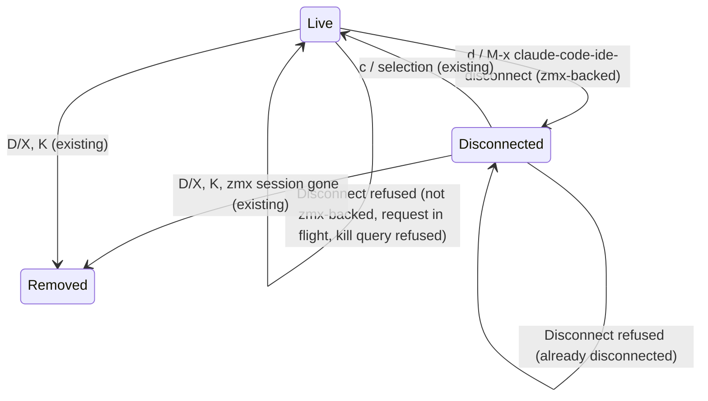

# Data Model: Disconnect Session

Disconnect adds no entity, field, or stored format. It moves one existing entity from one state to another.

## Disconnected session row (existing)

Specs 003 and 019 define it. It is a `claude-code-ide-manager-item` whose `live-p` is nil.

| Field | Source | Changed by Disconnect |
|---|---|---|
| `session-key` (Session ID) | registry | No |
| `zmx-name` | Session | No |
| `directory` | Session | No |
| Agent type (`cli-type`) | Session | No |
| `host` | Session (remote only) | No |
| Number, display name, custom name, order, pin | manager metadata | No |
| Saved layout | `claude-code-ide-manager--layouts` | No |
| `live-p` | manager | `t` → `nil` |
| Activity (working, idle, needs-input) | idle tracker | Cleared |

## State transitions

## Validation rules

- A target Session MUST have a zmx name (FR-007).
- A target MUST be live: registered or with a live Session buffer (FR-008).
- A remote target MUST have no request in flight (FR-009).
- After the command, the Session buffer MUST be dead. A live buffer means the kill was refused, and the command reports it.
