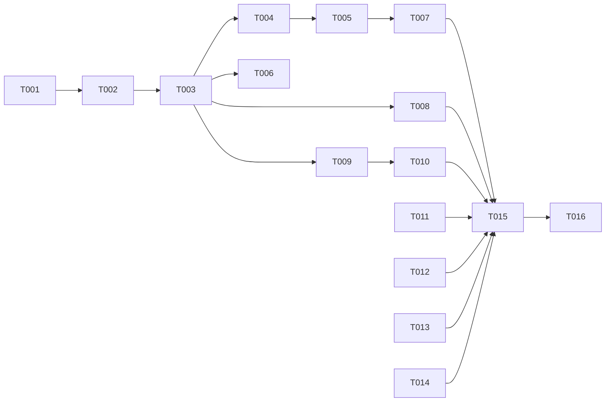

# Tasks: Disconnect Session

**Input**: Design documents from `specs/020-disconnect-session/`

**Prerequisites**: plan.md, spec.md, research.md, data-model.md, contracts/elisp-surface.md, quickstart.md

**Tests**: Required. Constitution principle II requires ERT tests for new logic in `claude-code-ide-tests.el`. Use the fixtures `claude-code-ide-tests--with-local-targets` (~22245: `add-local`, `remember-local`, `listed`, `kills`) and `claude-code-ide-tests--with-remote-targets` (`requests`, `claude-code-ide--materialize-remote-target`). Each test asserts a state change from data-model.md, not wiring.

**Organization**: One phase for each user story. All source files are at the repository root.

## Format: `[ID] [P?] [Story] Description`

- **[P]**: Can run in parallel (different files, no dependencies)
- **[Story]**: The user story from spec.md (US1–US3)

---

## Phase 1: Setup

- [X] T001 Run `./scripts/compile-and-test.sh` on the current tree and record the failing tests as the baseline (MG3 is known flaky). Baseline 2026-10-31: 1017 tests, 1002 as expected, 0 unexpected, 15 skipped

---

## Phase 2: Foundational (Blocking Prerequisites)

None. Disconnect reuses the spec 019 buffer-kill path (`claude-code-ide--cleanup-on-exit`, claude-code-ide.el ~1239) and adds no shared state. Commit `a19f021` must be in the tree.

---

## Phase 3: User Story 1 - Disconnect a live Session and keep its row (Priority: P1) 🎯 MVP

**Goal**: `d` and `M-x claude-code-ide-disconnect` close the client of a live zmx-backed Session. The row stays as a Disconnected session row with the same identity and presentation fields (research R1, R3, R5).

**Independent Test**: In ERT, with `add-local` and `listed` containing the zmx name, set a custom name and a pin, then run `claude-code-ide-manager-disconnect-at-point` on the row. The Session buffer is dead, `claude-code-ide--get-session` returns nil, the item is in the global items with `live-p` nil and the same session-key, custom name, pin, order, and Saved layout. `kills` is empty.

### Tests for User Story 1

- [X] T002 [US1] Add ERT tests in claude-code-ide-tests.el:
  - (a) local: disconnect a live `add-local` Session whose name is in `listed`, while its buffer is shown in a window and its key is the active session key of the global scope. Assert the state in the Independent Test above, `kills` empty, and the selected session key of the global scope still equal to the row (FR-002, FR-003, FR-010, FR-016: activity cleared). Also assert that the active session key of the global scope is nil, that no other key became active, and that the window now shows a different live buffer (FR-017). Capture `message` output and assert `Disconnected zmx session NAME. Press c to reattach` (FR-011).
  - (b) remote: disconnect a live remote Session in `claude-code-ide-tests--with-remote-targets`. Assert the row stays with `live-p` nil under its host, and `requests` gains no `zmx kill` or Stop request (FR-005, FR-006). Capture `message` output and assert `Disconnected zmx session NAME on HOST. Press c to reattach` (FR-011).
  - (c) `M-x` path: in the Session buffer, call `claude-code-ide-disconnect` with no argument. Assert the same result as (a) (FR-015).
  - (d) no Project-view cleanup: set up an owned, unmodified Project-view buffer for a live remote Session as the `eligible` case of `claude-code-ide-test-remote-project-cleanup-matrix` (~26887) does: a `dired-mode` buffer, `claude-code-ide-remote-project--make-view` with `:origin 'created-by-feature` and `:sessions` holding the Session key, and `claude-code-ide-remote-project-cleanup-hosts` bound to the Session host. Do not stub `claude-code-ide-remote-project-cleanup` or `claude-code-ide-remote-project-cleanup-snapshot`. Disconnect the Session. Assert that the Project-view buffer is still live (FR-012). Call `claude-code-ide-remote-project--reset-state` in `unwind-protect` when the test ends.

### Implementation for User Story 1

- [X] T003 [US1] In claude-code-ide.el, add `claude-code-ide-disconnect (&optional session-id)` next to `claude-code-ide-stop` (~2315), with `;;;###autoload` and `(interactive)`:
  - Resolve the Session: SESSION-ID through `claude-code-ide--get-session`, or `claude-code-ide--session-for-buffer` without it. No project or directory fallback.
  - Leave a place for the guards before the kill. T010 adds them.
  - Kill the Session buffer when it is live. If it is still live after the kill, signal `user-error "Disconnect did not close the Session buffer"`.
  - If the Session is still registered after the kill, call `(claude-code-ide--cleanup-on-exit session-id t)`.
  - Show `Disconnected zmx session NAME[ on HOST]. Press c to reattach`.
  - Do not call `claude-code-ide-manager-session-ended` with FORGET, and do not call any Project-view cleanup.
- [X] T004 [US1] In claude-code-ide-manager.el, add `claude-code-ide-manager-disconnect-at-point` next to `claude-code-ide-manager-detach-at-point` (~5549). Resolve the item with `claude-code-ide-manager--item-at-point` ("No manager session at point"), get the scope with `claude-code-ide-manager--scope-for-command`, call `claude-code-ide-disconnect` with the item's session key, then call `claude-code-ide-manager--sync-point-to-session-key` for that scope and key. Add a `declare-function` for `claude-code-ide-disconnect`
- [X] T005 [US1] In claude-code-ide-manager.el, bind `d` to `claude-code-ide-manager-disconnect-at-point` in `claude-code-ide-manager-mode-map`, next to the `D`/`X` bindings (~1493)
- [X] T006 [P] [US1] In claude-code-ide-transient.el, add `("d" "Disconnect (keep row)" claude-code-ide-manager-disconnect-at-point)` to the "Sessions" column of the manager dispatch, before `D` (~734), and add its `declare-function` next to the detach one (~85)
- [X] T007 [US1] Extend the existing keymap test `claude-code-ide-test-manager-mode-binds-d-and-x-to-detach` (claude-code-ide-tests.el ~2124) and rename it to `claude-code-ide-test-manager-mode-binds-disconnect-and-detach`. Assert that `d` maps to `claude-code-ide-manager-disconnect-at-point` and `D`/`X` still map to detach (FR-001, FR-014). Add `("d" . claude-code-ide-manager-disconnect-at-point)` to the dispatch key list in the test near ~11258, next to `("X" . claude-code-ide-manager-detach-at-point)` (FR-013)

**Checkpoint**: T002 passes. `d` keeps the row for local and remote Sessions.

---

## Phase 4: User Story 2 - Reattach a disconnected Session (Priority: P1)

**Goal**: A row from Disconnect goes back through the existing reattach and persistence paths with no new code (FR-004).

**Independent Test**: In ERT, disconnect a local Session, save and reload the manager state, then reattach it. The reattach uses the same session key and starts no new Agent.

### Tests for User Story 2

- [X] T008 [US2] Add one ERT test in claude-code-ide-tests.el, modeled on `claude-code-ide-test-local-zmx-row-reattaches-after-restart` (~22332): disconnect a live `add-local` Session with `claude-code-ide-disconnect`, bind `claude-code-ide-manager-persist-state` to t, save, reset, and load the state, then reattach the key with `claude-code-ide--reattach-target`, the step of `claude-code-ide--reattach-session` before the switch. Assert the attach targets the same zmx name, the registered Session has the same session key, and `kills` is empty (US2-1, US2-3)

### Implementation for User Story 2

None expected. If T008 fails, fix the cause in the shared path (claude-code-ide.el `--cleanup-on-exit` or claude-code-ide-manager.el `--remember-session`), not in `claude-code-ide-disconnect`.

**Checkpoint**: T008 passes.

---

## Phase 5: User Story 3 - Disconnect refuses actions it cannot do safely (Priority: P2)

**Goal**: Each guard from research R2 signals `user-error` and changes nothing.

**Independent Test**: In ERT, each refused case leaves the Session registry, the buffer, the items, and `kills` unchanged.

### Tests for User Story 3

- [X] T009 [US3] Add ERT tests in claude-code-ide-tests.el. Each one asserts `should-error … :type 'user-error`, the message text from contracts/elisp-surface.md, and no change to the registry, buffer, items, or `kills`:
  - (a) a plain Session without a zmx name: the buffer stays live and the Session stays registered (FR-007).
  - (b) a `remember-local` row with no live Session: "already disconnected" (FR-008).
  - (c) `claude-code-ide-manager-disconnect-at-point` with `--item-at-point` returning nil, and `claude-code-ide-disconnect` in a buffer that no Session owns (FR-008, US3-3, US3-4).
  - (d) a remote Session with `claude-code-ide--remote-target-pending-reason` stubbed to return "an attach request": the message names the zmx name, host, and reason (FR-009).
  - (e) a kill that `kill-buffer-query-functions` refuses: "Disconnect did not close the Session buffer", the Session stays registered.

### Implementation for User Story 3

- [X] T010 [US3] In claude-code-ide.el `claude-code-ide-disconnect`, add the guards before any kill, in research R2 order: no target, already disconnected (no registered Session and no live buffer for the key), no zmx name, then remote pending request. Use the message texts from contracts/elisp-surface.md

**Checkpoint**: T009 passes. No guard path kills a buffer or ends a Session.

---

## Phase 6: Polish & Cross-Cutting Concerns

- [X] T011 [P] Update README.org: add a `d` bullet before the `D`/`X` bullet in the manager key list (~710), and add `d` / `M-x claude-code-ide-disconnect` to the zmx lifecycle bullets (~229)
- [X] T012 [P] Update docs/zmx.org: add a row for manager `d` and `M-x claude-code-ide-disconnect` to the "Detach and Stop" table (~114): "Close the client and keep a `[disconnected]` row. The Agent continues. Refuses a Session that does not run in zmx."
- [X] T013 [P] Update docs/remote.org: add `d` to the manager key table (~356) as "Disconnect the client and keep the row as disconnected."
- [X] T014 [P] Update CONTEXT.md: add a "Disconnect" entry after "Detach" (~98). Define it as the command that closes the attach client and keeps the manager row as a Disconnected session. State that manager `D`/`X` closes the client and also removes the row
- [X] T015 Run `./scripts/format-and-clean.sh`, then `./scripts/compile-and-test.sh`. Compare with the T001 baseline: zero new failures. Result: 1023 tests, 1008 as expected, 0 unexpected, 15 skipped
- [X] T016 Load the changed files with `~/bin/emacsclient --eval` and run quickstart.md checks 2, 4, and 5 on a live local Session. Run check 3 when a remote host is reachable. Checks 2, 4, and 5 passed on a throwaway local zmx session. Check 3 was skipped because the only remote Sessions were the user's own work

---

## Dependencies & Execution Order

- US1 blocks US2 and US3, because both use `claude-code-ide-disconnect` from T003.
- US2 and US3 are independent of each other after T003.
- T002, T007, T008, and T009 all edit claude-code-ide-tests.el, so they run one after another.

## Parallel Opportunities

- After T003: T006 (claude-code-ide-transient.el) runs in parallel with T004 (claude-code-ide-manager.el).
- T011, T012, T013, and T014 edit different doc files and run in parallel at any time after T003.

## Implementation Strategy

1. MVP: Phase 1 and Phase 3 (US1). After that, `d` works for local and remote Sessions.
2. Add US3 (guards). This is the safety reason for the command, so ship it in the same change as US1.
3. Add US2's test. It proves that the existing reattach path accepts the row.
4. Finish with Phase 6 docs, the gate, and the live check.

## Phase 7: Convergence

- [X] T017 Extend `claude-code-ide-test-disconnect-keeps-local-row` in claude-code-ide-tests.el. Record the row's order, directory, host, and Project group before Disconnect, and assert they are the same after it per SC-002, US1/AC3 (partial)

## Phase 8: Review Follow-up

- [X] T018 Add `claude-code-ide-test-disconnect-closes-terminal-windows-like-buffer-kill`: split and side windows that show the terminal close, the other window stays, and a sole main window shows another live buffer. Correct FR-017, Q2, the window edge case, and research R5 to state this buffer-kill result
- [X] T019 Assert in `claude-code-ide-test-disconnect-keeps-local-row` that the row renders activity before Disconnect: the idle bell with idle state set, then the needs-input marker with that agent state. After Disconnect, assert the rendered marker is only the pin and the row face is not an attention, working, or idle face (US1/AC4, FR-016)
- [X] T020 Add `claude-code-ide-test-disconnect-changes-only-target-liveness`: 25 seeded trials with 0 to 4 other rows of mixed zmx backing, names, pins, and positions. Disconnect changes only the target row's liveness in displayed order (SC-002)
- [X] T021 Run quickstart check 3 on v12dev with a throwaway zmx session: `d` kept the row under its host, `zmx list` still listed the session, and reattach kept the Session ID and name. Restore the remote repository list after adoption
