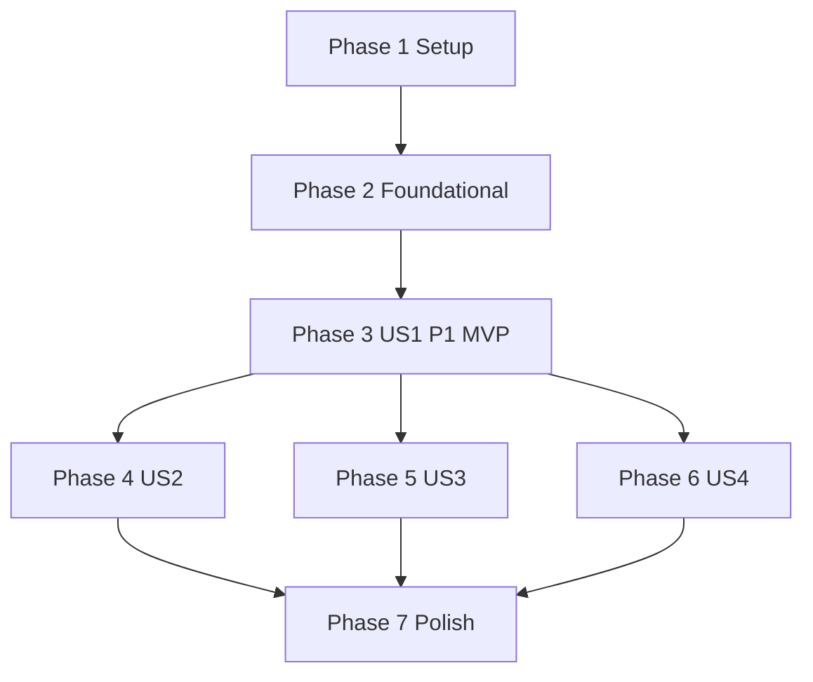

---

description: "Task list for spawn and remove Sibling Sessions"
---

# Tasks: Spawn and Remove Sibling Sessions

**Input**: Design documents from `specs/021-spawn-session/`

**Prerequisites**: plan.md, spec.md, research.md, data-model.md, contracts/, quickstart.md

**Tests**: Constitution principle II requires ERT tests for new package logic. omp tests cover only the pure functions whose bugs a user would see: the name, the labels, the argv for each mode, the window-close rule, and the worktree record. They are property tests with generated inputs and a fixed, printed seed.

**Paths**: The package paths are relative to this repo. `OMP/` means `~/agents/oh-my-pi/packages/coding-agent/`.

## Format: `[ID] [P?] [Story] Description`

- **[P]**: Can run in parallel (different files, no open dependencies)
- **[Story]**: The user story (US1–US4) of the task

---

## Phase 1: Setup

- [X] T001 In `~/agents/oh-my-pi`, create the branch `021-spawn-session` from the current main branch. Do not touch the user's uncommitted files.
- [X] T002 Run `zmx version` on the local machine and on each host in `claude-code-ide-remote-hosts`. Record any host older than 0.8.1 as unsupported in `specs/021-spawn-session/research.md`. Then check that zmx sets the new session's name in its child env: run `env -u ZMX_SESSION -u ZMX_SESSION_PREFIX zmx attach cci-spike-env sh -c 'printenv ZMX_SESSION; sleep 5' </dev/null`, then `zmx history cci-spike-env`, and expect `cci-spike-env`. Record the result in `research.md` as a new evidence row. If zmx does not set it, stop and report, because `cci-state` publishing and B's own `/spawn` (FR-020) depend on it. Kill `cci-spike-env` afterward.

---

## Phase 2: Foundational (blocks every story)

- [X] T003 [P] Move the child argv/env build out of `#handleForkTerminalCommand` (lines ~1543-1613) and its helpers `FORK_LAUNCH_OVERRIDES`, `forkScopeEnvCommand`, and `hasForkApiKeyOverride` (~162-196) into the new file `OMP/src/cli/fork-child.ts`. Export `buildForkChildLaunch({ session, settings, forkSessionFile?, model? }): { argv: string[]; env: Record<string, string | undefined>; apiKeyOverride: boolean }`. When `model` (a `provider/id` text) is given, it replaces the `--model` value that comes from `session.model`. Make `/fork` in `OMP/src/modes/controllers/command-controller.ts` call it without `model`, and keep its `env` prefix form. Delete the moved private copies.
- [X] T004 [P] Export `quoteOscArg` from `OMP/src/utils/external-editor.ts`. Keep one definition.
- [X] T005 Create `OMP/src/session/sibling-spawn.ts` with these exports (contracts/zmx-labels.md, research D9–D10):
  - `siblingName(parentName: string | undefined, dir: string, rand: string)`: the prefix is the text before the first `omp-` in `parentName`, or `cci-`. The basename is sanitized like `claude-code-ide-zmx--sanitize`.
  - `encodeLabels(record)` and `parseZmxList(stdout)`: values are unpadded base64url text (zmx accepts only `[A-Za-z0-9-_.]` in a value), labels are separated by spaces, and a list line is tab-separated `k=v` fields.
  - `createSibling({ name, dir, argv, env, labels })`: `ptree.exec(["zmx","attach","--labels",…])` with `ZMX_SESSION`, `ZMX_SESSION_PREFIX`, and `EMACS_BUFFER_NAME` set to `undefined` and `OMP_SPAWN_PARENT` set. On a non-zero exit it runs `zmx kill` without a check.
  - `listChildren(parentName)`, `killSibling(name)`, and `publishState(state: "working" | "idle", work?: string)`. `publishState` runs one `zmx set $ZMX_SESSION cci-state=<state> cci-work=<encoded work>`. The work text is the first line of `work` that is not only a tag (such as the `<file …>` wrapper of an `@file` prompt), cut to 80 characters. It is empty for `idle`.
  - `writeSpawnAnnouncement(name)`: `writeTerminalSequence` plus `wrapTmuxPassthroughIfNeeded`, in the format of contracts/osc-spawn-announce.md.
- [X] T006 [P] Add `spawn.confirm` (boolean, default `false`, tab `tasks`, with a label and a description) to `OMP/src/tools/settings.ts`. Check whether `OMP/src/config/registry` needs a schema or doc entry, and add it if it does.
- [X] T007 [P] Add `claude-code-ide-zmx--package-name-p (name)` to `claude-code-ide-zmx.el`. It returns `claude-code-ide-zmx--valid-name-p` and `string-prefix-p claude-code-ide-zmx-session-prefix`.
- [X] T008 Add property tests in `OMP/src/session/sibling-spawn.test.ts`. Use a fixed, printed seed and generated directory names and parent names, including empty, unicode, spaces, and a parent with no `omp-`. Check these properties:
  - every `siblingName` result matches `^<prefix>omp-[a-z0-9-]+-[a-z0-9]{6}$`;
  - `parseZmxList(encodeLabels(x))` gives back `x` for values with spaces, `=`, `%`, and tabs;
  - `listChildren` keeps only the lines whose `cci-parent` equals the parent.
- [X] T009 [P] Add ERT tests for `claude-code-ide-zmx--package-name-p` in `claude-code-ide-tests.el`. Cover the prefix match, a foreign prefix, an empty name, a leading `-`, and a name with `/`.

**Checkpoint**: The shared builder, the zmx helpers, the setting, and the name check exist. `/fork pane` still works.

---

## Phase 3: User Story 1 - Spawn a fresh Session (P1) 🎯 MVP

**Goal**: `/spawn <request>` creates a fresh B on A's host, and Emacs attaches and shows it.

**Independent Test**: quickstart.md scenarios 1, 2, 3, 6, 7, 8, 9, 10, 11, 16, and 17.

### Package

- [X] T010 [P] [US1] Add `claude-code-ide-session-spawn-announce (name)` and its one-time `ghostel-eval-cmds` registration to `claude-code-ide-session.el`, next to `claude-code-ide-session-editor-request` (~648-680). Accept only a buffer for which `claude-code-ide--session-for-buffer` gives a live session with CLI type `omp`, and a name accepted by `claude-code-ide-zmx--package-name-p`. Then schedule `run-at-time 0` with `claude-code-ide--adopt-spawned-session` and return nil. Add `declare-function` for any cross-file call.
- [X] T011 [P] [US1] In `claude-code-ide.el`, add `(defcustom claude-code-ide-switch-on-spawn t …)` as a boolean next to `claude-code-ide-switch-after-send`. Also add `claude-code-ide--adopt-spawned-session (host name)`:
  - With no host, filter `claude-code-ide--zmx-adoptable-sessions` to `:name` NAME.
  - Pass the result to `claude-code-ide--attach-zmx-entries`. If nothing matches, write one log line.
  - When the option is on and `claude-code-ide--live-session-for-target` finds B, call `claude-code-ide-manager-switch-to-session`.
  - Catch errors and log them. Raise nothing.
- [X] T012 [US1] Add ERT tests in `claude-code-ide-tests.el`, using `claude-code-ide-tests--with-editor-handoff-session` and stubs of `claude-code-ide-zmx-list-sessions`. Cover these cases:
  - the handler ignores a buffer that is not a Session, a Session that is not omp, and a bad name;
  - the handler schedules work and runs no zmx call inline;
  - the adopt step attaches only the named entry;
  - it skips an entry with an unknown `:cmd`;
  - it does nothing for a name that is already attached;
  - it switches when the option is on and keeps the selected window when the option is off.

### omp

- [X] T013 [US1] Add the hidden tool `spawn_session` (contracts/omp-spawn.md):
  - `OMP/src/tools/builtin-names.ts`: add the name to `HIDDEN_TOOL_NAMES`.
  - `OMP/src/tools/index.ts`: add the `HIDDEN_TOOLS` factory. Add the `isToolAllowed` gate `session.isSpawnWindowOpen?.() === true`, placed next to the `loop` gate at ~766. Add the `ToolSession` fields `peekSpawnHandler`, `setSpawnHandler`, `isSpawnWindowOpen`, and `setSpawnWindowOpen`.
  - `OMP/src/session/agent-session.ts`: add the handler field and its methods, wrapped in `waitForUser`, as `#loopStartHandler` does at ~3530. Add the window flag and its two methods. Filter the tool out of snapshots while the window is closed, as `#withoutIdleLoopTool` does.
  - `OMP/src/sdk.ts`: wire the handler and window methods (~2633), and register the hidden tool (~3760).
  - `OMP/src/modes/interactive-mode.ts`: call `setSpawnHandler` once at startup, so that the tool works whenever it is in the tool set (FR-018). The window does not set or clear the handler.
- [X] T014 [US1] Create `OMP/src/tools/spawn-session.ts` and `OMP/src/prompts/tools/spawn-session.md`:
  - Use an `omptype` schema for the arguments in data-model.md.
  - `execute` validates the arguments, calls the session spawn handler, and returns its text. It throws `ToolError` when no handler is set (print or RPC mode) or when the handler refuses. It does not check the window flag, so a later change can expose it by default (FR-018).
  - The prompt explains the four modes, `cwd`, `new_worktree`, and `model`. It tells the model to set `model` only when the request names a different model. It tells the model to ask one `ask` question when the mode is unclear and the `ask` tool is available. Otherwise the model picks the most likely mode (FR-003).
- [X] T015 [US1] Add a pure function `spawnWindowShouldClose(messages)` to `OMP/src/session/sibling-spawn.ts`. It returns true when no assistant `toolCall` block is named `spawn_session` or `ask`. Add property tests in `OMP/src/session/sibling-spawn.test.ts`:
  - any list without those two calls closes the window;
  - any list with one of them keeps it open, whatever other tool calls it has;
  - an empty list closes the window.
- [X] T016 [US1] In `OMP/src/modes/interactive-mode.ts` and `OMP/src/modes/types.ts`, add `handleSpawnCommand(request, input, text)`:
  1. Refuse when `ZMX_SESSION` is unset or `buildForkChildLaunch(...).apiKeyOverride` is true (FR-020).
  2. Refuse while another guided command is running.
  3. Open the window with `#beginSpawnWindow`, which records the tools, calls `setSpawnWindowOpen(true)`, and adds `spawn_session`.
  4. Render the kickoff from the new file `OMP/src/prompts/spawn/spawn-kickoff.md`, imported with `with { type: "text" }` the same way as `prompts/goals/guided-goal-interview.md`. Pass `request` and `askEnabled` (`cfgAskEnabled.get(settings)`). Send it as a hidden prompt, using `followUp` while a turn is running, as `/guided-goal` does at ~8356-8429.

  Add `#endSpawnWindow`, which calls `setSpawnWindowOpen(false)` and restores the recorded tools. Call it in three places: inside the handler on every spawn call, on `agent_end` when `spawnWindowShouldClose(event.messages)` is true (in `#handleGoalSessionEvent` ~6501), and from `#reconcileModeFromSession`.
- [X] T017 [US1] Implement the spawn handler in `OMP/src/modes/interactive-mode.ts` for `fresh` mode, with `cwd` and `new_worktree`:
  1. When `spawn.confirm` is true, call `showHookConfirm` with "No" as the default.
  2. For `new_worktree`, call `createSessionWorktree(cwd, settings, branch, { keepChanges: true })` and never call the source clean step. On an error, return a refusal that names the reason.
  3. Write the prompt to a mode-0600 temp file, marked `// ponytail: temp file never deleted`.
  4. Build `argv` with `buildForkChildLaunch({ session, settings, model })` plus `@file`.
  5. Call `createSibling` with the `cci-parent` and `cci-wt-*` labels.
  6. If `createSibling` fails and step 2 made a worktree, call `removeSessionWorktree(wt, false)` so that the failed spawn leaves no worktree and no branch. Show both errors if the removal also fails. Send no announcement.
  7. On success, call `writeSpawnAnnouncement`, show B's name, and return `Spawned <name> in <dir> (fresh)`.
- [X] T018 [US1] Add the `/spawn` `SlashCommandSpec` to `OMP/src/slash-commands/builtin-session.ts`, with `allowArgs` and `handleTui` calling `runtime.ctx.handleSpawnCommand` through `runWithDetachedDraft`. Add `"spawn"` to the detached mode command list in `OMP/src/modes/controllers/input-controller.ts` (~227).

**Checkpoint**: A local fresh spawn works from end to end. quickstart.md scenarios 1–3 and 6–11 pass.

---

## Phase 4: User Story 2 - Spawn with the current context (P2)

**Goal**: The fork, fork-with-handoff, and handoff-summary modes, without a change to A.

**Independent Test**: quickstart.md scenarios 4, 5, and 18, plus an unclear request that makes omp ask one question first.

- [X] T019 [P] [US2] Add the public method `generateHandoffDocument(customInstructions?, options?)` to `OMP/src/session/agent-session.ts` next to `handoff()` (~12693). It returns `this.#inLogContext(() => this.#handoff.generateDocument(...))` and commits nothing.
- [X] T020 [P] [US2] Add a pure function `spawnArgv(base, mode, { forkFile?, startFile? })` to `OMP/src/session/sibling-spawn.ts`:
  - `fresh` and `handoff_summary`: `base + @start`
  - `fork`: `base + --fork <file>`
  - `fork_handoff`: `base + --fork <file> @start`

  Add property tests in `OMP/src/session/sibling-spawn.test.ts` for any base argv:
  - `--fork` appears only in the fork modes;
  - `@` appears only when there is a start file;
  - no positional prompt text is ever present.
- [X] T021 [US2] Extend the spawn handler in `OMP/src/modes/interactive-mode.ts`:
  - fork modes: call `sessionManager.flush()` and resolve the session file. Refuse when there is no file (FR-020).
  - `fork_handoff`: write the note file.
  - `handoff_summary`: call `generateHandoffDocument(text)` under a Loader, the same as `/handoff` in `command-controller.ts` ~2395-2460, and write the summary file.
  - every mode: build the argv with `spawnArgv`. The confirmation shows the start content (FR-022).
- [X] T022 [US2] Keep `ask` in the active tool set while the window is open, when `ask.enabled` is true. In `OMP/src/prompts/spawn/spawn-kickoff.md`, use `{{#if askEnabled}}` to tell the model to ask one question through `ask` when the mode is unclear (FR-003). In the `{{else}}` branch, tell the model to pick the most likely mode and ask no question (the FR-003 exception).

**Checkpoint**: All four modes work. A's history has no compaction entry after `handoff_summary`.

---

## Phase 5: User Story 3 - Remove a child Session (P2)

**Goal**: `/despawn` ends one child after a confirmation that names it, and applies `worktree.onExit` to a spawned worktree.

**Independent Test**: quickstart.md scenarios 12, 13, and 14.

- [X] T023 [P] [US3] In `OMP/src/modes/interactive-mode.ts`, call `publishState("working", <last user message text>)` on `agent_start` and `publishState("idle")` on `agent_end`, when both `OMP_SPAWN_PARENT` and `ZMX_SESSION` are set. Take the text from the last user message in `session.messages`. Do not await the result, and log failures at debug level only.
- [X] T024 [P] [US3] Add `worktreeFromLabels(labels): SessionWorktree | undefined` to `OMP/src/session/sibling-spawn.ts`. It returns a value only when all four `cci-wt-*` labels are present. Add property tests in `OMP/src/session/sibling-spawn.test.ts`: any strict subset of the four labels gives `undefined`, and the full set gives back each value exactly.
- [X] T025 [US3] Add `handleDespawnCommand()` to `OMP/src/modes/interactive-mode.ts` and `OMP/src/modes/types.ts`, following contracts/omp-spawn.md `/despawn` steps 1–8:
  1. Run `listChildren` and pick a child with `showHookSelector`.
  2. If the child has a full worktree record and `worktree.onExit` is not `keep`, get `state = inspectSessionWorktree(wt)` and `action = decideWorktreeExit(policy, state)`. Export `describeWorktreeRisk` from `OMP/src/session/session-worktree.ts` for the risk text.
  3. Show one `showHookSelector` confirmation that names the target. When `cci-state=working`, the title adds "It is working on: <cci-work>", or "It is working on a turn." when `cci-work` is empty (FR-015). The options depend on `action`. With no record or `keep`, show "End <name>" and "Cancel". With `remove`, show "End <name> and remove its worktree" and "Cancel". With `prompt`, show "End <name> and remove its worktree", "End <name> and keep its worktree", and "Cancel", plus the risk text. "Cancel" is the default, and it ends nothing.
  4. If the user chose a removal, run `plan = planWorktreeExit([wt], "remove", async () => true, warn)`. The answer from step 3 is the approval.
  5. Run `killSibling`. On an error, show it and stop.
  6. Run `removeExitWorktrees(plan)`, and show its messages.

  Never add the child worktree to `#ownedWorktrees`.
- [X] T026 [US3] Add the `/despawn` `SlashCommandSpec` to `OMP/src/slash-commands/builtin-session.ts`. It calls `runtime.ctx.handleDespawnCommand`.
- [X] T027 [US3] Confirm that the existing ERT tests `claude-code-ide-test-remote-verified-exit-runs-from-the-sentinel` and the local verify tests in `claude-code-ide-tests.el` cover FR-016 and FR-021. If no local test proves "client exits, zmx session absent, row and buffer gone", add one.

**Checkpoint**: Removing a child clears B from zmx and from Emacs, and a spawned worktree follows `worktree.onExit`.

---

## Phase 6: User Story 4 - Spawn from a remote Session (P3)

**Goal**: The same flow for a Session on an approved remote host.

**Independent Test**: quickstart.md scenario 15.

- [X] T028 [US4] Extend `claude-code-ide--adopt-spawned-session` in `claude-code-ide.el`:
  - With a host, first check `(member host claude-code-ide-remote-hosts)`. When it is false, show one `message` that names the host and B, and stop (US4 scenario 2).
  - Otherwise call `claude-code-ide-zmx-discover-remote` with `claude-code-ide--remote-discovery-callback`. Filter its entries to NAME, then use the same attach and switch steps as the local branch.
- [X] T029 [US4] Add ERT tests in `claude-code-ide-tests.el` with `claude-code-ide-tests--with-remote-targets`:
  - an approved host sends one `list` request, and the reply attaches only B with `:host`;
  - a host that is not approved sends no request and shows one message;
  - a failed list keeps everything unchanged and logs one line.

**Checkpoint**: A remote spawn and a remote removal match the local behavior.

---

## Phase 7: Polish & Cross-Cutting

- [X] T030 [P] Document the spawn announcement, `claude-code-ide-switch-on-spawn`, and the `/spawn` and `/despawn` flow in `README.org` and `docs/zmx.org`.
- [X] T031 [P] Add the term "Sibling Session" to `CONTEXT.md`.
- [X] T032 [P] Add `/spawn`, `/despawn`, `spawn_session`, and `spawn.confirm` to `OMP/CHANGELOG.md`, and to the omp docs that list slash commands and settings, if those docs exist.
- [X] T033 Run `./scripts/format-and-clean.sh`, then `./scripts/compile-and-test.sh`. Expect 0 unexpected results (SC-007).
- [X] T034 In `OMP/`, run `bun test src/session/sibling-spawn.test.ts`, then `bun test` for the test files of `command-controller.ts` and `tools/index.ts`, then `bun run check`, then the full suite with `bun run test` (SC-007).
- [X] T035 Load the package with `~/bin/emacsclient --eval '(load-file "…")'` for each changed `.el` file. Run quickstart.md scenarios 1–18 on a local and a remote omp built from the branch.
- [X] T036 Kill every test zmx session. Remove every test worktree and its branch. Delete the spike notes that are no longer true from `specs/021-spawn-session/research.md`.

---

## Dependencies & Execution Order

- US2 extends the spawn handler from T017.
- US3 needs a spawned child from US1 to test against, but its code does not depend on US2.
- US4 extends the adopt function from T011.
- Inside US1, T010 and T011 (package) and T013 to T018 (omp) are independent tracks. T016 needs T013. T017 needs T005, T014, and T016. T018 needs T016.

## Parallel Examples

- **Phase 2**: T003, T004, T006, T007, and T009 touch different files. Run them together, then T005 and T008.
- **US1**: run the package track (T010, then T011, then T012) beside the omp track (T013, then T014, T015, T016, T017, T018).
- **After US1**: run US2 (omp), US3 (omp), and US4 (package) in parallel. US2 and US3 both edit `interactive-mode.ts`, so give that file to one agent, or run T021 and T025 one after the other.
- **Polish**: T030, T031, and T032 run together.

## Implementation Strategy

1. **MVP**: Phases 1–3. A local fresh spawn works from end to end with the package tests green. Stop and validate with quickstart.md scenarios 1–3.
2. Add US3 so that spawned Sessions do not pile up. Then add US2 for context-carrying modes. Then add US4 for remote parity.
3. Run the Phase 7 gates in both repositories before any commit. Commit the package and omp separately. Do not push without approval.

## Phase 8: Convergence

- [X] T037 In `OMP/src/modes/interactive-mode.ts`, also set `#spawnRunUsed = false` in `#beginSpawnWindow`, so a `/spawn` queued with `followUp` into a run that already spawned still creates its one session. Add a test with the `test/guided-loop.test.ts` InteractiveMode harness and `createSibling` stubbed: two parallel handler calls in one run create one session, and a second `/spawn` in the same run creates one more, per SC-008 (partial)
- [X] T038 Move the `cci-work` line rule out of `publishState` in `OMP/src/session/sibling-spawn.ts` into a pure exported `spawnWorkText(work)`, and add a property test in `OMP/test/session/sibling-spawn.test.ts`: the result is never a tag-only line, has no newline, and has at most 80 characters, per FR-015 (partial)

## Phase 9: Convergence

- [X] T039 In `OMP/test/fixtures/model-picker-compat-probe.ts`, add `viewSession` to the stub `ctx`, pointing at the same stub as `session`, because `SelectorController.#showModelPicker` now reads `ctx.viewSession` (`selector-controller.ts:944`). Then run `bun run test` and expect zero failures, per SC-007 (partial)
