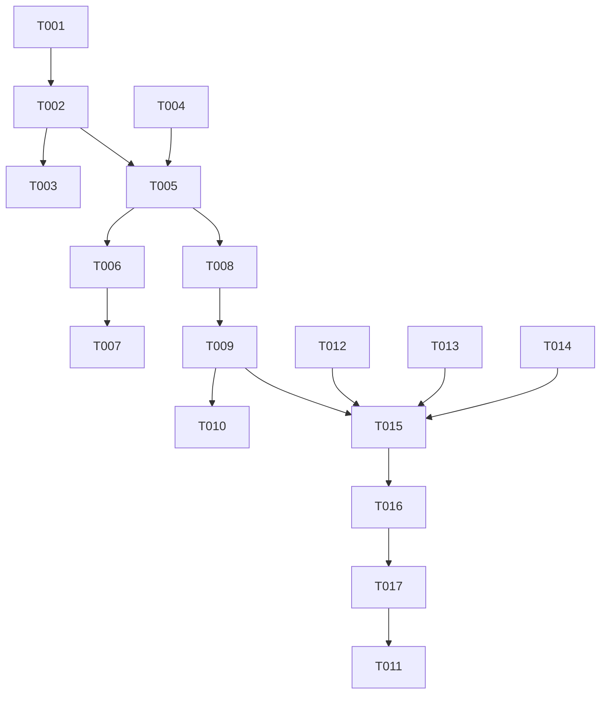

# Tasks: Fork into a Sibling Session with `/fork spawn`

**Input**: Design documents from `specs/022-fork-spawn/`

**Prerequisites**: plan.md, spec.md, research.md, data-model.md, contracts/fork-spawn.md, quickstart.md

**Tests**: The project rules require a regression test for each behavior change. The test tasks below use the existing harnesses. They are not new frameworks.

**Paths**: `OMP/` means `~/agents/oh-my-pi/packages/coding-agent/`. This repo gets no code change.

## Format: `[ID] [P?] [Story] Description`

- **[P]**: can run in parallel (different files, no open dependency)
- **[Story]**: the user story from spec.md

---

## Phase 1: Setup

- [X] T001 Confirm that `~/agents/oh-my-pi` is on `main` and clean except the user's untracked `TODOs.org`. Then run `bun test test/spawn-command.test.ts test/slash-commands/fork.test.ts` in `OMP/` as the baseline. Expect 0 failures.

---

## Phase 2: Foundational (blocks every story)

- [X] T002 In `OMP/src/modes/interactive-mode.ts`, split `#handleSpawnRequest` (~8645-8759) per research D1 and D3:
  - Keep the `#spawnRunUsed` guard and `await this.#endSpawnWindow()` in `#handleSpawnRequest`.
  - Move every later step into a new `async #spawnSibling(request: SpawnRequest, confirm: boolean): Promise<string>`.
  - Use `confirm` in place of `cfgSpawnConfirm.get(this.settings)`.
  - In `#spawnSibling`, delete the `this.showError(\`Spawn failed: ${message}\`)` line in the creation catch, and keep the rethrow and the start-file and worktree cleanup.
  - `#handleSpawnRequest` calls `this.#spawnSibling(request, cfgSpawnConfirm.get(this.settings))` in a `try`. On an error, it calls `this.showError(\`Spawn failed: ${message}\`)` and rethrows.
  - Update the doc comments of both methods.
- [X] T003 In `OMP/test/spawn-command.test.ts`, extend "sends the start text only through the start file, and a failed creation removes that file". Assert that a refused `fresh` call with `ZMX_SESSION` unset calls `showError` once with a text that starts with `Spawn failed:` (research D3).

**Checkpoint**: The `/spawn` tests pass, and `/spawn` behaves as before. The one exception: a refusal now also shows `Spawn failed: …` in A.

---

## Phase 3: User Story 1 - Fork the current conversation into a new Session (Priority: P1) 🎯 MVP

**Goal**: `/fork spawn` creates B with a copy of A's conversation, with no model turn and no new message.

**Independent Test**: quickstart.md scenarios 1–9.

- [X] T004 [US1] In `OMP/src/modes/types.ts`, add `handleForkSpawnCommand(): Promise<void>;` to `InteractiveModeContext`, next to `handleForkCommand`.
- [X] T005 [US1] In `OMP/src/modes/interactive-mode.ts`, add `async handleForkSpawnCommand(): Promise<void>` next to `handleSpawnCommand`. Follow contracts/fork-spawn.md, "Steps":
  1. When `this.session.isStreaming` is true, call `this.showHookConfirm` with the same title and body as `/fork pane` (`command-controller.ts` ~1488-1491). Return when the answer is no.
  2. Call `await this.#spawnSibling({ mode: "fork" }, false)`.
  3. Catch any error and call `this.showError(\`Spawn failed: ${message}\`)`.

  Do not touch the spawn window, `#spawnRunUsed`, or the tool set.
- [X] T006 [US1] In `OMP/src/slash-commands/builtin-session.ts`, change the `/fork` spec (~625-664):
  - Add the subcommand `{ name: "spawn", description: "Open the fork as a sibling session in its own zmx session" }`.
  - Change the description to "Fork this session, or open it in a multiplexer pane, window, or sibling session".
  - Change both usage texts to `Usage: /fork [pane|window|tab|spawn]`.
  - Add `case "spawn":`, which calls `clearSubmittedText(runtime)` and `await runtime.ctx.handleForkSpawnCommand()`, then returns.
- [X] T007 [P] [US1] In `OMP/test/slash-commands/fork.test.ts`, add `handleForkSpawnCommand` to `createRuntime`. Add these tests:
  - `/fork spawn` and `/fork SPAWN` call `handleForkSpawnCommand` once and do not call `handleForkCommand`;
  - `/fork spawn extra` calls neither handler, shows the usage error once, and clears the editor.
- [X] T008 [US1] In `OMP/test/spawn-command.test.ts`, add a `describe("/fork spawn")` with the existing `spawnHarness` (it stubs `createSibling`). Mock `h.session.prompt` and `h.session.followUp`. Give A a saved session file first:
  1. Append one user message and one assistant message to `h.session.sessionManager`.
  2. Call `flush()`.
  3. Assert that `getSessionFile()` names a file that exists.

  Without step 3, a missing file makes every case below test the "no saved conversation" refusal by mistake. Add these tests:
  - one call creates one B, with `--fork <A's resolved session file>` in `argv`, `startFile` undefined, and labels exactly `{ "cci-parent": <A name> }`. `writeSpawnAnnouncement` is called once with B's name, and `showStatus` once with `Spawned <B's name>` (FR-006);
  - `prompt` and `followUp` are never called;
  - A's message count does not change;
  - `isSpawnWindowOpen()` stays false;
  - with `spawn.confirm` set to true, `showHookConfirm` is not called and B is still created;
  - with `ZMX_SESSION` unset, nothing is created and `showError` gets a `Spawn failed:` text;
  - while a `/spawn` window is open (call `handleSpawnCommand("x")` first), `/fork spawn` creates one B, the window stays open, and a later `spawn_session` call in the same run still creates its own B (spec edge case).
- [X] T009 [US1] In the same `describe`, add: with `isStreaming` true and `showHookConfirm` resolving `false`, nothing is created. With `true`, one B is created.

**Checkpoint**: A local `/fork spawn` works from end to end. quickstart.md scenarios 1–9 pass.

---

## Phase 4: User Story 2 - Remove a forked Session (Priority: P2)

**Goal**: `/despawn` lists and ends a B from `/fork spawn`.

**Independent Test**: quickstart.md scenario 10.

- [X] T010 [US2] No code change: B carries the same `cci-parent` label as a `/spawn` B (data-model.md, research D4). T008 asserts the label set. Run quickstart.md scenario 10 against the build from Phase 3, and record the result in `specs/022-fork-spawn/quickstart.md` only if it differs.

---

## Phase 5: User Story 3 - Fork a remote Session (Priority: P3)

**Goal**: `/fork spawn` from a remote A gives the same result.

**Independent Test**: quickstart.md scenario 11.

- [X] T011 [US3] When the user approves the omp push, run `git pull --ff-only` in `~/agents/oh-my-pi` on v12dev. Then run quickstart.md scenario 11 from a remote A attached in Emacs. No code change is expected. Constitution VI needs no remote difference (plan.md).

---

## Phase 6: Polish & Cross-Cutting

- [X] T012 [P] In `~/agents/oh-my-pi/docs/session-operations-export-share-fork-resume.md`:
  - add a `/fork spawn` row to the table at ~32-36;
  - add one sentence next to the `/fork pane` text at ~293-302;
  - change the inline hint text `[pane|window|tab]` at ~300 to `[pane|window|tab|spawn]`.
- [X] T013 [P] In `OMP/CHANGELOG.md`, under Unreleased "Added", add one bullet for `/fork spawn`: it opens a pure fork as a sibling session in its own zmx session, with no model turn and no extra message. Name the change that `/spawn` refusals now show in the session too.
- [X] T014 [P] In `~/agents/oh-my-pi/UPSTREAM_DIVERGENCES.md`, in the `/spawn and /despawn sibling sessions` entry, add one Decision sentence for `/fork spawn`, `builtin-session.ts` (`/fork`) to the Key paths, and `test/slash-commands/fork.test.ts` to the Checks.
- [X] T015 In `OMP/`, run `bunx oxfmt` on the changed files, then `bun test test/spawn-command.test.ts test/slash-commands/fork.test.ts`, `bun run check`, and `bun run test` (SC-006). Expect 0 failures.
- [X] T016 Run `./scripts/compile-and-test.sh` in this repo (SC-006). Expect 0 unexpected results.
- [X] T017 Run quickstart.md scenarios 1–10 locally with `omp-dev`. Then kill every test zmx session, and delete the scratch repo and its session folders.

---

## Dependencies & Execution Order

- US2 and US3 have no code tasks. They need the US1 build to verify against.
- T011 needs the omp push, and the push needs explicit user approval.

## Parallel Examples

- After T006: run T007 (`fork.test.ts`) beside T008 (`spawn-command.test.ts`).
- Polish: T012, T013, and T014 touch different files and run together.
- T002 to T006 are short, and three of them edit `interactive-mode.ts`, so run them in sequence.

## Implementation Strategy

1. **MVP**: Phases 1–3. `/fork spawn` works locally with the tests green. Validate with quickstart.md scenarios 1–9.
2. Verify US2 (`/despawn`) on the same build.
3. Run the Phase 6 gates. When the user asks, commit omp and the spec files separately. Push only with user approval. Then verify US3 on v12dev.

## Phase 7: Convergence

- [X] T018 Review the vibe-mode refusal ("Exit vibe mode first.") at the start of `handleForkSpawnCommand` in `OMP/src/modes/interactive-mode.ts`. Either record it as a `/fork spawn` edge case in spec.md, or remove it, per FR-001 (unrequested)
