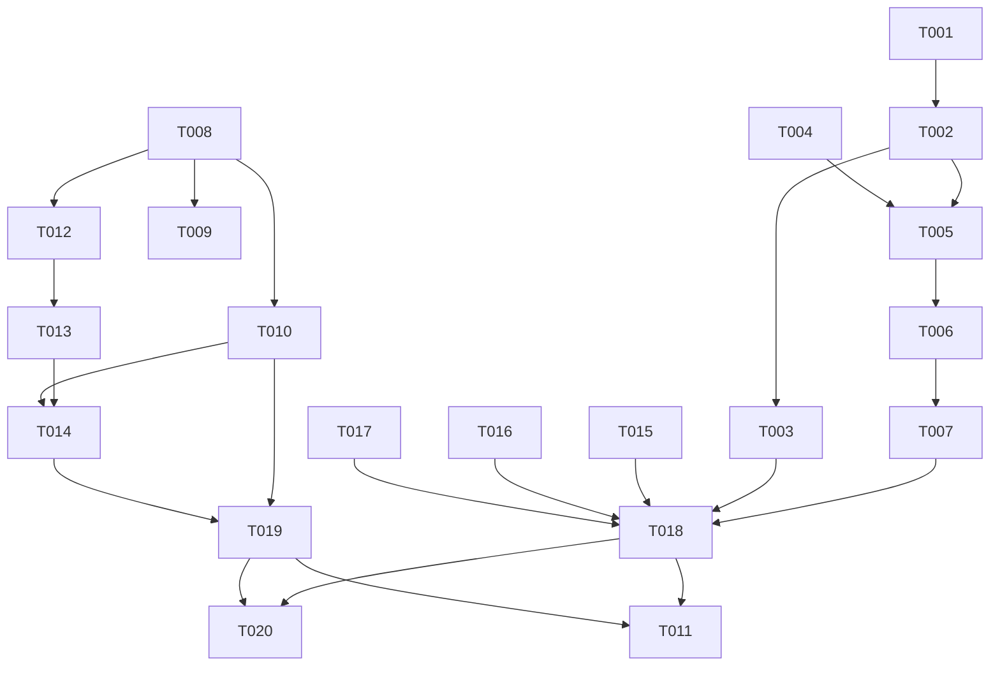

# Tasks: Fork a Session from the Sidebar with `S`

**Input**: Design documents from `specs/023-sidebar-fork-key/`

**Prerequisites**: plan.md, spec.md, research.md, data-model.md, contracts/pi-action-packet.md, quickstart.md

**Tests**: The project rules require a regression test for each behavior change. The test tasks below use the existing harnesses (research R6). They are not new frameworks.

**Paths**:
- `OMP/` means `~/agents/oh-my-pi/packages/coding-agent/`.
- `TUI/` means `~/agents/oh-my-pi/packages/tui/`.
- Paths without a prefix are in this repo.

## Format: `[ID] [P?] [Story] Description`

- **[P]**: can run in parallel (different files, no open dependency)
- **[Story]**: the user story from spec.md

---

## Phase 1: Setup

- [X] T001 Record `git status` in `~/agents/oh-my-pi` and in this repo. Do not touch unrelated dirty or untracked files, such as the user's `TODOs.org` or this feature's `specs/023-sidebar-fork-key/`. Then run `bun test test/spawn-command.test.ts test/modes/composer-editor-handoff.test.ts` in `OMP/` and `./scripts/compile-and-test.sh` here as the baselines. Record any known flake (MG3).

---

## Phase 2: Foundational (blocks every story)

- [X] T002 In `TUI/src/prompt/composer.ts`, add the `pi:action` packet kind (contracts/pi-action-packet.md):
  - Add a public field `onAction?: (name: string) => void;` to `Composer`, with a doc comment: InteractiveMode sets it after it adopts the Composer, and an unset field drops the packet.
  - In the input listener (~346-374), change the regex kind group to `(prompt|keyword|action)`.
  - For `action`, call `this.onAction?.(name)` before the focus check, and do not touch the editor. Keep the `prompt` and `keyword` branches behind the existing `this.ui.getFocused() === this.editor` check.
  - Keep `return { consume: true }` for every `pi:` packet.
  - Update the listener comment to name `pi:action;<name>`.
- [X] T003 [P] In `OMP/test/modes/composer-editor-handoff.test.ts`, add one test next to "keeps consuming the existing pi:prompt packet". Set `composer.editor.setText("draft")` and `composer.onAction = name => names.push(name)`. Feed `"\x1b_pi:action;fork-spawn\x1b\\"`. Assert `names` is `["fork-spawn"]`, `received` is `[]`, and the editor text is still `"draft"`. Feed the packet once more with `onAction` unset, and assert that the text is still `"draft"` and nothing throws.

**Checkpoint**: Composer passes `pi:action` names out, and the draft never changes.

---

## Phase 3: User Story 1 - Fork the Session at point (Priority: P1) 🎯 MVP

**Goal**: `S` on a local omp row creates B with A's conversation, and A's draft stays the same.

**Independent Test**: quickstart.md scenarios 1–6, 8, and 10.

### omp

- [X] T004 [US1] In `OMP/src/modes/types.ts` (~560), change the signature to `handleForkSpawnCommand(confirmBusy?: boolean): Promise<void>;`.
- [X] T005 [US1] In `OMP/src/modes/interactive-mode.ts`, make these changes (research R3, R4):
  1. `handleForkSpawnCommand(confirmBusy = true)` (~8644): ask the busy-turn question only when `confirmBusy && this.session.isStreaming`. Update the doc comment.
  2. Extract the three dialog conditions from `#isSpeckitStartBlocked` (~4299-4302) into `#inputOwnedByDialog(): boolean`. These are `this.ui.hasOverlay()`, `this.ui.getFocused() !== this.editor`, and `this.editorContainer.children[0] !== this.editor`. Keep the editor-slot comment, and call the new method from `#isSpeckitStartBlocked`.
  3. Add `#handleIdeAction(name: string): void`. For `fork-spawn`: when `#inputOwnedByDialog()` is true, call `this.showWarning("Fork request ignored: close the open dialog first.")` and return. Else call `void this.handleForkSpawnCommand(false)`. Ignore any other name.
  4. In the constructor, right after `this.editor = this.composer.editor;` (~2305), add `this.composer.onAction = name => this.#handleIdeAction(name);`. This line runs for a new Composer and for an adopted one.
- [X] T006 [US1] In `OMP/test/spawn-command.test.ts`, add `describe("IDE fork request")` next to the `/fork spawn` describe. Reuse its saved-session setup and the stubbed `createSibling`. Feed packets with `h.mode.ui.injectDebugInput("\x1b_pi:action;fork-spawn\x1b\\")`. The packet path does not await the fork, so wait as follows:
  - In a positive case, spy on `handleForkSpawnCommand` before the packet, then await every promise it returned. Then assert the `createSibling` call count. No wall-clock timer is used.
  - In a "nothing is created" case, the dialog refusal runs synchronously. Assert the `showWarning` call, that `handleForkSpawnCommand` was not called, and the `createSibling` count.

  Add these tests:
  - With `isStreaming` true, one B is created and `showHookConfirm` is not called (FR-009).
  - With editor text `"draft text"` set first, one B is created. The editor text and cursor are unchanged afterward (FR-004).
  - With `h.mode.ui.hasOverlay` returning true, nothing is created, and `showWarning` gets "Fork request ignored: close the open dialog first." once (FR-012).
  - With a `/spawn` window open (`handleSpawnCommand("x")` first), one B is created (FR-012, spec 022).
  - With two packets fed back to back and no await between them, `createSibling` gets two calls with two different `name` values (spec edge case "twice fast").
  - The typed path keeps the question: `handleForkSpawnCommand()` with `isStreaming` true still calls `showHookConfirm` once. The existing T009 test from spec 022 covers this, so keep it unchanged.
- [X] T007 [US1] In the same `describe`, add the startup-adoption test (research R6). Build a `Composer` with a `VirtualTerminal` (as `composer-editor-handoff.test.ts` does) and call `start()`. Pass it as the `composer` argument of `new InteractiveMode(...)`, with the same session setup as `spawnHarness`. Feed one packet through that Composer's `ui.injectDebugInput`, and assert that one B is created. If `spawnHarness` cannot take a Composer, add an optional `composer` parameter to it.

### Package

- [X] T008 [US1] In `claude-code-ide-manager.el`, add `claude-code-ide-manager-fork-at-point` next to `claude-code-ide-manager-start-session-at-point` (~5646). Follow contracts/pi-action-packet.md, "Emacs behavior", in this order:
  1. Get the item from `claude-code-ide-manager--item-at-point`. If there is none, call `(user-error "No manager session at point")`.
  2. Get the buffer from `claude-code-ide-manager--session-buffer` with the item's session key. If the buffer is not live, or `(process-live-p (get-buffer-process buffer))` is nil, call `(user-error "Session is disconnected. Press c to reconnect first")`. The helper returns a local Session's buffer even when its process is dead, so the process check is necessary.
  3. In that buffer, if `claude-code-ide--session-cli-type` is not `omp`, call `(user-error "Only Oh My Pi sessions can fork")`.
  4. In that buffer, call `(claude-code-ide-session-send-omp-packet "action" "fork-spawn")`.
  5. Call `(message "Fork request sent to %s" (claude-code-ide-manager-item-display-name item))`.
  The docstring names `/fork spawn` and says that B arrives through the spawn announcement. Bind `S` (~1491) to this command, in place of the old skip-permissions command, so the MVP is usable with one key.
- [X] T009 [US1] In `claude-code-ide-session.el` (~288-292), extend the `claude-code-ide-session-send-omp-packet` docstring with KIND "action" (run a named omp action such as \"fork-spawn\").
- [X] T010 [US1] In `claude-code-ide-tests.el`, add tests for `claude-code-ide-manager-fork-at-point`. Mock `claude-code-ide-manager--item-at-point`, `claude-code-ide-manager--session-buffer`, and `claude-code-ide-session-send-omp-packet`. A temp buffer has no process, so mock `process-live-p` to return t in the live cases and nil in the dead-process case:
  - An omp row with a live buffer sends `("action" "fork-spawn")` once, inside that buffer (check `current-buffer` in the mock), and shows "Fork request sent to <display-name>".
  - A remote omp row (item `:host "alpha"`) sends the same packet in its buffer (FR-005).
  - No item, a dead buffer, a local live buffer whose process is dead, and a `claude` buffer each signal `user-error` and send nothing (FR-007).

**Checkpoint**: Local `S` forks work from end to end. quickstart.md scenarios 1–6, 8, and 10 pass.

---

## Phase 4: User Story 2 - Fork a remote Session (Priority: P1)

**Goal**: `S` on a remote omp row creates B on the same host.

**Independent Test**: quickstart.md scenario 7.

- [X] T011 [US2] No code change: the row buffer is the Ghostel attachment for local and remote rows (research R5), and T010 covers the remote send. After the user approves the omp push, run `git pull --ff-only` in `~/agents/oh-my-pi` on v12dev. Then run quickstart.md scenario 7.

---

## Phase 5: User Story 3 - The old `S` start is gone from the sidebar (Priority: P2)

**Goal**: The sidebar has no permissions-bypass start. `S` means fork in the keymap and in the dispatch menu.

**Independent Test**: quickstart.md scenario 9.

- [X] T012 [US3] In `claude-code-ide-manager.el`:
  - Delete `claude-code-ide-manager-start-session-at-point-skip-permissions` (~5683-5686).
  - Remove the DANGEROUS argument from `claude-code-ide-manager-start-session-at-point` (~5646-5681). Make it `(&optional arg)` with `(interactive (list current-prefix-arg))`. The remote branch rejects only `arg`. The local branch calls `(claude-code-ide--transient-launch-flags nil)`. Remove the DANGEROUS line from the docstring.
- [X] T013 [US3] In `claude-code-ide-transient.el`:
  - Change the dispatch entry (~730) to `("S" "Fork session" claude-code-ide-manager-fork-at-point)`.
  - Change the `declare-function` for `claude-code-ide-manager-start-session-at-point` (~81) to `(&optional arg)`.
  - Replace the `declare-function` for the removed command (~82) with one for `claude-code-ide-manager-fork-at-point` `()`.
  - Do not change `claude-code-ide-manager-open-menu` or the start menus (FR-010).
- [X] T014 [US3] In `claude-code-ide-tests.el`, update the tests for the removal:
  - In the binding test (~2067-2068), expect `S` to give `claude-code-ide-manager-fork-at-point`.
  - In `claude-code-ide-test-manager-dispatch-mirrors-sidebar-keys` (~11266), change `S` to `claude-code-ide-manager-fork-at-point`.
  - Delete `claude-code-ide-test-manager-S-keeps-remote-local-options-rejected` (~2101-2122) and `claude-code-ide-test-manager-prefix-skip-selects-cli-and-bypasses` (~2273-2306).
  - Change `claude-code-ide-test-manager-start-session-at-point-skip-forces-bypass` (~2220-2241) so that it proves the remaining property: with `claude-code-ide-bypass-permissions-by-default` set, a plain `s` launch still gets the bypass flags. If that property already has a test, delete this test.
  - In `claude-code-ide-test-manager-unprefixed-sibling-preserves-session-cli` (~2308-2326), drop the skip call and expect `'(codex)`.
  - Add one remote test: `s` with a prefix ARG on a remote row signals `user-error` and starts nothing. This keeps the property of the deleted `S` test.

**Checkpoint**: `S` forks, and no sidebar path starts a Session with the bypass.

---

## Phase 6: Polish & Cross-Cutting

- [X] T015 [P] In `TUI/CHANGELOG.md`, under Unreleased, add one bullet: `Composer.onAction` receives the name of each `ESC _ pi:action;<name> ESC \` packet, and the packet never reaches the editor.
- [X] T016 [P] In `OMP/CHANGELOG.md`, under Unreleased "Added", add one bullet: an `ESC _ pi:action;fork-spawn ESC \` packet runs `/fork spawn` without the busy-turn question and without a change to the draft. An open dialog blocks it with a warning.
- [X] T017 [P] In `~/agents/oh-my-pi/UPSTREAM_DIVERGENCES.md` (~281), extend the `pi:prompt`/`pi:keyword` Decision with `pi:action;<name>` and its `fork-spawn` action. Add `test/spawn-command.test.ts` to that entry's Checks if it is not there.
- [X] T018 In `~/agents/oh-my-pi/packages/coding-agent/` and `~/agents/oh-my-pi/packages/tui/`, run `bunx oxfmt` on the changed files. Then run `bun test test/spawn-command.test.ts test/modes/composer-editor-handoff.test.ts`, `bun run check`, and `bun run test` in `OMP/` (SC-006). Expect 0 failures.
- [X] T019 Run `./scripts/format-and-clean.sh claude-code-ide-manager.el claude-code-ide-transient.el claude-code-ide-session.el claude-code-ide-tests.el` (constitution "Elisp Standards"). The script exits 1 without file arguments. Then run `./scripts/compile-and-test.sh` in this repo (SC-006). Expect 0 unexpected results, except the known MG3 flake.
- [X] T020 Load the changed package files into the live Emacs with `~/bin/emacsclient --eval`. Call `fmakunbound` on `claude-code-ide-manager-start-session-at-point-skip-permissions` first. Then run quickstart.md scenarios 1–6 and 8–10 locally with `omp-dev`. Then kill every test zmx session, and delete the scratch repo and its session folders.

---

## Dependencies & Execution Order

- The omp tasks (T002–T007) and the package tasks (T008–T010, T012–T014) touch different repos, so they can run side by side.
- T011 needs the omp push, and the push needs explicit user approval. It depends on the gates (T018, T019), not on the local live run (T020), so the remote story can be checked on its own.

## Parallel Examples

- After T002: T003 (`composer-editor-handoff.test.ts`) runs beside T004/T005 (`types.ts`, `interactive-mode.ts`).
- One agent can own the omp side (T002–T007) while another owns the package side (T008–T010, T012–T014).
- Polish: T015, T016, and T017 touch different files and run together.
- T008, T012, and T013 edit related keymap and menu code, and T010 and T014 share `claude-code-ide-tests.el`, so each group runs in sequence.

## Implementation Strategy

1. **MVP**: Phases 1–3. A local `S` fork works with the tests green. Validate with quickstart.md scenarios 1–6, 8, and 10.
2. Phase 5 removes the old start and makes the dispatch menu match.
3. Run the Phase 6 gates. When the user asks, commit omp, the package, and the parent gitlink bump separately. Push only with user approval. Then verify US2 on v12dev (T011).
