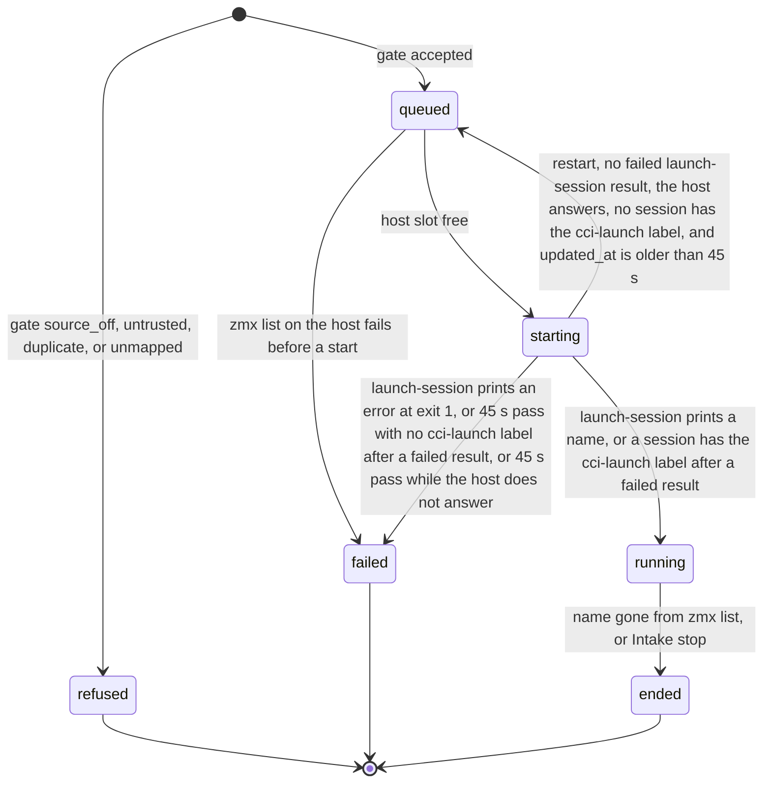

# Data Model: Launch Agent Sessions from Outside Events

The Intake keeps all of its records in one SQLite file, `$XDG_STATE_HOME/cci-intake/intake.db`, with WAL mode on. Times are ISO-8601 UTC text. IDs that the Intake makes are random 16-character `[a-z0-9]` text.

## Tables

### `triggers`

One event from a source (spec: Trigger).

| Column | Type | Rule |
|---|---|---|
| `id` | TEXT PK | Stable identity (research D10): `linear:history:<id>`, `linear:issue:<id>` (creation Trigger, D14), `linear:comment:<id>`, `api:<key>` or `api:<new id>` for a Launch request, and `api-input:<key>` or `api-input:<new id>` for a follow-up request. |
| `source` | TEXT | `api` or `linear`. |
| `kind` | TEXT | `launch` or `followup`. |
| `actor` | TEXT NULL | Linear user ID, or `api` for a client that sent the credential. |
| `link` | TEXT NULL | Issue or comment URL. |
| `gate` | TEXT | `accepted`, `source_off`, `untrusted`, `duplicate`, or `unmapped`. `duplicate` applies only to a label Trigger whose issue already has a `queued`, `starting`, or `running` Launch. |
| `reason` | TEXT NULL | Set for every result except `accepted`. |
| `created_at` | TEXT | |

An insert that conflicts on `id` does nothing, and the caller reads the existing row. This gives FR-024.

### `launches`

One request to start a Session and its result (spec: Launch).

| Column | Type | Rule |
|---|---|---|
| `id` | TEXT PK | The value of the `cci-launch` label. |
| `trigger_id` | TEXT UNIQUE FK→triggers | One Launch per Trigger. |
| `project` | TEXT NULL | A key in `[projects]`. NULL only for a `refused` Launch whose issue matches no project rule, whatever its gate result. |
| `host` | TEXT NULL | `local` or a host in the project's `hosts`. NULL only when `project` is NULL. |
| `dir` | TEXT NULL | The repository path. After start, the worktree path from `launch-session`, or from the `cci-wt-path` label when a restart or a timeout finds the session (research D5). NULL only when `project` is NULL. |
| `branch_request` | TEXT NULL | A branch name when the request asked for a worktree. For Linear, the issue ID in lowercase. |
| `branch` | TEXT NULL | The branch that `launch-session` made, which can have a suffix. A restart or a timeout that finds the session takes it from the `cci-wt-branch` label. |
| `prompt` | TEXT | The opening prompt. |
| `name` | TEXT NULL UNIQUE | The zmx session name, set when the Launch starts. |
| `state` | TEXT | See the state rules below. |
| `agent_state` | TEXT NULL | The last `cci-state` value: `working` or `idle`. NULL until omp publishes its first state. The sender sends `pending` follow-ups only after it is set, because before then omp cannot read input (research D7). |
| `reason` | TEXT NULL | Set for `failed` and `refused`. A `starting` Launch has a reason while it waits for the label after a `launch-session` result that was not clear (research D5). The reason is cleared when the Launch becomes `running`. For `refused`, it starts with the gate result, for example `untrusted: actor usr_… is not on the allow-list`. |
| `issue_id` | TEXT NULL | The Linear issue UUID for a Linear Launch. |
| `created_at`, `updated_at` | TEXT | For a Linear Launch, `created_at` is the time of the label event on Linear's clock. A comment older than it does not go to this Launch (research D15). |

### `followups`

One follow-up for a Launch.

| Column | Type | Rule |
|---|---|---|
| `id` | TEXT PK | |
| `trigger_id` | TEXT UNIQUE FK→triggers | One follow-up per comment or request. |
| `launch_id` | TEXT FK→launches | |
| `mode` | TEXT | `queue`, `guide`, or `stop`. |
| `text` | TEXT | At most 64 KiB of UTF-8 (research D7). A row that is `refused` because its text is over the limit keeps an empty text. |
| `state` | TEXT | `pending`, `sending`, `sent`, `failed`, or `refused`. The sender sets `sending` before `zmx send`. At startup, each `sending` row becomes `failed` with the reason `result unknown`, and the Intake does not send it again (research D7). |
| `reason` | TEXT NULL | Set for `failed` and `refused`, for example `launch is ended`, `empty text`, or `result unknown`. |
| `created_at` | TEXT | The arrival order is `created_at`, then `rowid`. |

### `comments`

The outbox of Linear comments that the Intake posts. It also holds the self-skip set (research D15).

| Column | Type | Rule |
|---|---|---|
| `id` | TEXT PK | UUIDv4, also sent as `CommentCreateInput.id`. |
| `issue_id` | TEXT | |
| `launch_id` | TEXT NULL | The Launch that the comment reports on. For the "name the repository" comment, it is the `refused` Launch. The Intake sets it for every comment. |
| `trigger_id` | TEXT UNIQUE | One comment per result (FR-052). |
| `body` | TEXT | |
| `state` | TEXT | `pending` or `posted`. |

### `adoptions`

The result of each push (FR-027).

| Column | Type | Rule |
|---|---|---|
| `launch_id` | TEXT FK | |
| `client` | TEXT | The `[[emacs]]` entry name. |
| `result` | TEXT | `adopting`, `skipped`, `refused`, or `failed`. |
| `reason` | TEXT NULL | |
| PK | (`launch_id`, `client`) | One push per Emacs per Launch. |

### `cursors`

| Key | Value |
|---|---|
| `linear.issues` | The largest issue `updatedAt` seen. |
| `linear.comments` | The largest comment `createdAt` seen. It moves to the current time when no issue has a Launch to watch (research D15). |

The Intake looks up the trigger label IDs by name on each label poll and keeps no copy (research D14). An old `linear.label_id` row is not used.

## Launch states

Rules:

- A Trigger that would start a Launch but fails the gate gets a `refused` Launch row, so the refusal shows in the Launch list with its reason (FR-028). A request that fails validation (`400`) is not recorded.
- Only the reconcile loop moves `running` to `ended`, and only after a successful `zmx list` (FR-026). An Intake stop runs `zmx kill`, then the same list check.
- A follow-up is accepted only when its Launch is live: `queued`, `starting`, or `running` (FR-030). The sender sends `pending` rows only while the Launch is `running` and its `agent_state` is set (research D7). The change that sets `agent_state` for the first time starts the sender. When a Launch becomes `ended` or `failed`, each of its `pending` follow-ups becomes `refused`. A `sending` row keeps its state until `zmx send` gives a result.
- A `starting` Launch whose session is not in the list yet takes a host slot (research D9).
- Each state change writes the row and then sends one `launch` event on the stream (FR-028).

## zmx labels on a launched Session

| Label | Set by | Value |
|---|---|---|
| `cci-launch` | `launch-session --label` | The Launch `id`, base64url. |
| `cci-state`, `cci-work` | omp at turn start and end (research D4) | As in spec 021, base64url. |
| `cci-wt-*` | `spawnSession` for a worktree | As in spec 021. |

A launched Session has no `cci-parent` label, so `/despawn` never lists it.

## Package state (Emacs)

| Variable | Shape | Rule |
|---|---|---|
| `claude-code-ide--pending-adoptions` | list of `(HOST . NAME)` | Added by `claude-code-ide-adopt-session`. Removed when the adopt callback runs, with or without success. |
| `claude-code-ide--adopted-sessions` | list of `(HOST . NAME)` | Added by the adopt callback of `claude-code-ide-adopt-session` when the Session is live. Also added when the command returns `skipped` because the pair is already a live Session target. A failed adopt adds nothing. Kept for the life of this Emacs. A pair in this list makes the command return `skipped`. |
| `claude-code-ide--refused-sessions` | list of `(HOST . NAME)` | Added when `claude-code-ide-adopt-session` refuses a pair. The refusal message shows only when the pair is not in this list yet. The command still returns `refused` for the pair. Kept for the life of this Emacs. |
| `claude-code-ide-intake--processes` | list of processes | The live curl processes: the stream and the list read. |
| `claude-code-ide-intake--timer` | timer or nil | The timer that reconnects the stream. |
| `claude-code-ide-intake--retry-delay` | integer seconds | 1 to 60. Reset by the first event. |
| `claude-code-ide-intake--partial` | string | The stream text after the last complete event. |
