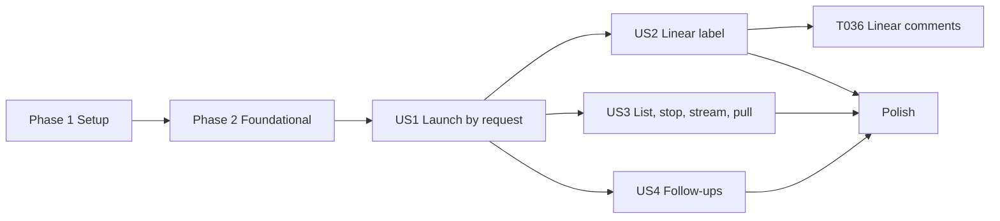

---

description: "Task list for launching Agent Sessions from outside events"
---

# Tasks: Launch Agent Sessions from Outside Events

**Input**: Design documents from `specs/024-session-launch-intake/`

**Prerequisites**: plan.md, spec.md, research.md, data-model.md, contracts/, quickstart.md

**Tests**: Constitution principle II requires ERT tests for new package logic, and SC-008 requires all three test suites to pass. Each test proves an invariant with generated inputs and a fixed, printed seed. A test must not copy the implementation.

**Paths**:
- `OMP/` means `~/agents/oh-my-pi/packages/coding-agent/`.
- `TUI/` means `~/agents/oh-my-pi/packages/tui/`.
- `INTAKE/` means `~/agents/cci-intake/`.
- The package paths are relative to this repository.

## Format: `[ID] [P?] [Story] Description`

- **[P]**: The task can run in parallel. It touches other files and has no open dependency.
- **[Story]**: The user story (US1–US4) of the task.

---

## Phase 1: Setup

- [X] T001 In `~/agents/oh-my-pi`, create the branch `024-session-launch-intake` from the current `main`. Do not touch the user's uncommitted files.
- [X] T002 [P] Create the repository `~/agents/cci-intake` with `git init`. Add `INTAKE/package.json` with `"name": "cci-intake"`, `"private": true`, `"type": "module"`, the scripts `"start": "bun run src/main.ts"` and `"test": "bun test"`, and no dependencies. Add `INTAKE/.gitignore` with `node_modules/` and `*.db*`. Create the empty directories `INTAKE/src/` and `INTAKE/test/`.

---

## Phase 2: Foundational (blocks every story)

- [X] T003 [P] Create `INTAKE/src/config.ts` from `contracts/intake-config.md`:
  - Read the file at `CCI_INTAKE_CONFIG`, or else at `$XDG_CONFIG_HOME/cci-intake/config.toml`, with `Bun.TOML.parse`. Expand a leading `~`.
  - Apply every rule in the contract. Each error names its key, for example `projects.api.default_host: "x" is not in hosts`. Refuse an unknown key.
  - Refuse `token_file` and `sources.linear.key_file` when `(stat.mode & 0o077) !== 0`.
  - Refuse each `listen` address that is not private, by the `listen` rule in the contract. This covers `0.0.0.0`, `::`, a host name, and a public address (FR-020).
  - Refuse an empty `followups.prefix` and a prefix that starts with a space.
  - Export the types `Config`, `Project`, `HostConf`, and `EmacsTarget`, plus `loadConfig()`. Also export `readSecret(path)`, which reads and trims the file at each call.
- [X] T004 [P] Create `INTAKE/src/db.ts` from `data-model.md`:
  - `openDb(path)` turns on WAL mode and `foreign_keys`, then creates all six tables if they do not exist. The default path is `$XDG_STATE_HOME/cci-intake/intake.db`, or `~/.local/state/cci-intake/intake.db`.
  - Export `tx(fn)` and `insertTrigger(row)`. `insertTrigger` uses `ON CONFLICT(id) DO NOTHING` and returns `{row, created}`.
  - Export `insertLaunch` and `getLaunch(id)`, plus `getLaunchByTrigger(triggerId)` and `listLaunches({states?})`.
  - Export `setLaunch(id, patch)`. It sets `updated_at` and then calls every listener that `onLaunchChange(fn)` registered.
  - Export the row functions for `followups`, `comments`, and `adoptions`, plus `getCursor` and `setCursor`.
  - Make IDs with `newId()`: 16 random `[a-z0-9]` characters.
- [X] T005 [P] Create `INTAKE/src/hosts.ts` (research D2):
  - `run(host, argv, {stdin?, timeoutMs = 30000})` returns `{code, stdout, stderr}`. For `local` it runs `Bun.spawn(argv)`. For any other host it runs `["ssh","-T","-o","BatchMode=yes","-o","ConnectTimeout=10",host,"--",argv.map(shQuote).join(" ")]`. A timeout kills the process and returns code 124 with the reason in `stderr`.
  - `shQuote(s)` wraps `s` in single quotes and turns each `'` into `'\''`.
  - `HOST_RE` is `^[^-\s\x00-\x1f\x7f"\\][^\s\x00-\x1f\x7f"\\]*$`, so a host has no quote and no backslash (`contracts/emacs-adopt.md`). `NAME_RE` is `^cci-[A-Za-z0-9._-]+$`.
  - `zmxList(host)` runs `zmx list` and parses each line the way `parseZmxList` does (`OMP/src/session/sibling-spawn.ts:77-93`). It strips `→ `, splits the tab fields, and base64url-decodes each `cci-*` value. It throws on a non-zero exit.
  - `zmxKill(host, name)` runs `zmx kill NAME` and needs the exact `killed session NAME` acknowledgement.
  - `setRunner(fn)` replaces `run` in tests.
- [X] T006 [P] Add `INTAKE/test/hosts.test.ts`:
  - **`shQuote` round trip.** Use 500 generated strings that include `'`, `\`, ESC, newlines, `$`, and unicode. For each one, `sh -c "printf %s " + shQuote(s)` must print `s` exactly. Print the seed.
  - **`zmxList`.** Encode generated label records with base64url and build list lines with and without the `→ ` prefix. Parsing must give back the records.
- [X] T007 [P] Add `INTAKE/test/config.test.ts`. Write a table of bad configurations, one for each rule in `contracts/intake-config.md`. Each one must fail with an error that names its key. The `listen` rows must cover `0.0.0.0:7311`, `[::]:7311`, `example.com:7311`, and `8.8.8.8:7311` as refused, and `127.0.0.1`, `10.1.2.3`, `100.101.102.103`, and `[fd00::1]` as accepted. A secret file with mode 0644 must be refused, and mode 0600 must be accepted.

**Checkpoint**: The configuration, the store, and the host commands work, and their tests pass.

---

## Phase 3: User Story 1 - Launch a Session with one request (P1) 🎯 MVP

**Goal**: One authenticated request starts an omp Session in zmx on the chosen host, and Emacs adopts it without a manual step.

**Independent Test**: quickstart.md scenarios 1, 2, 3, 4, and 15.

### omp

- [X] T008 [US1] In `OMP/src/session/sibling-spawn.ts`, add `spawnSession({dir, branch?, text, argv, env, labels, publishState})` from `contracts/omp-launch-session.md`. Move the worktree, name, start-file, and `createSibling` steps out of `#spawnSibling` (`OMP/src/modes/interactive-mode.ts` ~8890-8936) into it. When any step fails, the function removes everything the earlier steps made, then throws:
  - It runs `zmx kill` for a session it created.
  - It runs `removeSessionWorktree` and deletes the new branch.
  - It deletes the start file.
  Make `#spawnSibling` call `spawnSession` with `publishState: false` and its `cci-parent` label. Delete the moved code.
- [X] T009 [US1] Add `publishState?: boolean` to `createSibling` in `OMP/src/session/sibling-spawn.ts`. It sets `OMP_PUBLISH_STATE: "1"` in the child env when true and `undefined` otherwise. Change the gate at `OMP/src/modes/interactive-mode.ts:3116` to `(process.env.OMP_SPAWN_PARENT || process.env.OMP_PUBLISH_STATE) && process.env.ZMX_SESSION` (research D4).
- [X] T010 [US1] Create `OMP/src/commands/launch-session.ts` from `contracts/omp-launch-session.md`. Use `OMP/src/commands/commands.ts:61-86` as the template.
  - Flags: `--cwd`, `--branch`, `--label` (multiple), and `--json`. The rest after `--` is `CHILD_ARGV`.
  - Read the prompt from stdin with `Bun.stdin.text()`. Run `Settings.init({cwd})`.
  - Refuse these inputs, each with its own `{"error"}` and exit 1:
    - a relative or missing `--cwd`
    - a `--cwd` that is not a Git checkout
    - a label key that does not start with `cci-`
    - an empty prompt
    - an empty `CHILD_ARGV`
  - Call `spawnSession` with `publishState: true`. Print one JSON line.
  - Register the command in `OMP/src/cli-commands.ts`, and add `launchSessionHelp` to `OMP/src/cli/command-help.ts`.
- [X] T011 [P] [US1] Add property tests for `spawnSession` in `OMP/test/session/sibling-spawn.test.ts` with stubbed `ptree.exec` and Git:
  - Fail each step in turn, chosen by a seeded generator. After each failure, no zmx session, worktree, branch, or start file from the call remains.
  - A taken branch `b` gives `b-2`, and the existing branch and worktree do not change.
  - The child env has `OMP_PUBLISH_STATE` only when `publishState` is true.
  - `#spawnSibling` still passes `cci-parent`.
- [X] T012 [P] [US1] Add `OMP/test/cli/launch-session.test.ts`. On success the command prints exactly one JSON line with `name`, `dir`, and `branch`. Each refusal in T010 prints `{"error"}` and exits 1, and the stubbed `zmx` is never called. Make sure that `OMP/test/cli-command-metadata.test.ts` still passes with the new command.

### Package

- [X] T013 [US1] In `claude-code-ide.el`, add an optional `on-done` argument to `claude-code-ide--adopt-spawned-session`. Call it exactly once in every branch: local, refused host, remote callback, and error. Then add `claude-code-ide--pending-adoptions` and `claude-code-ide-adopt-session (host name)` from `contracts/emacs-adopt.md`. The command has an autoload cookie and no `interactive` form.
  - For a non-nil host that `claude-code-ide-zmx--valid-host-p` refuses or that is not in `claude-code-ide-remote-hosts`, and for a name that `claude-code-ide-zmx--package-name-p` refuses: show one `message` that names the refused value and the Session name, then return `refused`. Do not signal an error, because `emacsclient --eval` would hide it from Emacs (FR-011).
  - Return `skipped` when the pair is pending or `claude-code-ide--live-session-for-target` is true.
  - Otherwise add the pair to the pending list and schedule the adopt with `run-at-time 0`. The `on-done` callback removes the pair. Return `adopting`.
  - The existing callers keep their behavior.
- [X] T014 [P] [US1] Add ERT tests in `claude-code-ide-tests.el`. Reuse `claude-code-ide-tests--with-spawn-adoption` and `--with-remote-targets`. Cover these cases:
  - A host outside `claude-code-ide-remote-hosts` and a name with a foreign prefix each return `refused`, show exactly one message that names the value and the Session name, and schedule nothing.
  - A local call returns `adopting` and attaches once.
  - A second call while the first remote list is in flight returns `skipped`, and only one `zmx list` request is sent.
  - A live target returns `skipped`.
  - The pending pair is gone after a remote reply, after a refused host, and after an error.
  - `claude-code-ide-switch-on-spawn` nil means no switch.

### Intake

- [X] T015 [US1] Create `INTAKE/src/launches.ts`:
  - **`requestLaunch(body, now)`** follows `contracts/intake-http.md` `POST /v1/launches`.
    - It validates the project, host, and prompt.
    - A body with a `key` gives the trigger ID `api:<key>`. A body without one gives `api:<newId()>`.
    - When `sources.api.enabled` is false, it records the trigger with gate `source_off` and a `refused` Launch with that reason in one `tx`, then returns 409.
    - Otherwise it inserts the trigger and a `queued` Launch in one `tx`. A key that already has a Launch returns that Launch with `created: false`.
    - A body with `worktree` and no `branch` gets `launch-<id>`.
  - **`startNext(host)`** runs one start at a time per host (a promise chain for each host).
    - It runs `zmxList(host)` and counts the names that match `NAME_RE`. When the count is at least `max_sessions - 1`, it starts nothing.
    - Otherwise it takes the oldest `queued` Launch, sets it to `starting`, and runs the project's `launch_session` command. The arguments are `--cwd dir`, then `--branch b` when needed, then `--label cci-launch=<id>`, then `--json -- ...omp`, with the prompt on stdin.
    - A JSON result sets the Launch to `running` with `name`, `dir`, and `branch`. An error, or a host that does not answer, sets the Launch to `failed` with a reason that names the host.
  - **`reconcile()`** runs every 10 s for each host that has a `queued`, `starting`, or `running` Launch.
    - A successful list sets each `running` Launch whose name is gone to `ended`. It also copies `cci-state` into `agent_state` and then calls `startNext`.
    - A failed list changes nothing.
  - **`recover()`** runs at startup. For each `starting` Launch, it lists the host. A session with `cci-launch` equal to the Launch ID makes the Launch `running`. When no session has the label and `updated_at` is older than 30 s, the Launch goes back to `queued`. A younger Launch stays `starting`, and `reconcile()` checks it again (research D5).
- [X] T016 [US1] Create `INTAKE/src/emacs.ts`. `pushAdoption(launch)` runs on each change to `running`. For each `[[emacs]]` target whose `hosts` map names the Launch's host:
  - It checks the mapped host against `HOST_RE`, or accepts `""` for nil, and checks the name against `NAME_RE`.
  - It builds `(claude-code-ide-adopt-session "HOST" "NAME")`, or uses `nil` in place of `"HOST"`.
  - It runs `[...emacsclient, "--eval", form]` locally when `ssh` is `""`, or else through `run(target.ssh, …)`, with a 10 s timeout.
  - It writes one `adoptions` row with `adopting`, `skipped`, `refused`, or `failed` and a reason. The result is the symbol that `emacsclient` prints, or `failed` for a non-zero exit or a timeout. It never retries.
- [X] T017 [US1] Create `INTAKE/src/http.ts`:
  - It runs one `Bun.serve` for each `listen` address.
  - Every route checks the bearer token. It reads `readSecret(token_file)` at each request and compares with `crypto.timingSafeEqual` on buffers of equal length. A failed check returns 401 with an empty body and writes nothing.
  - Routes: `POST /v1/launches`, `GET /v1/launches` (with the repeatable `state` filter), and `GET /v1/launches/{id}`, with the status codes in the contract.
  - The Launch serializer builds `origin` from the trigger. It adds `emacs_host` only for a `client` query whose `hosts` map names the Launch's host, with `""` becoming `null`.
- [X] T018 [US1] Create `INTAKE/src/main.ts`:
  1. It runs `loadConfig`, `openDb`, and `recover`.
  2. It registers `onLaunchChange` for `pushAdoption` on a change to `running`, and for `startNext` on the Launch's host.
  3. It starts the server and the 10 s reconcile timer.
  4. On SIGINT or SIGTERM, it stops both and closes the database.
- [X] T019 [P] [US1] Add `INTAKE/test/launches.test.ts` with a fake runner that simulates zmx on two hosts. Write property tests, each with a printed seed:
  - **Exactly once.** Mix requests with keys from a small pool, restarts at random points (close the database, open it again, run `recover`), and crashes between the `launch-session` result and its database write. Each key gives exactly one zmx session (SC-002, SC-003).
  - **Host slots.** Random manual sessions, Launches, and session ends on a host never push the package Session count above `max_sessions - 1` because of a start (SC-006).
  - **List failure.** A failed list never changes a Launch state.
  - **Start still in flight.** A restart while a fake `launch-session` is still running, which ends with a labeled session 5 s later, gives one zmx session and a `running` Launch, not a second start (SC-003).
  - **Failed start.** A failed `launch-session` gives `failed` with a reason that names the host.
- [X] T020 [P] [US1] Add `INTAKE/test/http.test.ts`:
  - A missing or wrong token gives 401, and the database row count does not change.
  - Each 400 case in the contract.
  - 202 for a new request and 200 for a repeated key.
  - `emacs_host` is present, `null`, or absent according to the `client` host map.
- [X] T021 [P] [US1] Add `INTAKE/test/emacs.test.ts`:
  - The form is exact for a remote host and for a local one.
  - An SSH target wraps the call in `run`.
  - A host that the map does not name gives no call.
  - A call that prints `refused` writes one `refused` row.
  - A failed call writes one `failed` row, and no second call follows.
  - A name or host that fails its pattern gives no call.

**Checkpoint**: Quickstart scenarios 1–4 and 15 pass. The MVP is usable from `curl`.

---

## Phase 4: User Story 2 - Start work from a Linear issue (P1)

**Goal**: When an allow-listed user adds the trigger label, one Session starts in a new worktree, and the issue gets one comment.

**Independent Test**: quickstart.md scenarios 9, 10, 12, and 16.

- [X] T022 [US2] With the user's key and a Linear test team, check two schema facts. Record the answers as new evidence rows in `specs/024-session-launch-intake/research.md`:
  1. The operator that `IssueFilter.labels` accepts for "has this label", for example `{some: {id: {eq}}}`.
  2. What a second `commentCreate` with an `id` that already exists returns.
  If the second call creates a duplicate comment, change D15: before a pending comment is sent again, query `comment(id:)` and mark the row `posted` if the comment exists.
- [X] T023 [US2] Create `INTAKE/src/linear.ts`:
  - **`gql(query, variables)`** sends `fetch` to `https://api.linear.app/graphql` with `Authorization: <readSecret(key_file)>`. On 429 it skips the current tick, and it logs `Retry-After`.
  - **`labelId()`** looks up the trigger label by name once and stores it in `cursors`.
  - **`pollLabels(now)`** runs the D14 query with the T022 operator and `updatedAt > cursor - 2 min`.
    - It pages `history(after:)` while `hasNextPage` is true and the oldest node is newer than the cursor.
    - Each node whose `addedLabelIds` holds the label ID and whose `createdAt` is newer than `cursor - 2 min` becomes the trigger `linear:history:<id>`. An older node gives no trigger, so an old issue that is edited later does not launch.
    - **Creation Trigger** (research D14). An issue that has the label, with `createdAt` newer than `cursor - 15 min` and no history node in its full history that added the label, becomes the trigger `linear:issue:<issue id>`, with `issue.creator.id` as the actor.
    - Run `mapProject` first, then the gate. Gate, first match wins (research D14): `source_off` when the source is off. `untrusted` when `actorId` is null or not in `allow`. `duplicate` when the issue has a `queued`, `starting`, or `running` Launch. `unmapped` when `mapProject` returns nothing. Otherwise `accepted`.
    - An accepted trigger gets a `queued` Launch with branch `issue.identifier.toLowerCase()` and `issue_id`. Every other result gets a `refused` Launch with `issue_id` and the reason `<gate>: <detail>`. When `mapProject` returns nothing, `project`, `host`, and `dir` are NULL for every gate result.
    - The triggers, the Launches, and the cursor move to the largest `updatedAt`, all in one `tx`.
  - **`mapProject(issue, config)`** uses the D16 order: a `[repo=NAME]` tag (escaped brackets accepted, regex from Cyrus `RepositoryRouter.ts:503`), then `linear_labels`, then `linear_projects`, then `linear_teams`.
  - **`buildPrompt(issue)`** writes the title and link. It then writes the description inside a block that names it as text from the issue author (FR-053).
- [X] T024 [US2] Add the comment outbox to `INTAKE/src/linear.ts`:
  - `queueComment(triggerId, issueId, launchId, body)` inserts a `pending` row with `crypto.randomUUID()`. The unique `trigger_id` gives one comment per result.
  - `flushComments()` sends each `pending` row with `commentCreate(input: {id, issueId, body})` and marks it `posted`.
  - Register `onLaunchChange` so that a Linear Launch that becomes `running` queues "Session `NAME` on host `HOST`", and one that becomes `failed` queues the reason.
  - An `unmapped` trigger queues one comment that asks for the repository and names the `[repo=NAME]` syntax.
  - A Launch refused as `untrusted`, `duplicate`, or `source_off` queues no comment (FR-052).
- [X] T025 [US2] In `INTAKE/src/main.ts`, when `sources.linear` is configured, run `pollLabels` and then `flushComments` at once and then every `poll_seconds`. Run the poll also when `enabled` is false, so that the gate records `source_off` Triggers (FR-041). A failed tick logs one line and changes no cursor.
- [X] T026 [P] [US2] Add `INTAKE/test/linear.test.ts` with a fake Linear `Bun.serve` that returns scripted pages:
  - Only history nodes with the trigger label become triggers.
  - The same node in two overlapping polls, with a restart between them, gives one Launch.
  - A null actor or an actor outside the allow-list gives `untrusted` and a `refused` Launch with that reason, no zmx call, and no comment.
  - A second label event on an issue with a `running` Launch gives `duplicate` and a `refused` Launch, and no zmx call. The same event after the first Launch ends gives a new `queued` Launch.
  - With `enabled = false`, a label event gives `source_off` and a `refused` Launch, and no zmx call.
  - **Mapping order (property).** Use an allow-listed actor, the source on, and no live Launch on the issue. Generate issues with each of the tag, label, project, and team present or absent. The chosen project is the one from the first rule that matches, and no match gives `unmapped` plus exactly one comment. Any other actor gives `untrusted`, a NULL project when no rule matches, and no comment.
  - The prompt holds the title and link, and the description sits inside the marked block.
  - A failed tick leaves the cursor unchanged.
  - A pending comment survives a restart, and the restart sends it with the same `id`.
  - **Creation Trigger.** An issue that is created with the label and has no history gives one `linear:issue:<id>` trigger and one Launch, also over three polls. An issue created more than 15 min before the cursor gives none. An issue with a history node that added the label gives only the `linear:history:<id>` trigger.

**Checkpoint**: Quickstart scenarios 9, 10, 12, and 16 pass.

---

## Phase 5: User Story 3 - See and stop launched Sessions (P2)

**Goal**: The user and Emacs can list Launches, follow changes, and stop one Launch. Emacs can also adopt by pull.

**Independent Test**: quickstart.md scenarios 5, 6, 13, and 14.

- [X] T027 [US3] In `INTAKE/src/launches.ts`, add `stopLaunch(id)`:
  1. A Launch that is not `running` returns 409.
  2. The function runs `zmxKill(host, name)`, then `zmxList(host)`.
  3. When the name is gone, it sets the Launch to `ended` and returns 200.
  4. A failed kill or a name that is still listed returns 502 with the reason, and the state does not change.
  The function never touches the worktree or the branch. Add the route `POST /v1/launches/{id}/stop` in `INTAKE/src/http.ts`.
- [X] T028 [US3] In `INTAKE/src/http.ts`, add `GET /v1/events?client=` as a `ReadableStream` with `text/event-stream`. Each `onLaunchChange` writes `event: launch\ndata: <serialized Launch for that client>\n\n`. Write `: ping\n\n` every 30 s. Remove the listener when the client leaves.
- [X] T029 [P] [US3] Extend `INTAKE/test/http.test.ts` and `INTAKE/test/launches.test.ts`:
  - **Stop.** It covers 200, 409, and 502 with the state unchanged after a 502.
  - **Stream.** Each state change gives exactly one stream event, in order, with the client's `emacs_host`.
  - **Manual kill.** A session killed by hand shows as `ended` after one reconcile.
- [X] T030 [US3] Create `claude-code-ide-intake.el` from `contracts/emacs-adopt.md`. Use the GPL header and `lexical-binding: t`.
  - Add `defcustom` entries for `claude-code-ide-intake-url`, `claude-code-ide-intake-token-file`, and `claude-code-ide-intake-client`.
  - Add the autoloaded global minor mode `claude-code-ide-intake-mode`. On start it signals a `user-error` when the URL is nil or `(executable-find "curl")` is nil.
  - **`claude-code-ide-intake--curl (path callback &optional filter)`** runs `make-process` with `("curl" "-sN" "--fail" "--config" "-")` and `:connection-type 'pipe`. It sends `header = "Authorization: Bearer TOKEN"` and `url = "URL+PATH"` with `process-send-string`, then `process-send-eof`.
  - **Catch-up.** It reads `/v1/launches?state=running&client=…`.
  - **Stream.** It reads `/v1/events?client=…`. The filter keeps a partial buffer, splits events on `\n\n`, and parses `data:` with `json-parse-string`.
  - **Adopt.** For a `running` event that has an `emacs_host` key, it calls `claude-code-ide-adopt-session`. An `emacs_host` of `:null` becomes `nil`.
  - **Reconnect.** The sentinel reconnects after `claude-code-ide-intake--retry-delay` and doubles the delay up to 60. The first event resets the delay to 1. Each reconnect runs the catch-up again.
  - Turning the mode off deletes the process and cancels the timer.
  - Add `declare-function` for every call into `claude-code-ide.el`.
- [X] T031 [P] [US3] Add ERT tests in `claude-code-ide-tests.el` that mock `make-process`, `process-send-string`, and `executable-find`:
  - A nil URL or a missing `curl` gives a `user-error` and starts no process.
  - The process argv never contains the token, and the stdin text holds the header and the URL.
  - **Chunking (property).** Cut a fixed stream of 30 events at random byte points, with a printed seed. The cut stream gives the same adopt calls as the whole stream.
  - A `running` event with `emacs_host` calls adopt once. An event without that key, or with another state, calls nothing.
  - The reconnect delays go 1, 2, 4 … 60, 60, and one event resets them to 1.
  - The catch-up list adopts each running Launch.
  - Turning the mode off leaves no process and no timer.

**Checkpoint**: Quickstart scenarios 5, 6, 13, and 14 pass.

---

## Phase 6: User Story 4 - Send a follow-up to a launched Session (P2)

**Goal**: A Linear comment or an API call reaches a live Session once, in order, with the chosen mode.

**Independent Test**: quickstart.md scenarios 7, 8, and 11.

### omp

- [X] T032 [US4] In `TUI/src/prompt/composer.ts:365`, add `send` to the APC kinds. Parse the value as `<mode>.<payload>` with `mode` in `queue`, `guide`, or `stop`, and base64url-decode the payload to UTF-8. Add `onSend?: (mode, text) => void` next to `onAction` (~258). A packet with a bad mode or a bad payload calls `onShowStatus` once (or the nearest existing status hook) and does not change the draft.
- [X] T033 [US4] In `OMP/src/modes/interactive-mode.ts`, connect `onSend` beside the `onAction` hookup (~2323) to a handler next to `#handleIdeAction` (~4373). The handler maps each mode as in `contracts/omp-send-packet.md`:
  - `queue` calls `session.prompt(text, {streamingBehavior: "followUp"})`.
  - `guide` calls `session.prompt(text, {streamingBehavior: "steer"})`.
  - `stop` calls `await session.abort({reason: USER_INTERRUPT_LABEL})`, then `await session.waitForIdle()`, then `session.prompt(text)`.
  The handler does not check `#inputOwnedByDialog` and does not touch the editor. Run the handler calls of one Session in one promise chain, so a packet that arrives during a `stop` waits until that `stop` ends (research D6).
- [X] T034 [P] [US4] Add tests next to `OMP/test/modes/composer-editor-handoff.test.ts`:
  - **Round trip (property).** 300 generated texts (unicode, newlines, ESC, empty lines, 64 KiB) give the same `onSend(mode, text)` after encoding.
  - A bad mode or a bad payload calls no `onSend`, and the draft does not change.
  - With a stub session, `queue` calls `followUp` and `guide` calls `steer`. `stop` calls `abort`, then `waitForIdle`, then `prompt`, in that order.
  - **Order.** A `stop` packet followed at once by a `queue` packet, with a stub `abort` that resolves late, gives `abort`, `waitForIdle`, the `stop` text prompt, and then the `queue` text prompt, in that order.

### Intake

- [X] T035 [US4] In `INTAKE/src/launches.ts`, add follow-ups:
  - **`addFollowup(launchId, triggerId, text, mode)`.**
    - Text over 65,536 UTF-8 bytes is recorded as `refused` and returns 413.
    - A Launch that is not live (`queued`, `starting`, or `running`) gives `refused` and 409.
    - Otherwise the function inserts a `pending` row. A row for a `queued` or `starting` Launch waits until the Launch is `running`.
  - **One sender per Launch** (a promise chain). It runs only while the Launch is `running`, and it starts when the Launch becomes `running`. It takes `pending` rows in `created_at, rowid` order and builds `"\x1b_pi:send;" + mode + "." + base64url(text) + "\x1b\\"`. It runs `run(host, ["zmx","send",name,packet])`. Exit 0 sets the row to `sent`. Any other exit sets it to `failed` with the reason, with no retry.
  - A Launch that becomes `ended` or `failed` sets its `pending` rows to `refused`.
  - Add `POST /v1/launches/{id}/input` in `INTAKE/src/http.ts`. Its default mode is `followups.mode`, and a `key` gives the trigger ID `api:<key>`.
- [X] T036 [US4] In `INTAKE/src/linear.ts`, add `pollComments(now)` (research D15).
  - It runs one root `comments` query for the issues of live Linear Launches (`queued`, `starting`, or `running`), with `createdAt > cursor - 2 min`.
  - It skips a comment whose ID is in `comments`, and a comment whose body does not start with `followups.prefix`. A skipped comment gets no Trigger (FR-054).
  - For each other comment, the gate is `source_off` when the source is off, `untrusted` when `user.id` is not on the allow-list, and `accepted` otherwise. An accepted comment becomes `addFollowup` with the trigger `linear:comment:<id>`, the configured mode, and the body after the prefix and the spaces that follow it.
  - It moves the comment cursor in the same `tx`.
  - Call it in the Linear tick after `pollLabels`.
- [X] T037 [P] [US4] Add `INTAKE/test/followups.test.ts`:
  - **Order and once (property).** Generate random interleavings of arrivals on three Launches with random send failures. For each Launch, `zmx send` calls follow arrival order, and no follow-up is sent twice.
  - The exact packet bytes for a known text.
  - 65,536 bytes are accepted, and 65,537 bytes are refused with 413.
  - A follow-up for an `ended` Launch is refused. A follow-up for a `queued` Launch stays `pending` and is sent after the Launch becomes `running`. `pending` rows become `refused` when the Launch ends or fails.
  - **Linear.** A comment whose ID is in `comments` never becomes a follow-up. An allow-listed comment without the prefix, as the Agent's own reply would be, gives no Trigger and no send. A prefixed comment from outside the allow-list gives an `untrusted` Trigger and no send. The text of an accepted comment `/omp  fix it` arrives as `fix it`.

**Checkpoint**: Quickstart scenarios 7, 8, and 11 pass.

---

## Phase 7: Polish & Cross-Cutting Concerns

- [X] T038 [P] Document `claude-code-ide-adopt-session` and `claude-code-ide-intake-mode` with its three options in `README.org` and `docs/zmx.org`. Include the `emacsclient` push form and the note that pull needs `curl`.
- [X] T039 [P] Add the domain terms Intake, Launch, and Trigger to `CONTEXT.md`, in the existing format.
- [X] T040 [P] Write `INTAKE/README.md`. It covers what the Intake does, the setup from `quickstart.md`, a link to the configuration contract, and the `curl` examples for each route.
- [X] T041 [P] Add `omp launch-session` and the `pi:send` packet to `~/agents/oh-my-pi/docs/cli-reference.md`, in the format of the nearby entries.
- [X] T042 Run quickstart.md scenarios 1–16 on the Mac and `v12dev`. Record each result, and any deviation, in `specs/024-session-launch-intake/quickstart.md` under a new "Results" heading.
- [X] T043 Run `./scripts/format-and-clean.sh` in this repository, then the three test gates in quickstart.md, and expect zero unexpected results (SC-008). In omp, `bun run test` runs the full suite.
- [X] T044 Check that `AGENTS.md` in this repository is still correct after the new file and public command. Update it in the same change if it is not.

---

## Dependencies & Execution Order

- Phase 2 blocks every story.
- US1 blocks the other stories, because each one needs a `running` Launch.
- US2, US3, and US4 can run in parallel after US1. The only exception is T036, which needs `INTAKE/src/linear.ts` from T023.
- Inside US1, the three groups touch different repositories, so they can run in parallel: omp (T008–T012), package (T013–T014), and Intake (T015–T021). The Intake fakes `launch-session` in its tests. Run the real end-to-end check after all three groups are done.
- Inside a story, write the tests after the code that they test, because they test behavior and not a contract.

## Parallel Examples

- **US1**: Run T008→T009→T010 (omp), T013 (package), and T015→T016→T017→T018 (Intake) at the same time. Then run T011, T012, T014, T019, T020, and T021 at the same time.
- **US3**: Run T027→T028 (Intake) and T030 (package) at the same time. Then run T029 and T031 at the same time.
- **US4**: Run T032→T033 (omp) and T035 (Intake) at the same time. Then run T034 and T037 at the same time. T036 follows T023.

## Implementation Strategy

1. **MVP**: Phases 1–3. A `curl` request starts a Session that Emacs adopts by push. Stop here and run quickstart scenarios 1–4 and 15.
2. **Linear**: Phase 4. Labels start work, and the issue gets one comment.
3. **Control**: Phases 5 and 6 in either order. These phases add the list, stop, the stream, and pull adoption, then follow-ups.
4. **Polish**: Phase 7, then the full quickstart run and all three test gates.

## Phase 8: Convergence

- [X] T045 In `claude-code-ide.el`, keep a per-Emacs set of adopted `(HOST . NAME)` pairs that `claude-code-ide-adopt-session` writes when an adopt starts. Return `skipped` for a pair in the set, so that an Intake `running` event (each agent-state change sends one) never attaches again a Session that the user disconnected. Add an ERT test: adopt, disconnect, adopt again gives `skipped` per FR-011 (partial)
- [X] T046 In `OMP/src/session/session-worktree.ts` (or `spawnSession`), delete the branch and the worktree that `createSessionWorktree` made when `worktreeAdd` or the `ww` patch step fails. Add a `sibling-spawn` test with a failure after the branch exists per FR-003 (partial)
- [X] T047 In `INTAKE/src/launches.ts` `startLoop`, when `zmxList(host)` fails, set the oldest queued Launch for that host to `failed` with a reason that names the host, so that a Linear Launch gets its failure comment. Add a test with a failing list per edge case "Host unreachable", US1/AC4 (partial)
- [X] T048 In `INTAKE/src/linear.ts` `pollComments`, also read prefixed comments on issues whose newest Launch is ended or failed, and record each as a `refused` follow-up with its reason. Add a test per US4/AC3 (contradicts)
- [X] T049 In `INTAKE/src/linear.ts` `pollComments`, move the comment cursor to now when no Launch is live, and ignore a comment older than its Launch's `created_at`. Add a test: a prefixed comment from before a new Launch is not delivered to it per FR-054 (partial)
- [X] T050 In `INTAKE/src/linear.ts` `buildPrompt`, put the issue title inside the marked author block with the description. Update the prompt property test per FR-053 (partial)
- [X] T051 In `INTAKE/src/linear.ts` `labelId()`, store the label name with the cached ID and look it up again when `trigger_label` changes. Match every label with that name in the watched teams. Add tests per plan: research D14 (partial)
- [X] T052 In `INTAKE/src/launches.ts` `checkStarting`, set `dir` and `branch` from the session's `cci-wt-path` and `cci-wt-branch` labels when a restart recovers a `starting` Launch. Add a test per plan: research D5, data-model `launches` (partial)
- [X] T053 In `INTAKE/src/linear.ts`, flush the comment outbox right after `commentOnChange` queues a comment, and also when a poll step throws, so that the comment never waits a full poll interval per SC-004, FR-052 (partial)
- [X] T054 Add a `StdinBuffer`-level test in `TUI/` that feeds a 64 KiB `pi:send` packet in small chunks, with the kitty protocol on and off. If the packet tears, add `\x1b_pi:` to the string-head openers in `stdin-buffer.ts` per contract omp-send-packet "Bytes" (partial)
- [X] T055 Make the omp suite pass with zero unexpected results. Give the harnesses in `interactive-mode-deferred-command-notice.test.ts` and `interactive-mode-working-accent.test.ts` a `registerSessionChangeCallback`, and fix the `settings.valueCache` failure in `main-session-resolution-error.test.ts`. These failures also occur on the base commit per SC-008 (partial)
- [X] T056 In `INTAKE/src/launches.ts`, mark a follow-up `sending` before `zmx send`, and do not resend a `sending` row after a restart. Record it as `failed` with the reason "result unknown" per FR-031, plan: no retry of a step whose result is unknown (partial)
- [X] T057 Refuse an empty follow-up: in `INTAKE/src/linear.ts`, record a prefixed comment with no text as `refused`. In `TUI/src/prompt/composer.ts` `decodeSendPacket`, treat an empty decoded text as a bad payload. Add one test on each side per FR-030 (partial)
- [X] T058 Add a `followups` array (id, state, reason) to `GET /v1/launches/{id}` in `INTAKE/src/http.ts` and `contracts/intake-http.md`, so that the user can see each follow-up as handed to the Session per edge case "Session ends with queued follow-ups" (partial)
- [X] T059 In `INTAKE/src/launches.ts` `startLoop`, count `starting` Launches on the host that have no listed session toward the slot limit. Add a restart test per FR-025, SC-006 (partial)
- [X] T060 In `TUI/src/prompt/composer.ts`, hold valid `pi:send` packets that arrive before `onSend` is set and deliver them when it is set, so that a packet in the prepaint window is not lost per FR-031 (partial)
- [X] T061 In `INTAKE/src/launches.ts`, when `launch-session` times out, run `zmx list` for a session labeled `cci-launch=<id>` before the Launch becomes `failed`. Mark it `running` when found per US1/AC4, FR-003 (partial)
- [X] T062 In `INTAKE/src/http.ts`, give follow-up request keys their own trigger namespace (for example `api-input:<key>`), so that a follow-up key never matches a Launch key per FR-024 (partial)
- [X] T063 Add an Intake test that delivers one Trigger 100 times, with a restart in the middle, and checks that exactly one Session starts per SC-002 (partial)
- [X] T064 Add an entry for `Composer.onSend`, `Composer.onShowStatus`, and `SendMode` to `~/agents/oh-my-pi/packages/tui/CHANGELOG.md` per T041 (partial)
- [X] T065 In `contracts/emacs-adopt.md`, change the pull order to "open the stream, then read the list", and add the "Intake refused …" message on an HTTP error per contract emacs-adopt "Pull path" (partial)
- [X] T066 Remove the `CCI_LINEAR_URL` test seam from `INTAKE/src/linear.ts`, or limit it to tests, so that the Linear key never goes to another URL per FR-043 (unrequested)
- [X] T067 Remove the non-`--json` output of `OMP/src/commands/launch-session.ts`, or add it to `contracts/omp-launch-session.md` per FR-003 (unrequested)

## Phase 9: Convergence

- [X] T068 Make `#handleIdeSend` in OMP/src/modes/interactive-mode.ts wait until main.ts (L868–871) has submitted the spawn start prompt before its first `session.prompt`, only when `spawnStartText` exists; add a test that sends a `pi:send` packet during startup and checks the opening prompt goes first and `cci-state` publishes for the follow-up turn per FR-031, US4/AC5 (partial)
- [X] T069 Apply the API source gate to `POST /v1/launches/{id}/input` in INTAKE/src/http.ts (L120–141): when `sources.api.enabled` is false, record the Trigger as `source_off` with a `refused` follow-up and return 409; add the status to the `/input` table in contracts/intake-http.md and a test per FR-040, FR-041 (partial)
- [X] T070 Stop a timed-out `launch-session` so that it can clean up: in INTAKE/src/hosts.ts (L28–29) send SIGTERM with a grace period before SIGKILL, and make OMP/src/commands/launch-session.ts remove its worktree, branch, and zmx session on SIGTERM; add a test per US1/AC4, FR-003 (partial)
- [X] T071 Refuse a whitespace-only follow-up text in INTAKE/src/http.ts (L124) with `text.trim() === ""`, the same rule as the Linear path, and extend the empty-text test per FR-030, T057 (partial)
- [X] T072 Store an empty `text` for the `refused` row of an oversized (413) follow-up in INTAKE/src/launches.ts (L268–270), so that no stored follow-up text is larger than 64 KiB, per data-model followups.text (contradicts)
- [X] T073 Report a follow-up that `session.prompt` drops (a `stop` packet that aborts the turn setup of the one before it) with `showError`, and do not restore it into the editor (OMP/src/modes/interactive-mode.ts L4402–4406, `#restoreDroppedPrompt` L5211–5232), per FR-031 and contracts/omp-send-packet.md "the draft does not change" (partial)
- [X] T074 Add the pair to `claude-code-ide--adopted-sessions` in the live-target `skipped` branch of `claude-code-ide-adopt-session` (claude-code-ide.el L2796–2799), so that a Session the user attached by hand and then disconnected is not adopted again; add an ERT case per FR-011, T045 (partial)
- [X] T075 Change the pull order to "open the stream, then read the list" in docs/zmx.org (L176), the claude-code-ide-intake.el commentary (L19–20), and research.md (L131), to match the code and contracts/emacs-adopt.md per T065 (partial)

## Phase 10: Convergence

- [X] T076 Resubmit a follow-up that omp drops with no reason (an abort or session change, OMP/src/session/agent-session.ts ~L8783, ~L8830): in `#handleIdeSend` (OMP/src/modes/interactive-mode.ts), wait for idle and send it again before the `stop` packet's own prompt, reusing the retry pattern in OMP/src/task/executor.ts ~L2509–2516. Show the error only for a drop with a reason (cost cap, ~L8955). Change OMP/test/modes/composer-send-packet.test.ts (~L330–373) to check that "first" and then "second" both reach the transcript, per FR-031, US4/AC5 (contradicts)
- [X] T077 Give `launch-session` its own deadline below the Intake start timeout (INTAKE/src/hosts.ts ~L14, 30 s): abort through the existing `signal` of `spawnSession` (OMP/src/session/sibling-spawn.ts ~L170) and run the same cleanup, because SIGTERM to the local `ssh -T` client does not reach the remote command (a probe on v12dev confirmed that the remote command kept running). Keep SIGTERM then SIGKILL as the local backstop. Run one real timeout through the Intake with the configured omp path and confirm that the signal reaches omp, not a wrapper. Document the deadline in contracts/omp-launch-session.md, per US1/AC4, FR-003 (partial)
- [X] T078 Keep arrival order when a `stop` packet follows a `queue` packet that still waits in omp's follow-up queue: `abort()` keeps queued user follow-ups (OMP/src/session/agent-session.ts ~L1881–1883), so the stop text runs before them. Send the earlier queued follow-ups first, then the stop text. Add a test, per FR-031 (partial)

## Phase 11: Convergence

- [X] T079 Pass the launch `signal` into the worktree step: `spawnSession` (OMP/src/session/sibling-spawn.ts ~L188) → `createSessionWorktree` → `repository.worktreeAdd(..., signal)` (OMP/src/session/session-worktree.ts ~L172; the native call takes a signal), so that the 25 s deadline and SIGTERM stop a slow worktree add and the existing cleanup removes the branch, before the Intake's SIGKILL leaves them behind. Add a test with a worktree step that waits on the signal, per US1/AC4, FR-003 (partial)
- [X] T080 Pass `runCommands: false` in the `#sendIde` prompt call (OMP/src/modes/interactive-mode.ts ~L4450–4457), the same as the start prompt (OMP/src/main.ts ~L876), so that a follow-up that starts with "/" reaches the agent as text and never runs an extension command. State the rule in contracts/omp-send-packet.md and add a test, per FR-030, FR-031 (partial)
- [X] T081 Make the Intake start timeout cover ssh setup for a remote host: in INTAKE/src/hosts.ts `spawnRun`, use 30 s plus the ssh `ConnectTimeout` (10 s) for a non-local host, and keep 30 s for `local`. Correct the "below the Intake's 30 s start timeout" line in contracts/omp-launch-session.md (~L28) and research D2, per US1/AC4, plan: launch timeout decision (partial)

## Phase 12: Convergence

- [X] T082 Hold `pending` follow-ups in INTAKE/src/launches.ts `sendFollowups` (~L275–300) until the Session is ready: send only when the Launch is `running` and its `agent_state` is set (omp publishes `cci-state` only after its TUI reads raw input). A probe sent a 60 KiB follow-up 1 s after `running`: the Intake marked it `sent`, and the Session never got it. Add a test, and repeat the probe, per FR-031, US4/AC5 (partial)
- [X] T083 Keep arrival order when a `stop` packet follows a `guide` packet that still waits in omp's steering queue: `stillQueued()` reads only `peekFollowUpQueue()` (OMP/src/modes/interactive-mode.ts ~L4416–4418), and after `abort()` the queued steer starts a drain turn (OMP/src/session/agent-session.ts ~L10392, ~L1506), so the stop text either fails with `AgentBusyError` or runs first. Send the earlier steer first, then the stop text. Add a test with a real queue, per FR-031, US4/AC6 (partial)
- [X] T084 Look up the `cci-launch` label after every `launch-session` result that is not exit 0 with a JSON `name` (INTAKE/src/launches.ts ~L155–168 checks it only on exit 124), so that an ssh drop (exit 255) after the remote command made its session marks the Launch `running` and not `failed`. Add a test, per US1/AC4, research D5 (partial)
- [X] T085 Show the "host not configured" refusal message of `claude-code-ide-adopt-session` (claude-code-ide.el ~L2787–2796) once per `(HOST . NAME)` pair, because the Intake sends an event on each agent-state change. Keep the `refused` return and keep the pair out of the adopted list. Add an ERT case, per FR-011, edge case "Host not configured in Emacs" (partial)
- [X] T086 Correct the stale docs: data-model.md (~L134) must say that the live-target `skipped` branch also adds to `claude-code-ide--adopted-sessions`, data-model.md (~L135) must name `claude-code-ide-intake--processes`, `--timer`, `--retry-delay`, and `--partial`, and research.md (~L130) must say that the mode signals `user-error` when the URL is nil, per T074, contracts/emacs-adopt.md (partial)

## Phase 13: Convergence

- [X] T087 Correct contracts/intake-http.md (~L26) to say that only `name` and `branch` are `null` before the Launch starts, and that `dir` holds the repository path until `launch-session` returns the worktree path, as INTAKE/src/launches.ts (~L85) and data-model.md (~L34) set it, per contracts/intake-http.md Launch object (contradicts)
- [X] T088 Correct data-model.md (~L40) so that `agent_state` is no longer "Display only": the sender sends `pending` follow-ups only after `agent_state` is set (INTAKE/src/launches.ts ~L284–290, research D7), per T082, FR-031 (contradicts)

## Phase 14: Convergence

- [X] T089 Correct research.md D8 (~L87) to say that the 10 s loop runs for each host that has a `queued`, `starting`, or `running` Launch and then calls `startNext`, as INTAKE/src/launches.ts `reconcile` (~L199, ~L218) and T019 do. The current text leaves a host with only `queued` Launches out, which contradicts D9, per research D8/D9, FR-026 (contradicts)
- [X] T090 Correct contracts/omp-launch-session.md (~L35) so that the `spawnSession` signature matches OMP/src/session/sibling-spawn.ts (~L161–171): `text` is optional and `settings` is required, per T008 (contradicts)
- [X] T091 Add the `404` row (`{"error": "no such launch"}`) to the `stop` and `input` status tables in contracts/intake-http.md (~L76–92), as INTAKE/src/http.ts (~L127) and INTAKE/src/launches.ts (~L244, ~L265) return it, per contracts/intake-http.md (partial)
- [X] T092 Correct data-model.md (~L68): the "name the repository" comment carries the `refused` Launch ID in `launch_id` (INTAKE/src/linear.ts ~L178–181), so the column is NULL only for a comment that has no Launch, per FR-053 (contradicts)
- [X] T093 Correct research.md D14 "Limit" (~L155) to say that the Intake pages `history(after:)` while `hasNextPage` is true and every node it has is newer than `cursor − 2 min`, and always for an issue whose `createdAt` is newer than `cursor − 15 min`, as INTAKE/src/linear.ts `pollLabels` (~L129–132) does, per research D14 (contradicts)

## Phase 15: Convergence

- [X] T094 Correct contracts/intake-config.md (~L49): the Intake also refuses a host name, `[[emacs]].ssh`, or `[[emacs]].hosts` value that has `"` or `\` (INTAKE/src/hosts.ts `HOST_RE` ~L1, INTAKE/src/config.ts ~L132, ~L198, ~L203), because the value goes into a Lisp string in the push form. Say that this rule is stricter than `claude-code-ide-zmx--valid-host-p`, per FR-011, research D11 (contradicts)
- [X] T095 Correct contracts/intake-config.md (~L53): the Intake refuses a project whose `omp[0]` base name is not exactly `omp` (INTAKE/src/config.ts ~L155), per FR-002, contracts/intake-config.md (contradicts)

## Phase 16: Convergence

- [X] T096 Keep a Launch `starting` after a `launch-session` result that is not clear (exit 124, ssh exit 255, or output that is not JSON), with the failure as its `reason`, because the lookup right after an ssh drop can fail and a remote command can make its session later. `checkStarting` in INTAKE/src/launches.ts marks it `running` when the `cci-launch` label shows, and `failed` (not `queued`) when no label shows within 45 s. Keep the immediate `failed` for `{"error"}` at exit 1. Add a test where the label shows after the result, per US1/AC4, FR-003, research D5 (partial)

## Phase 17: Convergence

- [X] T097 Reword the `START_TIMEOUT_MS` comment in INTAKE/src/launches.ts (~L28–29): a `starting` Launch with no labeled session after this time becomes `failed` when it has a `reason`, and goes back to `queued` when it has none, as `checkStarting` (~L184–190) does, per T096, research D5 (contradicts)
- [X] T098 Add a `reason` bullet to contracts/intake-http.md (~L28): a `failed` Launch has a reason, and a `starting` Launch has one while it waits for its label after a `launch-session` result that was not clear. The reason is cleared when the Launch becomes `running`, per T096, data-model.md `reason` row (partial)

## Phase 18: Convergence

- [X] T099 Fail a `starting` Launch whose host does not answer after the 45 s window, so the spec edge case "Host unreachable" and the SC-004 bound hold after T096: `reconcile` and `recover` in INTAKE/src/launches.ts pass the list error to `checkStarting`, which marks the Launch `failed` with its stored reason, or with a reason that names the host. A list that fails inside the window still changes nothing. Add a test that keeps the host down past the window, and update research D5/D8 and the data-model state diagram, per spec edge case "Host unreachable", SC-004 (partial)
