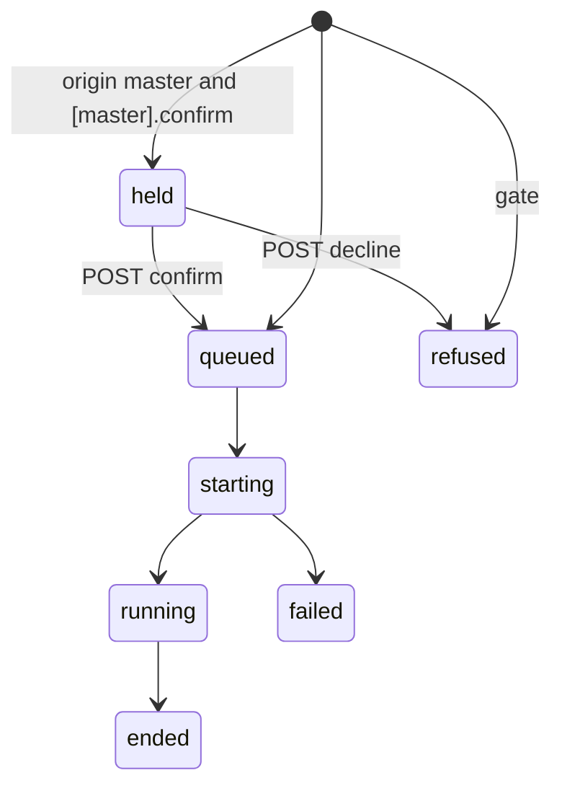
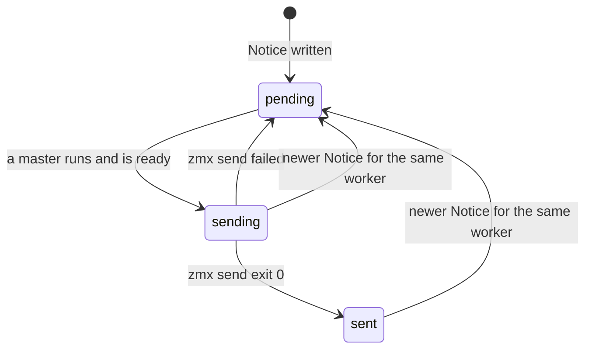

# Data Model: Master Session for Chat Dispatch

This file shows only the changes to the 024 data model (`specs/024-session-launch-intake/data-model.md`). The tables, states, and rules that are not named here stay the same.

## Intake (SQLite)

### `launches` (changed)

| Column | Type | Rule |
|---|---|---|
| `kind` | TEXT NOT NULL DEFAULT `'session'` | CHECK `kind IN ('session','master')`. At most one `master` row in `queued`, `starting`, or `running` (enforced by `POST /v1/master` inside one transaction). |
| `notified_turn` | INTEGER NULL | The last `cci-turn` value that got a Notice. NULL until the first turn Notice. Used only for Launches whose Trigger `source` is `master`. |
| `state` | TEXT | The CHECK adds `held`. |
| `project` | TEXT NULL | NULL for `kind = 'master'`. |

The master Launch has `host = 'local'`, `dir = [master].path`, `branch_request = NULL`, and `prompt = [master].prompt`.

### `triggers` (changed)

| Column | Change |
|---|---|
| `source` | Adds the value `master` (TypeScript type only, because the column has no CHECK). The Trigger ID is `master:<key or launch id>`. The Trigger of the master Launch itself uses `source = 'api'` and `kind = 'launch'`, with the ID `master-session:<launch id>`. |

### `notices` (new)

| Column | Type | Rule |
|---|---|---|
| `worker_id` | TEXT PRIMARY KEY REFERENCES launches(id) | One row for each Launch with origin `master`. |
| `text` | TEXT NOT NULL | The fixed-format line (`contracts/notices.md`). |
| `state` | TEXT NOT NULL | CHECK `state IN ('pending','sending','sent')`. |
| `updated_at` | TEXT NOT NULL | ISO time. The sender sends the oldest `pending` row first. |

A new Notice for the same worker replaces `text`, sets `state = 'pending'`, and sets `updated_at` to the current time, in one statement (`INSERT … ON CONFLICT(worker_id) DO UPDATE`). A row in `sending` that gets a new Notice also goes back to `pending`. The sender sends the new text on its next pass.

### Launch states

`held` is not in `LIVE` (`queued`, `starting`, `running`). It uses no host slot. `startNext` skips it. `stop` answers 409 for a `held` Launch, as 024 does for `queued`. Use `decline` to end it.

### Notice events

| Event | Condition | Notice `state` field |
|---|---|---|
| Reconcile tick | Launch `running`, origin `master`, `cci-state = idle`, `cci-turn` present and above `notified_turn` (or `notified_turn` is NULL) | `idle`, with `turn = cci-turn` |
| Launch change | origin `master`, new state `ended` | `ended` |
| Launch change | origin `master`, new state `failed` | `failed` |
| Launch change | origin `master`, new state `refused` (from `held` or the gate) | `refused` |

The Notice write and the `notified_turn` update are one transaction.

### Notice delivery

"Ready" means: the `master` Launch is `running`, and its `agent_state` is not NULL. This is the same rule that 024 T082 uses for follow-ups.

## Intake configuration (changed)

| Key | Type | Rule |
|---|---|---|
| `[master]` | table, optional | Without it, `POST /v1/master` answers 404, and `cci` exits 2. |
| `[master].path` | absolute path | Must exist. It does not need to be a Git checkout. |
| `[master].omp` | string array | `omp[0]` basename must be `omp`, as for projects. |
| `[master].launch_session` | string array | The same rule as for projects. |
| `[master].prompt` | string, optional | The opening prompt. Empty or missing: the master starts with no first turn. omp loads `AGENTS.md` from `path` into the system prompt. |
| `[master].confirm` | boolean | Default `false` (FR-050). |
| `[master].token_file` | path | The master token (research D4). The same mode rule as `token_file`: refused when group or other can read it. The Intake reads both token files at each request. When their contents are equal, it treats the request as shared (no master origin). |
| `[projects.*].description` | string, optional | A short text for `GET /v1/projects`. |
| `[projects.<key>]` key | string | Must match `^[A-Za-z0-9._-]+$`, so a Notice stays one line. The Intake refuses to start with any other key. |

## zmx labels (new)

| Label | Writer | Value | Reader |
|---|---|---|---|
| `cci-role` | Intake through `launch-session --label` | `master` | Emacs: sets the Session's `master` slot, Master section |
| `cci-origin` | Intake through `launch-session --label` | `master` | Emacs: the switch rule |
| `cci-turn` | omp at `agent_end`, in the same `zmx set` as `cci-state=idle` | decimal count of `agent_end` events in this omp process, starting at 1 | Intake: Notice rule |

All values are base64url, as in 021 `contracts/zmx-labels.md`.

## Package state (changed)

| Symbol | Kind | Role |
|---|---|---|
| `claude-code-ide-session` `master` slot | struct slot | Non-nil for the Master Session. Set from `cci-role` at attach. |
| `claude-code-ide-manager-item` `master` slot | struct slot | The same, and saved by `--serialize-item` and `--deserialize-item`. |
| `claude-code-ide--master-open-pending` | defvar | `(EMACS-HOST . NAME)` of the master that the open command waits for. EMACS-HOST is the Launch's `emacs_host`, nil for this machine. Rule 2 of the switch rule clears it. |
