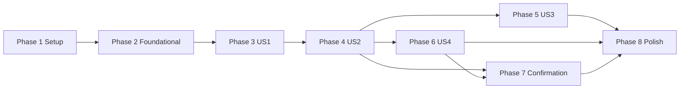

---

description: "Task list for the Master Session for chat dispatch"
---

# Tasks: Master Session for Chat Dispatch

**Input**: Design documents from `specs/025-master-session/`

**Prerequisites**: plan.md, spec.md, research.md, data-model.md, contracts/, quickstart.md

**Tests**: Constitution principle II requires ERT tests for new package logic. Each test proves an invariant with generated inputs and a fixed, printed seed (Intake `rng`/`seedFor`). A test must not copy the implementation. A bug test must fail without its fix.

**Paths**:
- `OMP/` means `~/agents/oh-my-pi/packages/coding-agent/`.
- `INTAKE/` means `~/agents/cci-intake/`.
- The package paths are relative to this repository.

**Rules**: Work on the current branch of each repository. Do not commit. Do not touch the user's own files (`TODOs.org` in omp and in `~/.spacemacs.d-30`, `lisp/init-ai.el`, `pkg-claude-code-ide.el`). No migration code: the schema changes need a fresh database (research D16).

## Format: `[ID] [P?] [Story] Description`

- **[P]**: The task can run in parallel. It touches other files and has no open dependency.
- **[Story]**: The user story (US1–US4) of the task.

---

## Phase 1: Setup

- [X] T001 Run the 024 gates before any 025 change: `./scripts/compile-and-test.sh` in this repository, `bun test` in INTAKE, and `bun run check` in `~/agents/oh-my-pi`. Record the counts. If a gate fails, stop and report the failure. Do not start Phase 2. Result (2026-11-09): package 1051 ERT tests, all pass; INTAKE 93 pass, 0 fail; omp `bun run check` pass.

---

## Phase 2: Foundational (blocks every story)

- [X] T002 [P] In INTAKE/src/config.ts, add the optional `[master]` table to the allowed root keys, with `path` (absolute, must exist, no Git check), `omp` (`omp[0]` basename must be `omp`), `launch_session`, `prompt` (not blank), `token_file` (required, same mode rule as the root `token_file`), and `confirm` (boolean, default `false`). Add the optional `description` string to each project and to the `Project` type. Export `MasterConf`. Add one row for each new rule to the bad-configuration table in INTAKE/test/config.test.ts, per data-model.md "Intake configuration". Include a master token file with mode 0644 (refused).
- [X] T003 [P] In INTAKE/src/db.ts, change the schema per data-model.md:
  - `launches`: add `kind TEXT NOT NULL DEFAULT 'session' CHECK(kind IN ('session','master'))` and `notified_turn INTEGER`. Add `held` to the `state` CHECK. Allow `project` to be NULL.
  - Add the table `notices(worker_id TEXT PRIMARY KEY REFERENCES launches(id), text TEXT NOT NULL, state TEXT NOT NULL CHECK(state IN ('pending','sending','sent')), updated_at TEXT NOT NULL)`.
  - Widen the types: Trigger `source` adds `master`, `LaunchState` adds `held`, and `NewLaunch` adds `kind`. `insertLaunch` writes `kind`.
  - Export `upsertNotice(workerId, text)` (one `INSERT … ON CONFLICT(worker_id) DO UPDATE` that sets `state='pending'` and `updated_at`), `pendingNotices()` (oldest first), `setNoticeState(workerId, state)`, and `setNotifiedTurn(id, turn)`.
  - Do not add `ALTER TABLE` code. Delete `~/.local/state/cci-intake/intake.db*` once before the first live run.
- [X] T004 [P] In INTAKE/test/helpers.ts, extend `FakeZmx`:
  - `fake-launch` keeps every `--label k=v` pair from its argv in the session labels.
  - It answers `zmx history <name>` with a settable text for each session (`history: Map<host, Map<name, string>>`), and exit 1 for an unknown name.
  - `testConfig(over)` accepts a `master` table. The default has none.
- [X] T005 [P] In INTAKE/src/http.ts `serialize`, add the field `kind` to the Launch object, per contracts/intake-http.md "The Launch object".
- [X] T006 [P] In claude-code-ide.el, add `claude-code-ide--zmx-label (entry key)`. It returns the base64url-decoded value of the `KEY` label of a parsed zmx entry (a `:cci-…` plist key from `claude-code-ide-zmx--parse-list-line`), or nil. Decode with `(base64-decode-string v t)` and `decode-coding-string … 'utf-8`. A bad value gives nil, not an error. Add an ERT round-trip property over generated UTF-8 strings (fixed seed, printed), and a case for a bad value, in claude-code-ide-tests.el.
- [X] T007 [P] In claude-code-ide-intake.el, give `claude-code-ide-intake--curl` optional `METHOD` and `BODY` arguments, per contracts/emacs-master.md "`claude-code-ide-intake--curl`":
  - Put `request`, `header = "Content-Type: application/json"`, and `data-binary` (or `data`) on the stdin configuration. Never put the token or the body in the argument list.
  - For the new callers, write the status with `--write-out` and do not use `--fail`. The callback gets `(STATUS BODY)`, or nil when curl cannot connect.
  - The existing GET callers (the SSE stream and the catch-up list) keep their current behavior and messages.
  - ERT in claude-code-ide-tests.el: for generated JSON bodies with quotes, backslashes, newlines, and non-ASCII text, the config text sent to curl gives back the exact body, and neither the token nor the body is in the `make-process` `:command`. Include a status parse case for 2xx, 4xx, and a connection failure.

**Checkpoint**: The new configuration, schema, test fakes, label decoding, and HTTP helper work, and their tests pass.

---

## Phase 3: User Story 1 - Open the Master Session (Priority: P1) 🎯 MVP

**Goal**: One Emacs command starts the Master Session through the Intake, or shows the existing one. It shows apart from all Project groups, and it survives an Emacs restart.

**Independent Test**: quickstart.md scenarios 1, 2, 3, and 15.

- [X] T008 [P] [US1] In OMP/src/commands/launch-session.ts, check `--cwd is not a Git checkout` only when `--branch` is given, per contracts/omp.md "`omp launch-session --cwd`". Update the matching cases in OMP/test/ (launch-session tests): a non-Git directory with no `--branch` starts the Session, and with `--branch` it fails as before. Add one line to OMP/CHANGELOG.md under `Unreleased`.
- [X] T009 [US1] In INTAKE/src/launches.ts, add `requestMaster()`, per research D1 and D11:
  - In one `tx`, return the `kind='master'` Launch in `queued`, `starting`, or `running` (200). Otherwise insert a Trigger `master-session:<id>` (`source='api'`, `kind='launch'`) and a Launch with `kind='master'`, `project=NULL`, `host='local'`, `dir=[master].path`, `branch_request=NULL`, and `prompt=[master].prompt` (202). Without `[master]`, answer 404 `no [master] in config`.
  - In `startLoop`, a `master` Launch uses `[master].launch_session` and `[master].omp`, adds `--label cci-role=master`, and never adds `--branch`.
  - The slot count leaves out `master` Launches, and `startNext` starts a queued master first, even when the host is full.
- [X] T010 [US1] In INTAKE/src/http.ts, add `POST /v1/master`, which calls `requestMaster` and answers through `reply(…, client)`, so a request with `?client=<name>` gets `emacs_host`. When `client` is given and names no `[[emacs]]` entry, answer 400 `unknown client: <name>` before `requestMaster`, as `/v1/events` does. Follow contracts/intake-http.md "`POST /v1/master`". In INTAKE/test/master.test.ts, test that `POST /v1/master?client=<known name>` for a `running` master returns the mapped `emacs_host`, that an answer with no `client` has no `emacs_host`, and that an unknown client gets 400 with no master recorded.
- [X] T011 [US1] Add INTAKE/test/master.test.ts:
  - **One master.** For generated counts (1–20) of concurrent `POST /v1/master` calls, mixed with ticks that end the master, at most one `master` Launch is live at any time. Every call during a live master gets that Launch. Print the seed.
  - **Slot bypass.** With the host full of `session` Launches, a master starts on the next `startNext`, and the session queue order does not change.
  - **Argv.** The fake launch argv has `--cwd [master].path`, `--label cci-role=master`, no `--branch`, and `[master].omp` after `--`.
  - **No config.** Without `[master]`, the answer is 404, and nothing is recorded.
- [X] T012 [P] [US1] Add the Master mark and the Master section, per research D13 and contracts/emacs-master.md "Master mark":
  - claude-code-ide.el: add a `master` slot to the Session struct. Set it from `(claude-code-ide--zmx-label entry "cci-role")` equal to `master`, in `claude-code-ide--attach-zmx-entry` and in the spawn adoption path (`claude-code-ide--attach-spawned-entry`). Never set it from a name or a directory.
  - claude-code-ide-manager.el: add a `master` slot to `claude-code-ide-manager-item`. Fill it in `make-item`, and save it in `--serialize-item` and `--deserialize-item`. In `--render`, draw the master rows under one `Master` heading before the Project groups. Leave them out of `--group-headings` and `--sorted-items`, so they belong to no group.
  - ERT in claude-code-ide-tests.el: an entry with `cci-role=master` (local and remote) gives a Session with the slot set. An entry without it gives nil, even with the same name and directory. The rendered manager shows the master row under `Master` and in no group. A serialized and restored item keeps the slot.
- [X] T013 [US1] In claude-code-ide.el, add the section "Master Session rules" with `claude-code-ide--master-open-pending` (a defvar) and `claude-code-ide--spawn-switch-p (entry host name)`. Implement rules 2 and 3 of contracts/emacs-master.md "Switch rule". Rule 2: the pair is equal to the pending pair, so return t and clear the variable. Rule 3: return `claude-code-ide-switch-on-spawn`. Replace the bare `claude-code-ide-switch-on-spawn` test in `claude-code-ide--attach-spawned-entry` with a call to this function. The `/spawn` and adopt paths keep their current results when nothing is pending.
- [X] T014 [US1] In claude-code-ide-intake.el, add the interactive command `claude-code-ide-master`, per contracts/emacs-master.md "Command `claude-code-ide-master`" and research D14:
  - Before any request, give a `user-error` when `claude-code-ide-intake-url` is nil, or when `(executable-find "curl")` is nil (constitution III).
  - It uses `--curl` with `POST /v1/master?client=<c>`. It polls `GET /v1/launches/{id}?client=<c>` every 1 s for up to 45 s, with `run-at-time`. `<c>` is `(url-hexify-string claude-code-ide-intake-client)`, as in pull mode. Without `client`, the Intake leaves out `emacs_host` (INTAKE/src/http.ts:35-36).
  - The Intake sets `name` and `running` in one change (INTAKE/src/launches.ts:158-159, :178-179), and it pushes its own adopt call at that moment (INTAKE/src/main.ts:12). So the poll cannot set the pending pair before `running`, and the push may arrive first.
  - Build the pair from the Launch's `emacs_host` (`:null` becomes nil) and `name`, as `claude-code-ide-intake--adopt` does. Never use the Launch's `host` key: for this machine it is `local`, and rule 2 would never match. When the Launch has no `emacs_host`, show one message that no Emacs target maps its host.
  - When an answer has state `running`, set `claude-code-ide--master-open-pending` to the pair first. Then:
    1. The Session is live: show it and clear the pending pair.
    2. The pair is in `claude-code-ide--pending-adoptions` (an attach from the push or pull mode is in flight): do nothing more. `claude-code-ide--attach-spawned-entry` decides the switch at attach time, so rule 2 shows the master.
    3. Otherwise: remove the pair from `claude-code-ide--adopted-sessions`, so a master that the user disconnected in this Emacs is attached again (spec edge case "disconnects the Master Session"). Then call `claude-code-ide-intake--adopt` with the Launch, and rule 2 shows the master.
  - The 45 s limit or a `failed` state clears the pending pair.
  - Add `declare-function` forms for the functions from claude-code-ide.el.
  - ERT in claude-code-ide-tests.el, with the `--with-intake` mocks:
    - A nil URL gives a `user-error`. A missing `curl` gives a `user-error`, and no process starts.
    - A connection failure gives one message that names the URL, and makes no adopt call and no switch. A 5xx answer gives one message with the status, and the same "nothing started" result.
    - A 404 and a 400 `unknown client` each show the `error` text, with no poll and no adopt.
    - A `running` and live master is shown with no adopt call.
    - A `running` master that is not live (the Emacs restart path, SC-005) is adopted once and shown.
    - A `starting` master is adopted after the poll sees `running`, and rule 2 shows it once.
    - The push adoption is in flight when the poll sees `running`, with `claude-code-ide-switch-on-spawn` nil: the master is shown once, and the poll makes no second adopt call.
    - The master was adopted and then disconnected in this Emacs: the command attaches it again and shows it.
    - A local master (`emacs_host` null) gives the pair `(nil . NAME)`, and rule 2 matches it.
    - Both request URLs carry `client=` with the encoded value of `claude-code-ide-intake-client`. Test it with a client name that has a space or a `&`.
    - A `failed` master gives one message with the reason.
    - The 45 s limit stops the poll and clears the pending pair.
- [X] T015 [US1] Document the Master Session: setup and `claude-code-ide-master` in README.org and docs/zmx.org, and the terms Master Session, Worker Session, and Notice in CONTEXT.md.

**Checkpoint**: `M-x claude-code-ide-master` starts or shows the one master, and the manager shows it under `Master`.

---

## Phase 4: User Story 2 - Dispatch work from chat without a focus change (Priority: P1)

**Goal**: The master launches Workers through `cci`. Each Worker is marked with origin `master`, and its adoption never moves the focus.

**Independent Test**: quickstart.md scenarios 4–7.

- [X] T016 [US2] Add the master token and `main_checkout`, per contracts/intake-http.md "Master token" and "`POST /v1/launches` (changed)", and research D4 and D5:
  - INTAKE/src/http.ts: check the bearer token against the shared token and against `[master].token_file` (read at each request, with `timingSafeEqual`). Pass `isMaster` to the route handlers. The content of the two files must differ: if they are equal, treat the request as shared.
  - INTAKE/src/launches.ts `requestLaunch(body, isMaster)`: validate all the new 400 cases before any write. With `isMaster`, record the Trigger `master:<key|id>` with `source='master'`. `main_checkout: true` gives `branch_request=NULL`. A `worktree` object keeps the 024 branch rule.
  - In `startLoop`, a Launch whose Trigger source is `master` adds `--label cci-origin=master`.
  - Other origins keep the 024 behavior.
- [X] T017 [US2] Extend INTAKE/test/http.test.ts:
  - Each new 400 case records nothing.
  - For generated requests with the master token and exactly one checkout choice, the Launch has `origin.source = master`, `branch_request` matches the choice, and the fake launch argv has `cci-origin=master`.
  - The same key gives the same Launch.
  - A shared-token request with no `worktree` still runs in the main checkout and gets no `cci-origin` label, whatever its body says. Print the seed.
- [X] T018 [P] [US2] Add INTAKE/src/cli.ts and the `package.json` entry `"bin": { "cci": "src/cli.ts" }`, per contracts/cci-cli.md and research D9. The first line of the file is `#!/usr/bin/env bun`, and the file is executable, so the link from quickstart.md "Setup" step 5 runs it:
  - Read `listen` and `[master].token_file` through `loadConfig()`, with `--config` as an override. Send only the master token, and only in the request header. Without `[master]`, exit 2 with `no [master] in config`.
  - Each subcommand makes one call. `launch` reads the prompt from stdin and sends `worktree: {branch?}` unless `--main` is given. With `--main` it sends `main_checkout: true`. `send` reads the text from stdin. `output` prints the text between the UNTRUSTED marker lines.
  - Exit codes: 1 with the `error` text on stderr for a non-2xx answer. 2 with `Intake at <url> is not reachable` for a connection failure.
- [X] T019 [P] [US2] Add INTAKE/test/cli.test.ts. Start `handle` on a `Bun.serve` test port with a shared test token, a different master test token, and the fake runner. Then:
  - Run each subcommand as a child process (`bun src/cli.ts …`), with generated prompt texts that include quotes, newlines, and non-ASCII. The recorded request has the exact method, path, and body. A `launch` without `--main` has a `worktree`, and with `--main` it has `main_checkout`.
  - Every recorded request carries the master token, and every recorded Launch has `origin.source = master`. No token is in the child argv, stdout, or stderr.
  - A 4xx answer gives exit 1, and a closed port gives exit 2. Print the seed.
- [X] T020 [US2] In claude-code-ide.el `claude-code-ide--spawn-switch-p`, add rule 1: an entry with `cci-origin` equal to `master` returns nil, before rules 2 and 3. ERT in claude-code-ide-tests.el with `claude-code-ide-tests--with-spawn-adoption`: the property table of contracts/emacs-master.md over every combination of label (none, `master`, other), pending (none, same pair, other pair), and option (t, nil), for a local and for a remote entry. `switched` must match the table. Rule 1 must also hold when the pending pair is set to the Worker's pair.

**Checkpoint**: The master dispatches Workers in the right project, and the selected window stays on the master.

---

## Phase 5: User Story 3 - Track and steer Launches from the chat (Priority: P2)

**Goal**: The master lists all Launches, reads recent output on any host, and sends text to or stops any Launch.

**Independent Test**: quickstart.md scenario 8.

- [X] T021 [P] [US3] In INTAKE/src/hosts.ts, add `zmxHistory(host, name)`. It checks `NAME_RE`, runs `zmx history <name>` through `run`, and throws with the exit code when the code is not 0. In INTAKE/src/http.ts, add `GET /v1/launches/{id}/output?lines=N`, per contracts/intake-http.md, and keep the last `N` lines.
- [X] T022 [P] [US3] In INTAKE/src/http.ts, add `GET /v1/projects`, per contracts/intake-http.md. It lists the projects in config order, with `description` set to `null` when a project has none.
- [X] T023 [US3] Extend INTAKE/test/http.test.ts for T021 and T022:
  - For generated history texts and every `lines` value at the bounds (1, 2, 1999, 2000) plus random values, the text is equal to the last `N` lines of the history.
  - 0, 2001, and non-integers give 400. A Launch that is not `running` gives 409. A failing history command gives 502.
  - A remote Launch runs history through ssh in the fake runner.
  - Projects come in config order. Print the seed.

**Checkpoint**: `cci list`, `cci output`, `cci send`, and `cci stop` work for Launches from every origin.

---

## Phase 6: User Story 4 - The master gets a Notice when a Worker finishes (Priority: P2)

**Goal**: Each new finished turn, end, failure, or refusal of a master Worker gives exactly one fixed-format Notice in the running master.

**Independent Test**: quickstart.md scenarios 9–13.

- [X] T024 [P] [US4] In omp, publish `cci-turn`, per contracts/omp.md "Label `cci-turn`" and research D6:
  - OMP/src/session/sibling-spawn.ts: `publishState(state, work?, turn?)` adds `cci-turn=<b64url(turn)>` to the same `zmx set` call when `turn` is given.
  - OMP/src/modes/interactive-mode.ts: keep a counter of `agent_end` events, and pass it with `idle` in `#publishSpawnState`.
  - Test: after two `agent_end` events, each `zmx set` argument list has `cci-state` and `cci-turn` together, with the turn values 1 and then 2. Add a CHANGELOG line.
- [X] T025 [US4] In INTAKE/src/launches.ts, add `noticeText(launch, state, turn)` per contracts/notices.md "Text". In `reconcile`, for each `running` Launch with Trigger source `master`: when `cci-state` is `idle`, `cci-turn` is present, and `cci-turn` is above `notified_turn` (or `notified_turn` is NULL), call `upsertNotice` and `setNotifiedTurn` in one `tx`. Do this apart from the `agent_state` change test, so a turn that ended between two ticks still counts.
- [X] T026 [US4] In INTAKE/src/main.ts, the Launch change listener calls `upsertNotice` when a Launch with Trigger source `master` changes to `ended`, `failed`, or `refused` (turn `-`).
- [X] T027 [US4] In INTAKE/src/launches.ts, add `sendNotices()`, per contracts/notices.md "Delivery rules":
  - It runs on the per-Launch chain of the `master` Launch that is `running` and has `agent_state` set. Without such a master, it does nothing.
  - For each pending row, oldest first: set `sending`, run `zmx send <master> <packet('queue', text)>`, then set `sent` on exit 0, or `pending` again on any other result.
  - In `recover()`, set every `sending` row back to `pending`, so a crash between `sending` and `sent` cannot lose a Notice (FR-045). A duplicate Notice is the accepted cost (research D6).
  - Call it after each reconcile tick, after each `upsertNotice`, and when the master Launch first gets `agent_state`.
- [X] T028 [US4] Add INTAKE/test/notices.test.ts:
  - **Turn rule.** Generate rising turn sequences for a Worker, and sample them at random tick points, so that several turns can fall between two ticks. The count of Notices is equal to the count of ticks where the sampled idle turn is above the last notified turn. Each Notice holds the newest sampled turn, and no turn gets two Notices.
  - **Restart.** Reopen the database with `freshDb().restart` and tick again. No new Notice for a turn that was already sent. A row left in `sending` before the restart is sent once after `recover()`.
  - **Master down.** With no running master, 3 Workers each end several turns. Then a master becomes ready, and it gets exactly 3 sends, one per Worker, each with the newest text.
  - **Send failure.** A failing `zmx send` returns the row to `pending`, and the next tick sends it once.
  - **Origin.** Launches from `api` and `linear` never get a Notice.
  - **Text.** For generated Launches, the text matches the contracts/notices.md pattern exactly. No `reason` and no history text appear, even when the Worker's history and reason contain `cci launch` text.
  - Print the seed.

**Checkpoint**: Notices arrive once for each new turn, end, failure, or refusal, and they wait while no master runs.

---

## Phase 7: Confirmation (FR-050–FR-052, part of US2)

**Goal**: With `[master].confirm = true`, a master Launch waits in `held` until the user answers in Emacs.

**Independent Test**: quickstart.md scenario 14.

- [X] T029 [US2] In INTAKE/src/launches.ts and INTAKE/src/http.ts, add the `held` flow, per research D12 and contracts/intake-http.md "`POST /v1/launches/{id}/confirm` and `/decline`":
  - With `confirm = true`, an accepted request with the master token inserts the Launch in `held`.
  - `startNext` and the slot count skip `held`.
  - `confirm` changes `held` to `queued`. `decline` changes `held` to `refused`, with `reason = "declined by user"`. Both answer 409 for any other state.
  - INTAKE/src/http.ts: `confirm` and `decline` answer 403 to the master token. `cci` gets no subcommand for them.
  - Extend INTAKE/test/master.test.ts:
    - A held Launch never starts and uses no slot.
    - `confirm` starts it.
    - `decline` refuses it, and T026 writes a `refused` Notice.
    - Both routes give 409 for any other state, and 403 to the master token, with the Launch unchanged.
- [X] T030 [US2] In claude-code-ide-intake.el, add the interactive command `claude-code-ide-intake-confirm`, per contracts/emacs-master.md "Command `claude-code-ide-intake-confirm`". Before any request, give a `user-error` when `claude-code-ide-intake-url` or `(executable-find "curl")` is nil (constitution III). In `claude-code-ide-intake--event`, a `launch` event with state `held` shows one message that names the command. ERT in claude-code-ide-tests.el:
  - A nil URL and a missing `curl` each give a `user-error`, and no process starts.
  - An empty list shows one message.
  - With two held Launches, the command asks with `completing-read`.
  - The `yes-or-no-p` question holds the project, the host, and the full prompt.
  - Yes posts `confirm`, and no posts `decline`.
  - The selected window does not change.
  - A `held` event shows the message once and makes no adopt call.

**Checkpoint**: Held Launches wait, and the user can confirm or decline them from Emacs.

---

## Phase 8: Polish & Cross-Cutting Concerns

- [X] T031 [P] Update INTAKE/README.md with the `[master]` table, `cci`, Notices, the confirmation setting, and an example master `AGENTS.md` (user file, per quickstart.md "Setup" step 3). The example has every rule of that step, including the FR-014 reply rule and the FR-016 host rule. Document the `cci` link step from quickstart.md "Setup" step 5.
- [X] T032 [P] Check AGENTS.md in this repository against the new files, functions, and rules. Update it only where it is now wrong.
- [X] T033 Run all gates: `./scripts/compile-and-test.sh`, `bun test` in INTAKE, and `bun run check` plus `bun run test` in `~/agents/oh-my-pi`. Report the counts and any failure honestly. Result (2026-11-09): package 1067 ERT tests, 1052 pass, 15 skipped, 0 unexpected. INTAKE 127 pass, 0 fail. omp `bun run check` pass. omp `bun run test` stops at `packages/ai`: 1 fail in `auth-storage-api-key-login.test.ts` (key rotation). This feature does not change `packages/ai`. The `packages/coding-agent` suite alone: 21677 pass, 346 skip, 0 fail.
- [X] T034 Run the quickstart.md scenarios 1–16 live, on the local host and `v12dev`. Use `~/bin/emacsclient --eval` for Emacs steps. Record each result. Afterward, stop the test Launches and the master, and remove the test directories. Leave the user's own zmx sessions alone. Result (2026-11-09): all 16 pass. Scenario 12 had 4 Workers, not 3, because a full local host required a stop. Each Worker got exactly one Notice with its newest text. Scenario 15 killed the master buffer in Emacs instead of a full Emacs restart. Scenario 14 answered `yes-or-no-p` through a one-shot advice.

---

## Dependencies & Execution Order

- US2 needs US1, because Workers come from a running master. US3 and US4 need US2's `origin` field. US3 and US4 do not depend on each other.
- Phase 7 needs US4 (T026), because a declined Launch is reported by a Notice.
- Inside each phase, the tests sit next to their code task. The same-file tasks run in order: INTAKE/src/launches.ts (T009, T016, T025, T027, T029), INTAKE/src/http.ts (T010, T021, T022, T029), and claude-code-ide.el (T006, T012, T013, T020).

## Parallel Examples

- **Phase 2**: T002, T003, T004, T005, T006, and T007 touch different files. They can run together.
- **US1**: T008 (omp) and T012 (package manager) can run beside T009–T011 (Intake).
- **US2**: T018 and T019 (`cci`) can run beside T016 and T017 (`requestLaunch`) and T020 (package).
- **US3 and US4**: T021 and T022 (Intake http and hosts) can run beside T024 (omp).

## Implementation Strategy

1. **MVP**: Phases 1–3. The user opens a master in Emacs and chats with it. Dispatch still needs `cci` from Phase 4.
2. **Dispatch**: Phase 4 gives the full chat-to-Worker path with no focus change. This replaces the Mac app.
3. **Tracking and Notices**: Phases 5 and 6 add status, output, and reports.
4. **Confirmation**: Phase 7 is optional for the user. It is off by default.
5. **Close**: Phase 8 runs the gates and the live scenarios.

## Phase 9: Convergence

- [X] T035 Add the `prompt` field to the Launch object in INTAKE/src/http.ts `serialize`, document it in contracts/intake-http.md "The Launch object", and add an INTAKE test that `GET /v1/launches?state=held` returns each held Launch's prompt, so the `claude-code-ide-intake-confirm` question shows the opening prompt instead of nil per FR-051 (partial)
- [X] T036 Keep the Master mark when the manager reattaches a remembered master row: carry the item's `master` flag into the session made by `claude-code-ide--reattach-target` (claude-code-ide.el:2517-2531), or fall back to the existing item's flag at claude-code-ide-manager.el:2082, and add an ERT test (local and remote) that a reattached persisted master row stays under `Master` per FR-004, FR-005, SC-005 (partial)
- [X] T037 Clear `claude-code-ide--master-open-pending` when an adopt that `claude-code-ide-master` started ends without a live Session (the attach fails or the zmx entry is missing), so a later manual attach of that name does not switch, with an ERT test per contracts/emacs-master.md "Command `claude-code-ide-master`" (partial)
- [X] T038 Make `claude-code-ide-intake--check` signal a `user-error` that names `claude-code-ide-intake-token-file` when the token file is missing or unreadable, before `claude-code-ide-master` or `claude-code-ide-intake-confirm` starts a process, with an ERT test per Constitution III (partial)
- [X] T039 In INTAKE/src/cli.ts, read the master token file before the request `try`, and exit 2 with a token-file message (never the token) when it cannot be read, so only a connection failure prints `Intake at <url> is not reachable`, with a case in INTAKE/test/cli.test.ts per contracts/cci-cli.md (contradicts)
- [X] T040 In INTAKE/src/config.ts, refuse project keys that do not match `^[A-Za-z0-9._-]+$`, so a Notice stays one line with valid fields, and add a row to the bad-configuration table in INTAKE/test/config.test.ts per contracts/notices.md "Text" (partial)

## Phase 10: Convergence

- [X] T041 Document that `claude-code-ide-master` and `claude-code-ide-intake-confirm` also need a readable `claude-code-ide-intake-token-file`: update the sentence at docs/zmx.org:202 and the first row of both command tables in contracts/emacs-master.md per T038, Constitution III (partial)
- [X] T042 Document the project-key rule `^[A-Za-z0-9._-]+$` (the Intake refuses to start otherwise) in the INTAKE/README.md configuration text and in the data-model.md "Intake configuration" table per T040, contracts/notices.md "Text" (partial)
