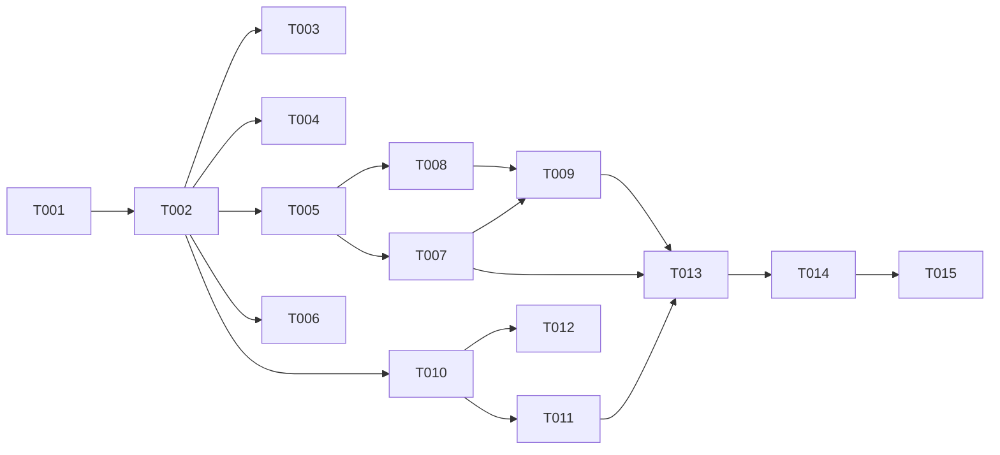

---

description: "Task list for per-host project paths"
---

# Tasks: Per-Host Project Paths

**Input**: Design documents from `specs/026-per-host-paths/`

**Prerequisites**: plan.md, spec.md, research.md, data-model.md, contracts/, quickstart.md

**Tests**: Each test proves a rule with generated inputs and a fixed seed that the test prints (Intake `rng`/`seedFor` helpers). A test must not copy the implementation.

**Paths**: `INTAKE/` means `~/agents/cci-intake/`. The `specs/` paths are relative to this repository.

**Rules**:
- Work on the current branch of each repository.
- Do not commit.
- Do not touch the user's own files: `TODOs.org` in each repository, `lisp/init-ai.el`, and `pkg-claude-code-ide.el`.
- No compatibility code: `Project.path`, `Project.omp`, and `Project.launch_session` are removed (research D2), and `GET /v1/projects` drops `path` (D7).

## Format: `[ID] [P?] [Story] Description`

- **[P]**: The task can run in parallel. It touches other files and has no open dependency.
- **[Story]**: The user story (US1–US3) of the task.

---

## Phase 1: Setup

- [X] T001 Run the gates before any change: `bun test` in INTAKE and `./scripts/compile-and-test.sh` in this repository. Record the counts. If a gate fails, stop and report the failure.
  - Result: INTAKE 130 pass, 0 fail. Package 1070 tests, 0 unexpected, 15 skipped.

---

## Phase 2: Foundational (blocks every story)

**Purpose**: Resolve the per-host values at load, so that every caller reads one record for each host (research D1–D4).

- [X] T002 In INTAKE/src/config.ts:
  - Add `export type HostRun = { path: string; omp: string[]; launch_session: string[] }`.
  - Replace `Project.path`, `Project.omp`, and `Project.launch_session` with `on: Record<string, HostRun>`.
  - Make `MasterConf` use the same three field types, so that a `HostRun` can come from the master or from a project.
  - Add a `perHost(v, key, hosts, parse)` helper. A string or an array is one value for all hosts. A table is resolved per contracts/intake-config.md "Refusals at start":
    - A key that is not a project host and is not `default` is refused.
    - Each host takes its own entry, or else the `default` entry, or else the start is refused.
    - Each entry, also an unused `default` entry, is checked with `parse` under the key `<key>.<entry>`.
  - Use `str` for `path`, `ompArgv` for `omp`, and `strs(…, true)` for `launch_session`.
  - Build `on` in `hosts` order.
  - In the `[hosts]` loop, refuse the name `default` with `"default" is reserved for the fallback entry of a per-host table`.
- [X] T003 [P] In INTAKE/test/helpers.ts, make `testConfig()` build `projects.api.on` for `local` and `v12`. Give each host a different path and a different omp array, so that a later test can tell the hosts apart. Update the other test files that build a `Project` by hand to set `on` instead of `path`, `omp`, and `launch_session`: INTAKE/test/linear.test.ts and INTAKE/test/notices.test.ts. Also update any other test file that `grep -n "path:\|omp:" INTAKE/test` shows on a `Project`.
- [X] T004 [P] In INTAKE/test/config.test.ts:
  - Add rows to the bad-configuration table for each refusal in contracts/intake-config.md: `[hosts.default]`, an extra table key, a missing host without `default`, a bad `path` entry, an `omp` entry whose program is not omp (in a host entry and in an unused `default` entry), and an empty `launch_session` entry. Each expected message must hold the project, the key, and the host.
  - Add a seeded property test. Generate a random host list (1–4 hosts from a pool), and a random table for `path` with or without `default`. Some tables must hold an extra key. Check two things:
    - The load succeeds exactly when there is no extra key and every host has its own entry or a `default` entry.
    - On success, `on[h].path` equals the host's own entry, or else the `default` entry.
  - Keep the reference rule as a small separate function in the test, and print the seed.
  - Add one case that loads the single-string form and checks that every host gets the same value (FR-008).

**Checkpoint**: `bun test test/config.test.ts` passes. The other test files may fail until US1 and US2 are done.

---

## Phase 3: User Story 1 - One project, a different checkout on each host (Priority: P1) 🎯 MVP

**Goal**: A Launch on a host records the path of that host.

**Independent Test**: Request a Launch for `api` on `local` and on `v12`. Each Launch row's `dir` is the path of its host.

- [X] T005 [US1] In INTAKE/src/launches.ts `requestLaunch`, set `dir` to `project.on[host]!.path`. `host` is the request host or `default_host`, and it is checked against `project.hosts` before this line.
- [X] T006 [P] [US1] In INTAKE/src/linear.ts, set `dir` to `project.on[project.default_host]!.path` when a project matches, and keep `null` otherwise (research D6).
- [X] T007 [US1] In INTAKE/test/launches.test.ts, add a test. For generated prompts, request a Launch for each host of `api` with no host, with `host: "local"`, and with `host: "v12"`. Check that each row's `dir` equals `testConfig().projects.api.on[<row host>].path`. Check that the `dir` of the two hosts differs. Then, per FR-006, change `api.on.v12.path` in the loaded config, call `restart()` on the `TestDb` from the test's own `freshDb()`, and check that every recorded row keeps its first `dir`. In INTAKE/test/linear.test.ts, check that an accepted issue gets the `dir` of the default host.

**Checkpoint**: US1 works. A Launch records the right checkout for its host.

---

## Phase 4: User Story 2 - A different omp command on each host (Priority: P1)

**Goal**: A Launch starts with the `launch-session` command and the omp command of its host.

**Independent Test**: Start one Launch on each host through `FakeZmx` and a recording runner. The `v12` start uses only the `v12` commands.

- [X] T008 [US2] In INTAKE/src/launches.ts, Launch start, replace `conf = isMasterSession ? config.master : config.projects[launch.project!]` with a `HostRun`: `config.master` for the master, or `config.projects[launch.project!]?.on[host]` for a Worker. Keep the existing failure when it is missing, and name the host in the reason when the project exists but has no record for the host. Build `argv` from `run.launch_session` and `run.omp`. Depends on T005 (same file).
- [X] T009 [US2] In INTAKE/test/launches.test.ts, add a test with a recording runner, as in the existing `setRunner` tests. Give `api` a different `launch_session[0]` and `omp` for `local` and for `v12`. Start one Launch on each host. Check that each start runs on its own host, that its argv starts with its host's `launch_session`, and that its argv ends with its host's `omp` after `--`. Check that it never holds the other host's commands. Check that a master start still uses the `[master]` commands.
  - The master check is in INTAKE/test/master.test.ts "argv: the master runs [master] commands…": the argv starts with `[master].launch_session`, `--cwd` is `[master].path`, and the argv ends with `[master].omp`.

**Checkpoint**: US1 and US2 work. One project runs on the MacBook and on v12dev.

---

## Phase 5: User Story 3 - The Master Session sees each host's path (Priority: P2)

**Goal**: `GET /v1/projects` and `cci projects` show each host with its path.

**Independent Test**: `GET /v1/projects` returns `paths` with one entry for each host, in `hosts` order, and no `path` field.

- [X] T010 [US3] In INTAKE/src/http.ts `GET /v1/projects`, replace `path: p.path` with `paths: Object.fromEntries(p.hosts.map((h) => [h, p.on[h]!.path]))`, per contracts/intake-http.md.
- [X] T011 [US3] In INTAKE/test/http.test.ts, change the projects test to expect `paths`, with its keys in `hosts` order and its values from `on`. Also check that no project object has a `path` key.

**Checkpoint**: All user stories work.

---

## Phase 6: Polish & Cross-Cutting Concerns

- [X] T012 [P] In INTAKE/README.md:
  - Show a project with `hosts = ["local", "v12dev"]`, a `path` table, an `omp` table, and a `launch_session` table with a `default` entry.
  - Explain the two value forms, the `default` entry, and the refusals in one short paragraph.
  - State that `default` is not a valid host name.
  - Change the `GET /v1/projects` example and the `cci projects` text from `path` to `paths`.
- [X] T013 Search INTAKE/src and INTAKE/test for leftover uses of a project's `.path`, `.omp`, or `.launch_session` outside `on[...]` and the master: `grep -rn "project\.\(path\|omp\|launch_session\)\|p\.path\|conf\.omp" INTAKE/src INTAKE/test`. Remove each one.
  - Result: the wider search `\.(path|omp|launch_session)\b` finds only `[master]` fields, `HostRun` reads, and test text. There is no leftover. INTAKE has no type checker, so the tests are the only check.
- [X] T014 Run the gates: `bun test` in INTAKE, with 0 fail and the seed printed, and `./scripts/compile-and-test.sh` in this repository, with 0 unexpected. Record the counts in this task.
  - Result: INTAKE 145 pass, 0 fail, with the seeds printed. Package 1070 tests, 0 unexpected, 15 skipped.
- [X] T015 Run quickstart.md live scenarios 1–8 with the Intake, the MacBook, v12dev, and Emacs. Record each result in this task. Then do the quickstart Cleanup.
  - Setup change: the v12dev omp at `/home/yufu/.bun/bin/omp` runs `~/agents/oh-my-pi` at `c0b5e1f0b1`, which has no `launch-session` flags. The v12dev entries used a fork `main` worktree at `/home/yufu/tmp/omp-026` (`66e4fa2377`) instead. The first scenario 3 try with the old build failed with `unknown flags: --branch, --label, --label, --json`.
  - 1 pass: `paths` for `p026` is `local` → `/private/tmp/cci-026`, `v12dev` → `/home/yufu/tmp/cci-026`.
  - 2 pass: host `local`, a worktree of `/private/tmp/cci-026`, `LOCAL.md` made, and Emacs attached the session.
  - 3 pass: host `v12dev`, a worktree of `/home/yufu/tmp/cci-026`, the v12dev omp build, `REMOTE.md` made, and Emacs attached the session over TRAMP.
  - 4 pass: `--main` gives the `dir` `/private/tmp/cci-026`.
  - 5 pass: the master started a Launch on v12dev in a worktree of `/home/yufu/tmp/cci-026`, and it reported the Launch with its project and host.
  - 6 pass: `omp = ["/tmp/omp-026/omp"]` and `launch_session = { default = [...] }`. On each host, `/tmp/omp-026/omp` is a wrapper that runs that host's fork build. A v12dev Launch started.
  - 7 pass: the three changed configs stop the Intake with `projects.p026.path: no value for host "v12dev" and no default entry`, `projects.p026.path.nope: "nope" is not in projects.p026.hosts`, and `hosts.default: "default" is reserved for the fallback entry of a per-host table`.
  - 8 pass: `e2e` (one `path` value) started `--main` in `/private/tmp/cci-e2e`.
  - Cleanup done: the test Launches and the test master are stopped. `[projects.p026]` is removed. The scratch repos, worktrees, wrappers, and the v12dev omp worktree are deleted. `claude-code-ide-intake-mode` is off again.

---

## Dependencies & Execution Order

- Phase 1, then Phase 2. T002 comes first. T003 and T004 can run together after T002.
- US1 (T005–T007) depends on Phase 2.
- US2 (T008–T009) depends on T005, because both change INTAKE/src/launches.ts. T009 also depends on T007, because both change INTAKE/test/launches.test.ts.
- US3 (T010–T011) depends only on Phase 2. It can run beside US1 and US2.
- Polish depends on all stories. T012 can start after T010.

## Parallel Examples

- After T002: T003 (fixtures) beside T004 (config tests).
- In US1: T006 (`linear.ts`) beside T005 (`launches.ts`).
- US3 (`http.ts`, `http.test.ts`) beside US1 and US2.

## Implementation Strategy

1. **MVP**: Phases 1–3 (US1). A Launch records the right checkout for each host. Do not use this alone across hosts, because the omp command is still the one value until US2. Ship US1 with US2.
2. **Increment**: US2 makes the commands per host. After US2, one project runs on both machines.
3. **Increment**: US3 shows the paths to the Master Session.
4. **Finish**: Polish, gates, and the live quickstart.

## Phase 7: Convergence

- [X] T016 In INTAKE/test/launches.test.ts "per host: a Launch records its host's path…", always request one Launch with no host, one with `host: "local"`, and one with `host: "v12"` before the random ones; set `max_sessions` above the Launch count; check that the `dir` of the two hosts differs per FR-006, US1/AC1–AC2 (partial)
- [X] T017 In INTAKE/test/launches.test.ts "per host: each start runs its host's launch_session…", start at least one Launch on each host; check that no argv holds the other host's `launch_session[0]` or `omp[0]` per US2/AC1, FR-005 (partial)
  - Result for T016 and T017: both tests pass with the default seed and with `SEED=1` to `SEED=20`. INTAKE 145 pass, 0 fail.
