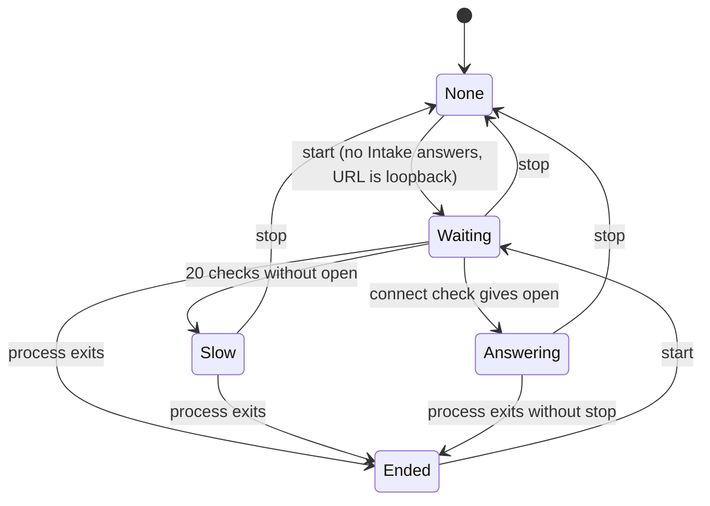

# Data Model: Start the Intake from Emacs

## Intake command setting

`claude-code-ide-intake-command`: a user option, a list of strings or `nil` (default).

- The first string is the program, and the rest are its arguments.
- Emacs runs it in the user's home directory (research D1).
- `nil` means that Emacs never starts the Intake.

## Managed Intake

One internal variable holds the process that this Emacs started, or `nil`.

| Field | Source | Use |
|---|---|---|
| process | `make-process` | Signal, liveness, and exit status |
| buffer | `*claude-code-ide-intake*` | All output since the last start, with the process status in the mode line |
| stopping | set by stop | When set, the sentinel shows no "ended" message |

### States

- **None**: no managed process. A start makes one, unless an Intake already answers.
- **Waiting**: the process runs, and the start wait checks it every 0.5 seconds.
- **Answering**: the process runs and accepts connections.
- **Slow**: the process runs, but it did not answer within 10 seconds. Emacs told the user once.
- **Ended**: the process exited without a stop. Emacs told the user once, and it keeps the buffer. A start erases the buffer and starts again.

Each `start` from Waiting, Slow, or Answering shows "already runs" and changes nothing.
