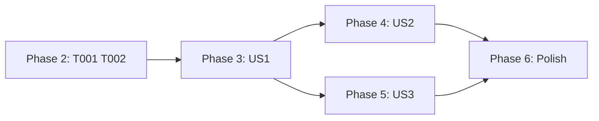

# Tasks: Start the Intake from Emacs

**Input**: Design documents from `specs/027-intake-from-emacs/`

**Prerequisites**: plan.md, spec.md, research.md, data-model.md, contracts/emacs-commands.md, quickstart.md

**Tests**: Included. Constitution II requires ERT tests for new logic. Each test proves a contract row, and a seeded test prints its seed.

**Organization**: Tasks are grouped by user story. All code goes into `claude-code-ide-intake.el` and `claude-code-ide-tests.el`. Tasks in the same file are not `[P]`.

## Phase 1: Setup

None. The file, the group, and the test harness already exist.

## Phase 2: Foundational (blocks all stories)

- [X] T001 In `claude-code-ide-intake.el`, add the following (research D1–D4):
  - `defcustom claude-code-ide-intake-command`: type `(choice (const nil) (repeat string))`, default `nil`.
  - `defvar claude-code-ide-intake--managed`: the managed process or `nil`.
  - `defvar claude-code-ide-intake--stopping`.
  - `defconst` buffer name `*claude-code-ide-intake*`.
  - `claude-code-ide-intake--loopback-p URL`: true for host `localhost`, `[::1]`, or a host that starts with `127.`, through `url-generic-parse-url`.
  - `claude-code-ide-intake--answers CALLBACK`: a `make-network-process :nowait t :noquery t` to the URL host and port. It calls CALLBACK once with t for a first event `"open\n"` and nil otherwise, and it deletes the connection. A connect error also gives nil.
- [X] T002 In `claude-code-ide-tests.el`, add the macro `claude-code-ide-tests--with-intake-process`. It expands inside `claude-code-ide-tests--with-intake`, so it reuses that macro's token file, its `make-process` mock (SPAWNED holds each call with its ARGS, so `:command` too), its `run-at-time` mock (TIMERS), and its local functions `curl-for`, `finish`, and `fire`. Do not add a second `make-process` mock. Inside, it binds the URL to `http://127.0.0.1:7311`, the Intake command setting to `("fake-intake" "--run")`, and `--managed` and `--stopping` to nil. It adds these mocks:
  - `make-network-process`: records the host and port, and returns a pipe process. The local function `answer (open-p)` fires the sentinel of the newest connection with `"open\n"` or `"failed with code 61\n"`.
  - `signal-process`: records (PROCESS SIGNAL). For `SIGKILL`, it also deletes the process, as the real signal ends it.
  - `accept-process-output`: returns nil at once, and calls ON-WAIT, a local variable that a test can set to a function. For example, a test can end the process after `SIGTERM`. So no test waits in real time (research D7).
  - `message`: records the text in MESSAGES.

  Add these local functions:
  - `intake-process`: the newest SPAWNED process whose `:command` starts with `"fake-intake"`. Curl processes have `:command` that starts with `"curl"`, and `curl-for` still finds them.
  - `exit-with (code output)`: inserts OUTPUT into the Intake buffer, then calls `finish` on `intake-process` with `"finished\n"` for code 0, or `"exited abnormally with code CODE\n"` for another code.

  The `--with-intake` cleanup deletes every process at the end.

**Checkpoint**: The helpers compile, and the macro is ready.

## Phase 3: User Story 1 - Start and stop the Intake from Emacs (P1) 🎯 MVP

**Goal**: One command starts the Intake, one command stops it, one command restarts it, and one command shows its output.

**Independent Test**: quickstart scenarios 1, 2, 4, 5, and 7.

### Tests for User Story 1

- [X] T003 [US1] In `claude-code-ide-tests.el`, add tests for the start rows in `contracts/emacs-commands.md`:
  - A `nil` command, a `nil` URL, and a non-loopback URL each give a `user-error` that names the setting or the URL, and make no process.
  - `claude-code-ide-intake--loopback-p` is true for `127.0.0.1`, `127.1.2.3`, `localhost`, and `[::1]`. It is false for `100.64.1.2`, `example.com`, and `localhost.example.com`.
  - With no answer, start makes one process. Its `:command` is the option value, `default-directory` is `~/`, `:noquery` is t, and the buffer is erased first.
- [X] T004 [US1] In `claude-code-ide-tests.el`, add tests for the start wait and the end messages:
  - `open` on a later check gives `Intake answers at URL` once, and no more timers.
  - 20 failed checks give the "does not answer yet" message once, and the process stays.
  - An exit during the wait gives `Intake ended (exit N): LINE` once, and starts no process. Use `exit-with` with code 1 and with code 3, and check that the message holds that code. A `finished` event gives `exit 0`.
  - An exit after `open` gives the same message once, and starts no process.
  - Run stop and then a new start, and also run restart. In both cases, an unasked end of the new process still gives the "ended" message once. This proves that stop clears `--stopping`.
  - Add a seeded property test, with the seed printed. For random output made of blank lines, plain lines, and `error:` lines, LINE equals a small reference: the last `error:` line, or else the last non-blank line.
- [X] T005 [US1] In `claude-code-ide-tests.el`, add tests for stop, restart, and log:
  - Stop sends `SIGTERM`. When ON-WAIT ends the process, stop sends no `SIGKILL`. When the process stays live for all 50 wait steps, stop sends `SIGKILL` and waits until the process is not live. In both cases, the result is `Intake stopped`, `--managed` and `--stopping` are nil, a start-wait step that the test calls directly after the stop shows no message and adds no timer, no "ended" message appears, and the test takes no real wait time.
  - Restart stops, then makes a new process.
  - After a restart, call the start-wait step and the connect callback of the old process directly, with `answer t`. Neither shows `Intake answers at URL`, and neither adds a timer. The wait of the new process works as usual.
  - Log shows the buffer, or the message `Emacs has not started the Intake` when there is no buffer.

### Implementation for User Story 1

- [X] T006 [US1] In `claude-code-ide-intake.el`, add `claude-code-ide-intake-start` (autoload, interactive) per `contracts/emacs-commands.md`:
  - Check the three `user-error` rows.
  - Run `--answers`. In its callback, check again for a live `--managed`. When it is live, show "already runs" and stop. With no answer and no managed process, erase the buffer, and set `mode-line-process` to `(":%s")`.
  - `make-process` in `~/` with `:connection-type 'pipe`, `:noquery t`, the buffer, and a sentinel.
  - Start the wait: a 0.5 s timer chain of `--answers`, up to 20 checks. Each step and each callback holds its process, and does nothing when that process is not `eq` to `--managed` (research D5).
- [X] T007 [US1] In `claude-code-ide-intake.el`, add the sentinel (research D6). When the process is not live, always set `--managed` to nil and cancel the start wait. Only when `--stopping` is nil, show `Intake ended (exit N): LINE` once. Take N from the event text, not from `process-exit-status`: the number in `exited abnormally with code N`, 0 for `finished`, or the trimmed event text for a signal. Add `claude-code-ide-intake--error-line TEXT` for LINE, where TEXT is the output buffer text.
- [X] T008 [US1] In `claude-code-ide-intake.el`, add `claude-code-ide-intake-stop`, `claude-code-ide-intake-restart`, and `claude-code-ide-intake-log` (autoload, interactive), per research D7 and the contract:
  - For stop, set `--stopping`, send `SIGTERM`, and wait in up to 50 steps of `(accept-process-output process 0.1)`. If the process is still live, send `SIGKILL` and wait with the same step until it is not live (FR-008). Then show `Intake stopped`. Count steps, not clock time (research D7).
  - Put these steps in `unwind-protect`. The cleanup cancels the start wait, sets `--managed` to nil, and clears `--stopping`.
- [X] T009 [US1] Run `./scripts/compile-and-test.sh`. T003–T005 pass, and there are 0 unexpected results.

**Checkpoint**: User Story 1 works alone.

## Phase 4: User Story 2 - No second Intake (P1)

**Goal**: Emacs never starts an Intake while one answers, and it never stops an Intake that it did not start.

**Independent Test**: quickstart scenarios 3 and 6.

- [X] T010 [US2] In `claude-code-ide-tests.el`, add tests:
  - Start while `open` answers gives the "already answers at URL" message and makes no process.
  - Start while `--managed` is live gives "already runs", and makes no connect check and no process.
  - Two start steps before any answer make exactly one Intake process, and `--managed` is the first process. Run both orders: (a) the start command, then the quiet start step of the mode, and (b) the quiet start step, then the start command. Then give `answer nil` for both connections. The second callback starts nothing. When it belongs to the start command, it shows "already runs". When it belongs to the quiet start step, it shows nothing.
  - Stop with no managed process gives the "did not start" message when `open` answers, and `No Intake runs` when it does not. Neither case sends a signal.
  - Restart while an Intake that Emacs did not start answers sends no signal and makes no process.
- [X] T011 [US2] In `claude-code-ide-intake.el`, make T010 pass:
  - In start, check for a live `--managed` before `--answers`, and again in its callback, before `make-process`.
  - In stop, add the no-managed branch that uses `--answers`.
- [X] T012 [US2] Run `./scripts/compile-and-test.sh`. There are 0 unexpected results.

## Phase 5: User Story 3 - The Intake starts with Intake pull (P2)

**Goal**: Turning on `claude-code-ide-intake-mode` starts the Intake when the Intake command setting is set and nothing answers.

**Independent Test**: quickstart scenarios 8 and 10.

- [X] T013 [US3] In `claude-code-ide-tests.el`, add tests for the mode with the T002 macro. Tell the Intake process from curl processes with `intake-process` and `curl-for`:
  - With the Intake command setting set and no answer, mode-on makes one Intake process and opens the stream.
  - With the Intake command setting `nil`, mode-on makes no Intake process and no connect check.
  - With an answer, mode-on makes no Intake process and shows no "already answers" message.
  - With a non-loopback URL, mode-on makes no Intake process and gives no error.
  - Mode-off leaves the managed process live.
- [X] T014 [US3] In `claude-code-ide-intake.el`, change `define-minor-mode claude-code-ide-intake-mode` per research D8. When it turns on, the Intake command setting is set, and the URL is loopback, it runs the start step in quiet mode before `--connect`. Split start into the interactive checks and an internal `claude-code-ide-intake--start-quietly`, or pass one QUIET argument. Pick the smaller diff.
- [X] T015 [US3] Run `./scripts/compile-and-test.sh`. There are 0 unexpected results.

## Phase 6: Polish & Cross-Cutting

- [X] T016 [P] In `docs/zmx.org`, in the Intake section near line 162, add these items:
  - `claude-code-ide-intake-command`, with the example from `quickstart.md`.
  - The four commands.
  - The one-Intake rule and the loopback-only rule.
  - That quitting Emacs stops the Intake, and that an Intake that must run while Emacs is closed is started outside Emacs.
- [X] T017 [P] In `AGENTS.md`, line 19, add the start, stop, restart, and log commands to the `claude-code-ide-intake.el` entry.
- [X] T018 Run `./scripts/format-and-clean.sh` and `./scripts/compile-and-test.sh`. Record the counts. Result: the formatter changed nothing. The gate ran 1082 tests: 1067 as expected, 0 unexpected, 15 skipped.
- [X] T019 Load the new `claude-code-ide-intake.el` into the live Emacs with `~/bin/emacsclient --eval`. Run `quickstart.md` scenarios 1–10, and record each result. Then do the quickstart cleanup and start the Intake again the way the user runs it. Result: scenarios 1–10 pass. In scenario 10, the Launch attach step was not run in the fresh `emacs -Q`, because it has no Ghostel; scenario 8 showed the attach in the live Emacs. Scenarios 9 and 10 used the exit command `save-buffers-kill-terminal` (the command of `C-x C-c`), because the terminal input drops control keys. The Intake runs again as the detached `cci-intake` service.

## Dependencies & Execution Order

- US2 changes the start and stop commands from US1, so US1 must exist first.
- US3 calls the start step from US1. It does not need US2, but US2 must be done for a safe auto-start, so do US2 first in a serial run.
- Within each story, write the tests first and see them fail. Then implement.

## Parallel Opportunities

- T001 and T002 change different files.
- T016 and T017 change different files, and they can run during T018.
- All other tasks share `claude-code-ide-intake.el` or `claude-code-ide-tests.el`, so they run in order.

## Implementation Strategy

1. MVP: Phase 2, then US1 (T001–T009). Stop and check quickstart scenarios 1, 2, 4, 5, and 7.
2. Add US2 (T010–T012). After this, the start command is safe when an outside Intake runs.
3. Add US3 (T013–T015). After this, a reboot needs no manual step.
4. Polish (T016–T019).

## Phase 7: Convergence

- [X] T020 In `claude-code-ide-intake-stop`, when no managed Intake runs and `claude-code-ide-intake-url` is nil, show `No Intake runs` (now it shows nothing), and add this case to `claude-code-ide-test-intake-stop-never-ends-other-intake` per contracts/emacs-commands.md stop table, FR-008 (partial)
